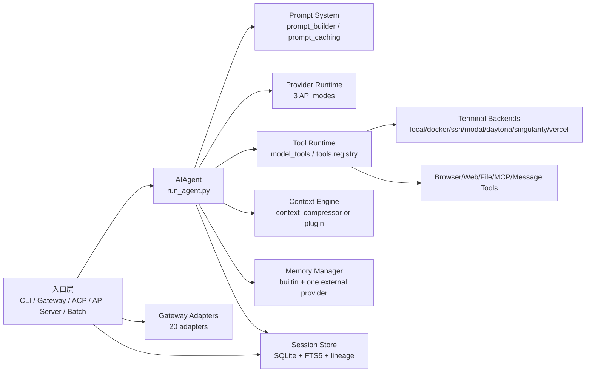
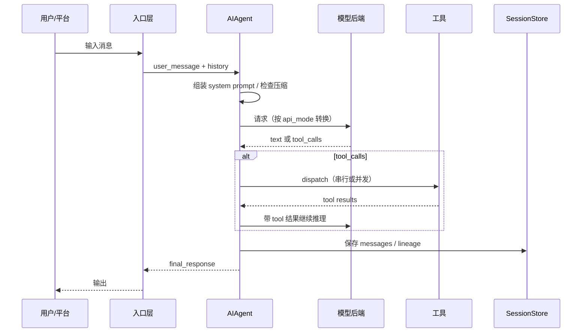

# Hermes Agent 深度分析报告

检索与分析时间：**2026-05-08（America/Los_Angeles）**。研究对象为 urlNousResearch/hermes-agent 仓库turn0search6 与 urlHermes Agent 官方文档turn25search12。按你的要求，**未指定约束部分默认采用中等深度代码审查**：覆盖核心模块、关键函数、运行示例、官方文档与代码内显式提到的部分 issue；**未逐一穷举全部 60+ 工具、20 个平台适配器和所有 PR/提交记录**。citeturn25search12turn34view0turn32view1

## 执行摘要

Hermes Agent 的核心不是“一个带工具调用的聊天壳”，而是一个**平台无关的代理运行时**：`run_agent.py` 中的 `AIAgent` 统一服务 CLI、消息网关、ACP、批处理与 API Server；外围再用工具注册表、会话存储、上下文压缩、记忆管理和插件系统把它扩成“可长期运行的代理操作层”。它最鲜明的定位，是**自改进闭环**：技能（procedural memory）、持久记忆（`MEMORY.md`/`USER.md`）、会话检索、上下文压缩、以及多平台路由都被当成一等公民，而非附加功能。citeturn10view0turn32view0turn33view0turn31search0turn28view0

从工程视角看，它的优势是三点：**一套内部消息模型兼容三种 API 模式**、**工具系统通过注册表与 toolset 做强解耦**、**会话和长上下文治理做得非常“产品化”**。主要代价也很明显：`run_agent.py` 与 `gateway/run.py` 体量巨大，兼容层与回退逻辑多，意味着维护成本高、回归风险高、边角行为很多。对于你这类偏云原生/架构视角的读者，我会把它定义为：**偏“agent runtime / agent OS”的项目，而不是单纯的 SDK 或 demo agent**。citeturn34view0turn26view1turn28view2turn26view2

## 项目概述与定位

官方文档把 Hermes 描述为“self-improving AI agent”，`pyproject.toml` 也直接写明它会“creates skills from experience, improves them during use, and runs anywhere”；入口面覆盖 CLI、Gateway、ACP、Batch、API Server、Python Library。架构页进一步强调：平台差异尽量留在入口层，核心只保留一个 `AIAgent`。citeturn10view0turn32view0turn33view3

它的能力边界很宽：工具系统覆盖网页搜索、浏览器自动化、终端执行、文件编辑、记忆、澄清、委派子代理、定时任务、消息投递、Home Assistant、MCP、RL 环境等；消息网关文档写“14+ 外部平台”，而架构页列出 **20 个适配器**，其中还包含 `api_server`、`webhook` 等并非传统 IM 平台的接入面，这说明项目已从聊天代理演进为多入口代理基础设施。citeturn26view7turn26view6turn26view1turn32view3

下表按官方架构页与源码目录整理：citeturn32view1turn32view2turn32view3turn26view1

| 关键模块 | 代表文件 | 主要职责 | 备注 |
|---|---|---|---|
| 核心编排 | `run_agent.py` | `AIAgent` 对话循环、回退、压缩、持久化 | 项目中枢 |
| 工具运行时 | `model_tools.py`、`tools/registry.py` | 工具发现、schema 收集、dispatch | 注册表驱动 |
| Prompt 系统 | `agent/prompt_builder.py` | 身份、记忆、技能、上下文文件组装 | 重视前缀稳定 |
| 上下文治理 | `agent/context_compressor.py` | 长会话压缩、摘要与缓存协同 | 可插件替换 |
| 记忆层 | `agent/memory_manager.py` | 内建记忆 + 单一外部 provider 编排 | 单选外部 provider |
| 会话存储 | `hermes_state.py`、`gateway/session.py` | SQLite/WAL/FTS5、会话谱系 | 支撑跨会话检索 |
| 接入层 | `gateway/run.py`、`gateway/platforms/*` | 多平台消息接入、授权、投递 | 长驻网关 |

## 架构与模块划分



这张图基本对应官方 Architecture 页：一个平台无关的 `AIAgent` 居中，向下连接 Prompt、Provider、Tool、Compression、Session Storage，入口层只是不同的壳。目录结构也印证了这种分层：`agent/` 放内部机制，`tools/` 放工具，`gateway/` 放接入与路由，`plugins/` 放扩展点。citeturn32view0turn32view1turn32view2turn32view3turn33view0

Hermes 的“味道”在于 Prompt 不是一段模板，而是**多层合成**：身份（`SOUL.md` 或默认身份）、记忆快照、技能索引、项目上下文文件、工具行为指导、模型特定 guidance。`prompt_builder.py` 还会扫描上下文文件中的 prompt injection 特征，如“ignore previous instructions”、隐藏字符和疑似凭据外传模式。citeturn6view0turn15view0turn28view1turn28view3

## 关键实现与运行流程

官方 Agent Loop 文档给出的生命周期非常清楚：`run_conversation()` 生成 `task_id`、构建/复用系统提示词、检查是否需要预压缩、按 API mode 格式化消息、发起可中断调用；如果拿到 `tool_calls`，就执行工具并把 `tool` 结果回灌历史；如果拿到文本，则持久化会话并在必要时刷写记忆后返回。`run_agent.py` 代码还显示它会恢复 todo 状态、重建连接、应用迭代预算、支持流式路径做健康探测、并在错误时走压缩/重试/回退链。citeturn34view0turn7view0turn7view1turn7view2turn8view0



几个实现点值得特别关注。其一，`model_tools.py` 不是简单的 import 聚合，而是做了**持久 event loop** 与工具 schema 缓存：这样能避免 async handler 反复 `asyncio.run()` 导致的 “Event loop is closed”，并减少 Gateway 热路径里重复 schema 过滤的开销。其二，`MemoryManager` 强制“**内建记忆永远存在，外部 provider 最多一个**”，避免工具 schema 膨胀和记忆后端冲突。其三，`ContextCompressor` 采用“保头、保尾、压中间”的策略，并先做旧工具结果裁剪，再进入 LLM 摘要。citeturn11view0turn17view0turn17view1turn16view0

下面这段伪代码可以概括其主循环：citeturn34view0turn11view0turn17view0turn16view0

```python
# run_agent.py（概念化伪代码）
def run_conversation(user_message, history):
    restore_todo_if_needed(history)
    prompt = cached_prompt or build_system_prompt()
    while iteration_budget.ok():
        api_messages = normalize(history, prompt, api_mode)
        resp = interruptible_model_call(api_messages)
        if resp.tool_calls:
            results = execute_tools(resp.tool_calls)  # sequential / concurrent
            history += [assistant_with_tool_calls, *results]
            maybe_compress_or_fallback_on_error()
            continue
        persist_session(history + [resp])
        flush_memory_if_needed()
        return resp.text
```

## 依赖、配置与部署

`pyproject.toml` 显示当前主干可见包版本为 **0.13.0**，要求 **Python >=3.11**。核心依赖包括 `openai>=2.21.0,<3`、`anthropic>=0.39.0,<1`、`httpx[socks]>=0.28.1,<1`、`prompt_toolkit>=3.0.52,<4`；可选 extras 覆盖 `modal`、`daytona`、`vercel`、`mcp`、`web(fastapi/uvicorn)`、`bedrock`、`mistral`、`voice`、`slack` 等。脚本入口暴露 `hermes`、`hermes-agent`、`hermes-acp`。citeturn10view0

| 依赖/扩展 | 版本约束 | 用途 |
|---|---|---|
| `openai` | `>=2.21.0,<3` | OpenAI 兼容后端 / Responses |
| `anthropic` | `>=0.39.0,<1` | native Messages 模式 |
| `httpx[socks]` | `>=0.28.1,<1` | 网络与代理 |
| `prompt_toolkit` | `>=3.0.52,<4` | CLI/TUI 交互 |
| `fastapi` + `uvicorn` | optional `web` | API / dashboard |
| `modal` / `daytona` / `vercel` | optional extras | 远程或云执行 |
| `mcp` | optional | MCP 服务接入 |

部署层面，官方配置文档给出 **7 种 terminal backend**：`local`、`docker`、`ssh`、`modal`、`daytona`、`vercel_sandbox`、`singularity`。而 Docker 文档明确区分两种模式：**Hermes 运行在 Docker 容器里**，以及**Hermes 运行在主机上、但 terminal 工具把命令送进 Docker sandbox**。API Server 默认只绑定 `127.0.0.1:8642`，若监听非回环地址必须配置 `API_SERVER_KEY`。Dockerfile 本身体现了较成熟的容器交付：Debian 13.4、`tini`、非 root 运行用户、Playwright 预装、`uv pip install -e ".[all]"`。citeturn26view3turn26view4turn26view5turn10view1

| 部署选项 | 隔离性 | 运维复杂度 | 适合场景 |
|---|---|---|---|
| `local` | 低 | 低 | 本机开发、可信任务 |
| `docker` backend | 高 | 中 | 安全沙箱、CI |
| 运行在 Docker 中 | 中-高 | 中 | 统一交付、便携部署 |
| `ssh` | 中 | 中 | 远程服务器/大算力 |
| `modal/daytona/vercel_sandbox` | 高 | 中-高 | 云端执行与弹性扩展 |
| `singularity` | 高 | 较高 | HPC/无 root 环境 |

**快速上手（源码方式）**：以下命令中，前两步是根据仓库 `Dockerfile` 与 `pyproject.toml` 可直接推导的源码安装路径；后几步来自官方 CLI/API 文档。citeturn10view1turn10view0turn25search14turn25search30

```bash
uv venv
uv pip install -e ".[all]"

hermes model          # 选择 provider / model
hermes                # 启动 CLI

# 启用 OpenAI 兼容 API Server
hermes config set API_SERVER_ENABLED true
hermes gateway
```

## 安全、性能与扩展性

安全方面，官方 Security 页明确给出七层防护：用户授权、危险命令审批、容器隔离、MCP 凭证过滤、上下文文件扫描、跨会话隔离、输入净化。Prompt 层又额外做了上下文文件的注入检测；CLI/网关层支持 `manual`、`smart`、`off` 等审批模式，但文档明确提醒不要在生产里轻易关闭。API Server 也默认仅本地绑定。citeturn30search1turn15view0turn28view1turn26view5turn30search13turn30search18

性能与扩展性上，Hermes 的思路非常“运行时化”：系统 Prompt 稳定以换取前缀缓存；长会话用压缩而不是粗暴截断；SQLite 用 WAL + FTS5 做多入口读多写少场景；多工具调用走线程池并保持结果回放顺序；`model_tools.py` 还显式缓存工具 schema，并为 async 工具维护长期 event loop。对大规模“入口扩张”也比较友好，因为平台差异主要在 adapter 层。citeturn28view2turn26view2turn34view0turn11view0turn33view3

```text
扩展性 / 隔离性（高）
^
|  modal / daytona / vercel_sandbox
|        ssh / singularity
|   docker backend
| local
+----------------------------------> 运行成本 / 运维复杂度（高）
```

我的判断是：**Hermes 已具备“从单用户 CLI 升到多入口代理平台”的骨架**，但还没有完全摆脱“核心文件过大导致的复杂性债务”。这不是设计失误，而是项目高速演化后的典型现象。citeturn34view0turn33view3turn26view1

## 已知问题、社区讨论与建议

从源码注释能直接看到多个“社区反馈 → 架构修补”的痕迹：`#16856` 指向 MCP discovery 曾在 async gateway 中造成阻塞，因此改为显式启动时发现；`#17335` 是工具 schema cache 被下游修改后导致重复 tool name；`#11762` 是压缩时粗暴截断 JSON 参数导致 provider 反复报错；`#10933` 是复用已关闭 `httpx.Client`；`#11314/#13636` 是 rate limit 下 credential pool 与 fallback 的策略修正；Dockerfile 里的 `#15012/#18800` 则分别对应 PID1 僵尸进程与前端依赖权限问题。说明项目正在持续做**运行时鲁棒性硬化**，但也反向证明系统行为面相当复杂。citeturn11view0turn16view0turn18view2turn10view1

**优先级建议**如下：  
**短期（P0）**：先拆 `run_agent.py` 与 `gateway/run.py`，按“API mode / tool execution / fallback / persistence / callbacks”分模块；同时补统一 capability matrix 与契约测试，减少 provider/工具兼容回归。**中期（P1）**：把插件 SPI、memory provider SPI、context engine SPI 做成更稳定的 typed interface，并为网关、会话、工具分发增加结构化追踪。**长期（P2）**：将 kanban / 多代理协作、会话检索、压缩与 provider 选择进一步服务化，朝“运行时内核 + 外围服务”的架构演进。这个路线与其现有注册表、单选 provider、平台无关核心的设计是一致的。citeturn33view3turn34view0turn31search10turn28view2

**常见故障排查**：如果工具突然不可用，先检查 `hermes tools`/toolset 配置；如果配置改了但行为没变，CLI 需重启，Gateway 需 `/restart` 或重拉进程；如果 API Server 返回 `401`，优先核对 `Authorization` 与 `API_SERVER_KEY`；如果长会话行为突然“失忆”，检查是否触发了上下文压缩与新 session lineage。citeturn26view7turn25search30turn26view2turn34view0

**相关资源与重要引用**：最值得读的不是单篇论文，而是官方开发文档链：架构总览、Agent Loop、Prompt Assembly、Context Compression、Gateway Internals、Session Storage；另一个重要外部参照是技能兼容的 urlagentskills.iohttps://agentskills.io 开放标准。就我本次检索而言，**未见官方学术论文作为主叙事载体，Hermes 更像一个以工程文档和 issue/PR 演化为主的系统项目**。此外，**我未单独可靠核验最新 release/commit 标签**；若以当前主干可见源码为准，`pyproject.toml` 显示版本为 **0.13.0**。citeturn25search12turn31search0turn34view0turn10view0

**开放问题 / 局限**：本报告没有逐文件审读 `gateway/run.py` 与所有 `tools/*.py`；也没有完整核对最新 release note、所有高优先级 issue 与最近提交序列。因此，关于“当前最末 commit/发布节奏”的判断，我保守地只以本次检索到的主干源码和官方文档为准。citeturn10view0turn26view1turn34view0