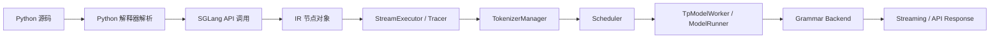
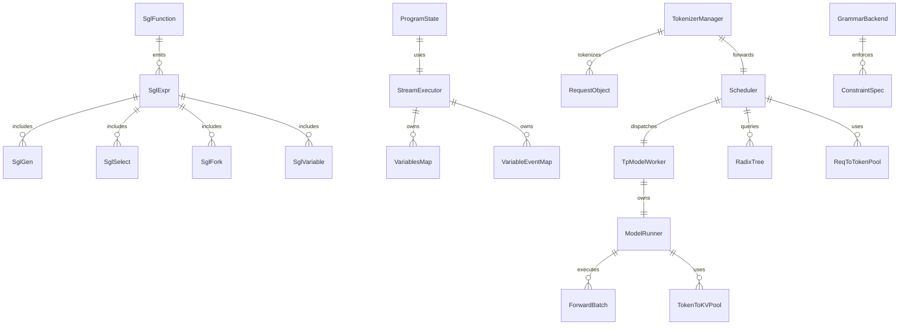
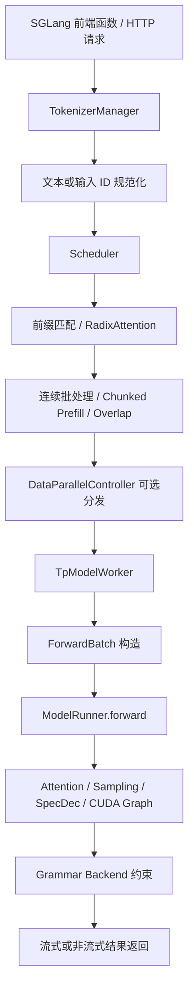

# SGLang 源码深度研究报告

## 执行摘要

从源码与官方资料看，SGLang 的准确定位并不是“带有独立词法器、语法器、静态类型系统和字节码虚拟机的传统编程语言”，而是**嵌入在 Python 中的前端 DSL**与**高性能大模型推理运行时 SRT**的协同系统。前端负责把提示词编程、控制流、多模态输入、约束生成和并行分支组织成一组 IR/状态操作；后端负责分词、请求调度、KV Cache 复用、批处理执行、并行通信、约束解码和 API 返回。因此，如果按“分析一门语言/编译器源码”的研究范式来看，SGLang 更接近“**可编程推理系统**”而不是“传统编译器”。citeturn14search0turn30search0turn11search1

它的核心机制可以归纳为四条主线。第一条是**前端表达能力**：SGLang 用 Python 装饰器与运算符重载构建程序，把 `gen`、`select`、`fork`、角色边界、多模态输入等抽象成 IR 节点。第二条是**运行时高性能链路**：在 `TokenizerManager -> Scheduler -> TpModelWorker -> ModelRunner` 的链路中，把请求整理成适合 GPU/CPU/NPU 等设备执行的批。第三条是**缓存与调度**：RadixAttention 将 token 前缀映射到 paged KV cache，并配合连续批处理、chunked prefill、零开销重叠调度与数据并行控制器提高吞吐。第四条是**受约束生成**：通过 XGrammar / Outlines / Llguidance 等 grammar backend 支持 JSON Schema、正则和 EBNF 约束生成。citeturn8view0turn10view0turn42view0turn42view2turn14search0turn13search0turn30search4

如果把用户给出的“编译器式分析框架”硬套到 SGLang 上，需要做几处重解释。SGLang 前端**没有单独的 BNF/ANTLR 词法-语法前端**，因为宿主语言是 Python，SGLang 自己的“语法”主要体现在 API 调用与 IR 节点构造上。它**没有传统静态类型系统**，更多是 Python 的动态类型加运行时验证。它也**没有独立垃圾回收器**；真正关键的内存管理依赖 Python/Torch 对宿主对象和张量的管理，以及 SGLang 自己的 KV cache 内存池、前缀树和逐级缓存淘汰策略。citeturn15view3turn15view2turn15view1turn30search5turn40search0

对源码学习者而言，最值得优先啃透的文件并不是“parser/ast/typechecker”，而是 `python/sglang/lang/ir.py`、`python/sglang/lang/interpreter.py`、`python/sglang/srt/server_args.py`、`python/sglang/srt/managers/tokenizer_manager.py`、`python/sglang/srt/managers/scheduler.py`、`python/sglang/srt/managers/tp_worker.py`、`python/sglang/srt/model_executor/*`、`python/sglang/srt/mem_cache/*` 与 `sgl-kernel/*`。这几层连起来，才构成 SGLang 的真正“核心机制”。citeturn9view0turn10view0turn42view0turn42view2turn40search0turn7view1

## 仓库与版本边界

本次研究优先使用官方源码仓库、官方文档、官方博客与官方 release 页面。官方源码托管在 entity["organization","GitHub","code hosting platform"] 上，项目目前由 entity["organization","LMSYS","open source nonprofit"] 托管；仓库首页显示默认分支为 `main`，截至本次检索仓库已有 11,736 次提交和 49 个 release，最新 release 为 `v0.5.10.post1`。citeturn38view0turn39view0

| 项目 | 信息 |
|---|---|
| 官方源码仓库 | `https://github.com/sgl-project/sglang` |
| 官方文档 | `https://docs.sglang.io` |
| 默认分支 | `main` |
| 本报告静态分析锚点 | `v0.5.10.post1` |
| 分析锚点提交哈希 | `7c35342` |
| 该版本发布日期 | `2026-04-09` |
| 默认分支 HEAD 完整提交哈希 | 未在本次抓取到的官方页面中直接展示 |

上表根据仓库首页与 releases 页面整理；`v0.5.10.post1` release 页面还注明它是对 FlashInfer 版本的小修订，主要把 `v0.6.7.post2` 升到 `v0.6.7.post3` 以修复 JIT cubin 下载问题。对于严肃的源码审计，**建议固定到 tag 而不是直接跟 `main`**，因为 `main` 更新频率很高，配置语义、调度细节和后端默认值会持续变化。citeturn38view0turn39view0turn39view2

一个非常重要的边界条件是：官方文档和仓库主页已经把 SGLang 定位成“高性能 serving framework”，其核心卖点是 RadixAttention、零开销调度、PD/EP/DP 等并行、结构化输出、多 LoRA 和多硬件支持；这意味着今天的 SGLang 已经明显偏向“推理基础设施”而非“前端语言实验”。因此本文对“语法、AST、类型系统”的分析，会比对“调度器、缓存、并行和 kernel”的分析更克制。citeturn38view0turn30search0

## 构建与运行路径

SGLang 当前官方推荐的标准安装方式是 `pip` 或 `uv`；对常见的 GPU 平台，官方文档给出的主路径是直接安装 `sglang`，然后用 `python -m sglang.launch_server` 启服务。对于开发场景，官方还提供了 Docker 开发指南与 `sgl-kernel` 单独构建说明。citeturn34search1turn12search0turn7view1

### Linux

最稳妥的 Linux 试跑路径，是先按官方安装页装包，再跑一个小模型验证 API 和调度链路。官方给出的最简安装命令是：

```bash
pip install --upgrade pip
pip install uv
uv pip install sglang
```

一个可复现的最小服务启动命令可以写成：

```bash
python -m sglang.launch_server \
  --model-path qwen/qwen2.5-0.5b-instruct \
  --host 0.0.0.0 \
  --log-level warning
```

随后你可以用兼容 entity["company","OpenAI","ai company"] 的客户端接口，或者直接调用 SGLang 原生 `/generate` / `/health` / `/get_model_info` 等端点验证服务。官方文档同时提供了 OpenAI-compatible API、native API 与 offline engine 三条示例路径。citeturn34search1turn12search6turn12search2turn33search0

如果你要**从源码构建**，建议区分两部分。第一部分是 `python/` 下的主 Python 包；第二部分是 `sgl-kernel/` 下的高性能 kernel 子项目。`sgl-kernel` 的 README 说明其 Python 包名是 `sglang-kernel`，源码目录仍然叫 `sgl-kernel/`，并要求 Python ≥ 3.10、CMake ≥ 3.31、`scikit-build-core`，`ninja` 可选；它还给出 `make build` 与限制并行编译资源的命令。citeturn7view1

```bash
# 在 sgl-kernel 源码目录
make build
make build MAX_JOBS=2
make build MAX_JOBS=2 CMAKE_ARGS="-DSGL_KERNEL_COMPILE_THREADS=1"
```

如果你做的是 CPU 服务器源码构建，官方另有专门页面，流程是复制 `pyproject_cpu.toml`、分别在 `python/` 和 `sgl-kernel/` 下安装，再设置 `SGLANG_USE_CPU_ENGINE=1` 与若干动态库环境变量。CPU 页面给的是面向 Intel Xeon CPU 的特化流程，不应与通用 GPU 安装路径混为一谈。citeturn34search0

### macOS

从源码结构看，`python/sglang` 目录中存在 `_mps_stub.py`，而 `ServerArgs.__post_init__` 的处理链中也有 `_handle_mps_backends()`，这说明代码层面**考虑过 MPS/Metal 相关路径**。但在本次检索到的官方安装文档与平台页中，我没有找到一份与 Linux/CPU/NPU/TPU 同等级的、完整的 macOS Runtime 部署指南。换句话说，**源码有适配钩子，不等于官方把 macOS 当成主线部署目标**。citeturn8view0turn26view3turn30search0

因此，面向 macOS 的建议是分层处理。若你的目标是**阅读源码、跑前端 DSL、调用远端 SGLang 服务、做客户端/协议层实验**，macOS 完全够用；若目标是**本机生产级 serving**，当前公开文档不足以把它当成“官方主路径”。这类实验应默认关闭或避开 CUDA graph、某些设备专用 attention backend 和分布式路径，并自行验证模型、依赖与 kernel 兼容性。这个判断来自源码存在适配入口、但官方部署文档仍以 Linux 硬件后端为主这一事实。citeturn8view0turn26view3turn34search1turn30search0

### Windows

对 Windows 更要保守。当前官方文档首页和安装页强调的是按硬件后端划分的平台支持，而不是把 Windows 作为 SRT Runtime 的主安装页面来写；我唯一检索到的明确“支持 Windows/Mac”的官方声明，来自 **SGLang Model Gateway** 的 release note，而不是 SGLang Runtime 本身。也就是说，**Gateway 的跨平台支持，不能直接等价为核心推理 Runtime 的跨平台主线支持**。citeturn30search0turn37search4

因此，Windows 用户最务实的路线通常是三种：其一，把 Windows 当成开发机，连接远端 Linux 服务；其二，在 Windows 上只做客户端调用、前端 DSL 与源码阅读；其三，采用 WSL2 或远端容器环境试验，但把它视为“实验路径”，不是当前官方文档明示的生产标准路径。这个结论是基于官方文档侧重硬件和 Linux 容器/源构建，而非基于单独的“Windows 不支持”声明。citeturn30search0turn12search0turn37search4

### 依赖、示例与常见错误

`python/pyproject.toml` 显示当前主包要求 Python `>=3.10`，并 pin 了 `torch==2.9.1`、`sglang-kernel==0.4.1`、`transformers==5.5.4`、`xgrammar==0.1.32`、`flash-attn-4>=4.0.0b4` 等关键依赖；而 `sgl-kernel` README 也写明了 `torch == 2.9.1`、CMake、Python 和构建工具要求。需要注意，CPU 专用安装页走的是另一套 `pyproject_cpu.toml` 路径，版本组合和主线 GPU 安装不完全一致。citeturn22view1turn22view3turn22view5turn7view1turn34search0

| 类别 | 关键项 | 备注 |
|---|---|---|
| Python | `>=3.10` | 主包要求 |
| Torch | `2.9.1` | 主线 GPU 包 pin 值 |
| Transformers | `5.5.4` | 主包 pin 值 |
| Grammar | `xgrammar==0.1.32` | 默认 grammar backend 相关依赖 |
| Kernel 包 | `sglang-kernel==0.4.1` | 高性能内核库 |
| CMake | `>=3.31` | `sgl-kernel` 构建要求 |
| 其他构建工具 | `scikit-build-core`、可选 `ninja` | `sgl-kernel` README 指定 |

表中数据来自 `python/pyproject.toml` 与 `sgl-kernel/README.md`。citeturn22view1turn22view3turn22view5turn7view1

| 常见问题 | 现象 | 处理方式 |
|---|---|---|
| `CUDA_HOME` 未设置 | 安装阶段报 `OSError: CUDA_HOME environment variable is not set` | 按安装页设置 `CUDA_HOME`，或先按官方说明安装所需的 FlashInfer/相关依赖 |
| Prefill OOM | 长输入时显存不足 | 把 `--chunked-prefill-size` 调低到 `4096` 或 `2048` |
| Decode OOM | 高并发 decode 显存不足 | 降低 `--max-running-requests` |
| 整体显存过高 | 预热后可用显存很低 | 调低 `--mem-fraction-static`，也可调低 `--cuda-graph-max-bs` |
| `input_embeds` 无法用 | 直接报错 | 启服务时显式加 `--disable-radix-cache` |
| `skip_tokenizer_init=True` 后文本请求失败 | 只能接收 `input_ids` | 重新初始化 tokenizer，或改用 `input_ids` 输入 |

上表中的前四项来自官方安装页和 FAQ；后两项直接来自 `TokenizerManager` 的源码检查逻辑。citeturn34search1turn12search1turn42view1

如果你要快速验证“不起 HTTP 服务也能跑”，官方 offline engine 文档给了更直接的方式：

```python
import sglang as sgl

llm = sgl.Engine(model_path="qwen/qwen2.5-0.5b-instruct")
outputs = llm.generate(["Hello"], {"temperature": 0})
print(outputs[0]["text"])
```

这条路径非常适合你在阅读源码时先把“请求对象 -> tokenization -> batch execution -> output”主链路跑通，再下钻服务层和分布式层。citeturn33search0

## 代码结构总览

从仓库树看，SGLang 的主线结构非常清晰：`python/sglang/lang` 是前端 DSL；`python/sglang/srt` 是后端运行时；`sgl-kernel` 是高性能 kernel 库；`benchmark`、`examples`、`docs` 则分别承担评测、示例与文档职责。`python/sglang/README.md` 甚至直接把 `lang` 说明为 frontend language，把 `srt` 说明为 backend engine。citeturn8view0turn9view0turn10view0

| 目录/文件 | 角色 | 关键类/函数 | 你应先看什么 |
|---|---|---|---|
| `python/sglang/lang/ir.py` | 前端 IR 定义 | `SglFunction`、`SglGen`、`SglSelect`、`SglFork`、`SglVariable` | 看“语言到底抽象了哪些操作” |
| `python/sglang/lang/interpreter.py` | 前端解释执行器 | `StreamExecutor`、`ProgramState` | 看表达式如何变成后台请求 |
| `python/sglang/lang/tracer.py`、`lang/backend/` | trace/compile 路径 | prefix tracing、graph execution 相关逻辑 | 看“compiler mode”在源码里的落点 |
| `python/sglang/srt/server_args.py` | 全局配置中枢 | `ServerArgs` | 看所有能力如何被参数化与校验 |
| `python/sglang/srt/managers/tokenizer_manager.py` | 请求入口与分词管理 | `TokenizerManager` | 看输入从文本变成 request/token |
| `python/sglang/srt/managers/scheduler.py` | 调度核心 | `Scheduler` | 看连续批处理、prefill/decode 编排 |
| `python/sglang/srt/managers/data_parallel_controller.py` | 数据并行调度 | `DataParallelController`、`LoadBalanceMethod` | 看 DP 分发和路由策略 |
| `python/sglang/srt/managers/tp_worker.py` | 张量并行 worker | `TpModelWorker`、`forward_batch_generation` | 看 batch 如何交给模型执行 |
| `python/sglang/srt/model_executor/*` | 模型执行层 | `ModelRunner`、`ForwardBatch`、CUDA graph runner | 看真正的 forward 执行 |
| `python/sglang/srt/mem_cache/*` | 前缀缓存与内存池 | `BasePrefixCache`、`ReqToTokenPool`、`TokenToKVPool` | 看 KV cache 管理与复用 |
| `python/sglang/srt/constrained/*` | 约束生成 | grammar backend 适配 | 看 JSON/regex/EBNF 约束 |
| `python/sglang/srt/distributed/*` | 分布式通信 | 并行 group、device communicator | 看 TP/DP/EP/PD 通信 |
| `sgl-kernel/*` | 高性能 AOT 内核 | C++/CUDA/Torch extension | 看性能临界路径的 native 代码 |
| `benchmark/*` 与 `python/sglang/bench_*` | 基准与 profiling | `bench_serving`、`bench_one_batch` | 看如何量化优化收益 |
| `docs/*` 与官方文档站 | 架构与运维说明 | 安装、平台、feature guide | 看功能和源码如何对应 |

这张表综合了仓库目录树、`python/sglang/README.md` 的说明、`sgl-kernel/README.md` 的角色定义，以及 `TokenizerManager` / `TpModelWorker` / `DataParallelController` 的类定义。citeturn8view0turn9view0turn10view0turn7view1turn42view0turn42view2turn42view4turn40search0

如果只允许我给出一个“**源码阅读顺序**”，我会建议：先读 `server_args.py` 了解系统能力边界；再读 `lang/ir.py` 和 `lang/interpreter.py` 理解前端如何表达一个程序；然后顺着 `TokenizerManager -> Scheduler -> TpModelWorker -> ModelRunner -> mem_cache -> sgl-kernel` 往下钻。这样最符合 SGLang 的真实架构重心。citeturn24view0turn15view3turn15view1turn42view0turn42view2turn40search0turn7view1

## 前端语言、约束语法与解析

### 这不是一套独立文本语法，而是 Python 内嵌 DSL

官方前端教程和最核心的前端源码都表明：SGLang frontend language 的主体形式是 Python EDSL，而不是独立语言文件。你写的是 `@function` 装饰的 Python 函数，通过 `s += user(...)`、`assistant(gen(...))`、`fork`、`choices` 等 API 构造程序。`SglFunction` 会检查函数签名，并强制第一个参数必须叫 `s`；`ProgramState` 则把角色操作和表达式提交给 `StreamExecutor`。因此，**Python 自己承担了词法和基础语法解析，SGLang 只负责把这些高层 API 映射成内部 IR 节点**。citeturn11search1turn15view3turn15view0turn15view1

这意味着你在源码里找不到传统意义上的“lexer.l / parser.y / ANTLR grammar”。更像“语法”的部分，其实是 `ir.py` 中定义的一组表达式节点类型，以及 `interpreter.py` 中对这些节点的执行规则。官方 2024 年博客也明确说过，SGLang 程序既可以通过 interpreter eagerly 执行，也可以被 trace 成 dataflow graph 走“compiler mode”与 graph executor，但这仍然不是 LLVM 风格的编译器前端。citeturn9view0turn14search0

### 可操作的概念语法

下面这段 EBNF **不是源码里的正式 grammar 文件**，而是依据 `lang/ir.py`、前端教程和结构化输出文档，对 SGLang 前端“可写程序形态”的概念化重述：

```ebnf
program        ::= decorated_function
decorated_function
               ::= "@function" "def" IDENT "(" "s" { "," IDENT } ")" ":" suite

suite          ::= statement { statement }

statement      ::= append_stmt
                 | role_scope
                 | branch_stmt
                 | select_stmt
                 | multimodal_stmt

append_stmt    ::= "s +=" expr

role_scope     ::= "with" role_begin ":" suite

expr           ::= text
                 | role_wrapped_expr
                 | gen_call
                 | select_call
                 | image_call
                 | video_call
                 | fork_call
                 | variable_ref

role_wrapped_expr
               ::= system_call | user_call | assistant_call

gen_call       ::= "gen" "(" [name] { "," sampling_kw } ")"
select_call    ::= "select" "(" name "," choices { "," option_kw } ")"
fork_call      ::= "fork" "(" number [ "," offset ] ")"

constraint     ::= "json_schema" | "regex" | "ebnf"
```

这个“概念语法”的重点不是 token，而是**可形成哪些 IR 结点**。例如 `SglGen` 对应一次模型生成，`SglSelect` 对应在候选集合里做约束选择，`SglFork` 对应并行分支，`SglVariable` 对应变量引用，`SglRoleBegin/End` 对应聊天角色边界。citeturn15view2turn16view3turn16view4turn16view5

### 结构化输出的“第二层语法”

SGLang 还有第二层“语法”体系，即运行时的约束语法。官方 Structured Outputs 文档说明：一次请求只能指定 `json_schema`、`regex` 或 `ebnf` 三者之一；后端支持 XGrammar、Outlines、Llguidance 三种 grammar backend，其中 XGrammar 是默认选择，并采用 GGML BNF 格式。换言之，**前端 DSL 用来描述“程序”，grammar backend 用来描述“输出空间”**，这两层不要混淆。citeturn30search4turn25view0

### 解析并不是“先建 AST 再走 parser”，而是“运行时构 IR”

下面这个流程图更符合 SGLang 源码中的真实含义：



图中最关键的一点是：**Python 负责“把代码变成可执行的宿主程序”，SGLang 负责“把宿主程序里的 DSL 操作组织成自己的 IR 和运行时请求”**。这也是为什么你分析 SGLang 时，重点应该放在 API、IR、执行器和 runtime，而不是找一个传统 parser。citeturn11search1turn15view3turn15view1turn30search4

## 核心数据结构、类型边界与执行链路

### 核心数据结构

SGLang 前端的核心数据结构不是传统 AST，而是一组**表达式对象**。`ir.py` 里可以直接看到 `SglFunction`、`SglImage`、`SglVideo`、`SglGen`、`SglSelect`、`SglFork`、`SglVariable`、`SglVarScopeBegin/End`、`SglSeparateReasoning` 等类。这些类型把“提示编程”离散成一串高层语义操作。特别是 `SglGen` 持有生成所需的 sampling 参数，而 `SglFunction` 持有函数对象、参数绑定信息，并检查第一个参数是否为 `s`。citeturn15view3turn15view2turn16view3turn16view4turn16view5

如果非要在 SGLang 里找“符号表”的对应物，最接近的其实不是编译器里的全局/局部符号表，而是 `StreamExecutor` 里的 `variables`、`variable_event` 和 `meta_info`。其中 `variables` 保存变量名到结果值的映射，`variable_event` 负责在异步执行和流式生成过程中做同步屏障，`meta_info` 保存附加元信息。这是一个**偏运行时的数据依赖模型**，而不是静态语义分析模型。citeturn15view1turn16view2

在后端，最关键的数据结构是 **KV cache 及其元数据**。官方 RadixAttention 博客说明，SGLang 用 radix tree 把 token 序列映射到其对应的 KV cache tensor；KV cache 以 paged layout 存储，且“每页大小等于一个 token”。为了适应 GPU 显存上限，它还要配合淘汰策略。后续的 HiCache 进一步把这套结构扩展为 L1 GPU、L2 Host、L3 Distributed Storage 的三级层次缓存，并在缓存元数据层引入 HiRadixTree。`mem_cache` 相关 RFC/提案则把内存池进一步拆成 `ReqToTokenPool` 与 `TokenToKVPool`。citeturn14search0turn30search5turn40search0

### 类型系统与内存管理边界

SGLang 并没有一个独立、显式、静态的类型系统；它更依赖 Python 类型、dataclass 配置与运行时检查。最典型的是 `ServerArgs`：这是一个超大的 dataclass，既描述模型/分词器/网络/SSL，又描述量化、显存、调度、并行、grammar backend、speculative decoding、HiCache、PD/EP、LoRA、debug 等几乎所有运行时行为。换句话说，**SGLang 的“类型系统中心”不在表达式层，而在配置/请求协议层**。citeturn24view0turn26view3

这也决定了它的内存管理方式。这里没有“对象由 GC 自动回收，一切不用管”的语言运行时神话；真正贵的是张量内存、KV cache 和缓存元数据。官方文档与博客强调的是显式池化、前缀匹配、分层缓存和淘汰策略，而不是 tracing GC。源码还暴露了 `radix_eviction_policy` 选项，允许 `lru`、`lfu`、`slru`。因此，从系统设计上讲，SGLang 的关键不是“GC 算法”，而是**缓存命中率、缓存淘汰策略、张量页复用和异步调度的协同**。citeturn25view0turn14search0turn30search5turn40search0

### 一个更贴近源码的实体关系图



这张图不是逐类一一对应的 UML，而是把 SGLang 源码里的“前端 IR、执行器、请求入口、调度器、模型执行器、缓存池和约束后端”之间的主依赖关系压缩成了一个便于记忆的轮廓。你可以把它当作后续读源码时的“脑内地图”。citeturn15view3turn15view1turn42view0turn42view2turn30search5turn40search0

### 执行链路

把一次 SGLang 请求从前端到结果返回串起来，大致是这样：



这个流程与前端教程、`TokenizerManager` / `TpModelWorker` 类定义、`ServerArgs.__post_init__` 的配置依赖整理、以及官方关于 RadixAttention、零开销调度、speculative decoding 的文档是相互吻合的。citeturn11search1turn42view0turn42view2turn26view3turn14search0turn13search0turn31search0

### 前端解释执行

`StreamExecutor` 的注释直接写明它是“在后台线程中执行 SGL expressions 的 stream executor”。初始化时，如果 `use_thread=True`，它会创建 `queue.Queue()` 与后台 worker 线程；`submit()` 的行为非常简单：先为表达式涉及的变量初始化事件对象，再把表达式放入队列，或在非线程模式下直接执行。这说明前端层的“解释执行”其实是 **IR 提交 + 后台异步执行**。citeturn15view1turn16view2

下面这段是按源码逻辑**简化重述**的关键片段，保留了控制意图，但不是逐字拷贝：

```python
def submit(expr):
    init_var_event(expr)          # 为本表达式可能产出的变量注册同步事件
    if use_thread:
        queue.put(expr)           # 正常模式：交给后台线程
    else:
        execute(expr)             # 调试/同步模式：当前线程直接执行
```

它的边界条件很明确：如果表达式后续要被别的节点引用，就必须先注册变量事件；如果不开线程，行为更像同步解释器。这个设计让前端 DSL 获得了“像写脚本一样写程序，但底下能并发推进”的能力。citeturn16view2turn15view1

### 输入规范化与分词阶段

`TokenizerManager` 的类注释说明它是“tokenizes the text”的进程。源码中还能看到它区分单字符串、字符串 batch、cross-encoder pairs 等输入格式，并在 `_tokenize_texts()` 中根据输入形态选择普通 tokenizer 或动态 batch tokenizer。`_tokenize_one_request()` 还直接写了两个非常重要的边界：一是如果传入 `input_embeds`，就要求 `--disable-radix-cache`；二是如果启用了 `skip_tokenizer_init=True`，那么文本 prompt 会被拒收，只能用 `input_ids`。citeturn42view0turn42view1

这背后反映出一个关键设计事实：**RadixAttention 的前提是 token 级可比较前缀**。如果你给的是原始 embedding，那么 prefix cache 的“前缀相等性”就不再天然成立，所以源码要求显式关闭 radix cache。这一点虽然只是一个异常分支，但非常能说明系统内部假设。citeturn42view1

### 调度、缓存与并行执行

调度层是 SGLang 的真正心脏。官方 2024 年 RadixAttention 博客已经把核心思路说得很清楚：完整 prompt 由前端发到 runtime，runtime 自动做 prefix matching、reuse 和 caching；缓存元数据保存在 CPU 侧的 radix tree 上，而 KV tensor 留在 GPU 上的 paged cache 中。到了 v0.4，官方又把 CPU 调度和 GPU 执行重叠，做成所谓“zero-overhead batch scheduler”，核心思想是**让 CPU 在 GPU 跑当前 batch 时，提前准备下一个 batch 的 metadata**。citeturn14search0turn13search0

在数据并行方向，`DataParallelController` 负责把请求派发到多个 data parallel worker。源码能直接看到 `LoadBalanceMethod` 的枚举值有 `ROUND_ROBIN`、`FOLLOW_BOOTSTRAP_ROOM`、`TOTAL_REQUESTS`、`TOTAL_TOKENS` 四种；而 `ServerArgs.__post_init__` 里又说明，在 `load_balance_method=auto` 时，普通模式默认 round-robin，PD prefill 场景会用 `follow_bootstrap_room`。这意味着 SGLang 的 DP 分发不是一个固定的轮询器，而是已经为不同部署形态内建了策略分岔。citeturn42view4turn42view6turn26view3

### 张量并行 worker 与模型执行器

`TpModelWorker` 的注释写得很直接：它是一个 tensor parallel model worker。其 `forward_batch_generation()` 方法接受 `ModelWorkerBatch` 和可选的 `ForwardBatch`、`PPProxyTensors`、`is_verify` 等参数，最终返回 `GenerationBatchResult`。另外，同一文件里 embedding 路径显示了一个重要步骤：先调用 `ForwardBatch.init_new(model_worker_batch, self.model_runner)`，再进入 `self.model_runner.forward(...)`。这说明运行时真正的执行单元并不是“原始请求”，而是**已经被调度器整理好的 ForwardBatch**。citeturn42view2turn42view3

按源码意图可以把这一段简化成下面的伪代码：

```python
def forward_batch_generation(model_worker_batch, forward_batch=None, ...):
    if forward_batch is None:
        forward_batch = ForwardBatch.init_new(model_worker_batch, model_runner)
    # 这里会处理 verify / CUDA graph / attention backend 等分支
    result = model_runner.forward(forward_batch)
    return postprocess(result)
```

它的边界主要在三类地方：第一，是否是 speculative verify 路径；第二，是否走 CUDA graph；第三，是否伴随 pipeline parallel 的 proxy tensors。你读源码时，如果想抓住性能临界路径，就应该顺着这个函数往 `model_executor/` 继续钻。citeturn42view3turn26view3

### 配置编排本身就是一条“解释链”

`ServerArgs.__post_init__` 是理解整个系统的最佳入口之一，因为它几乎把所有运行时能力都编排进了一条初始化链：先处理负载均衡、多模态、SSL 和 dummy model；再处理默认值、设备特化后端、CUDA graph、多 item scoring、显存设置、模型特化调整、sampling/attention backend、HiCache、数据并行、上下文并行、MoE、pipeline、speculative decoding、load format、PD/encoder disaggregation、tokenizer batching、环境变量、缓存兼容性、确定性推理、debug 和其他校验。citeturn26view3

按逻辑简化后，大致像这样：

```python
def __post_init__(self):
    handle_load_balance()
    handle_multimodal()
    handle_ssl()

    if model_path in ["none", "dummy"]:
        return

    handle_defaults()
    handle_device_specific_backends()
    handle_gpu_memory()
    handle_model_specific_adjustments()
    handle_grammar_backend()
    handle_parallelism()
    handle_speculative_decoding()
    handle_disaggregation()
    handle_environment()
    handle_cache_and_determinism()
    handle_debug_and_validation()
```

这段代码的意义在于：SGLang 并不是一堆 feature flag 零散拼接，而是试图把它们组织成一条**有依赖顺序的初始化语义链**。这也是为什么 `server_args.py` 虽然巨大，却仍然是理解系统边界最有效的文件之一。citeturn26view3turn24view0

## 运行时、性能、并发与调试

### 性能主轴与基准结果

SGLang 的性能故事不是单点优化，而是多种机制叠加。官方 2024 年博客给出的最初结论是：凭借 RadixAttention、前端并行性与前后端协同设计，SGLang 在若干 LLM workload 上可达到相对 Guidance 和 vLLM **最高约 5 倍**吞吐提升。到 2024 年 12 月的 v0.4 release，零开销调度器带来 **约 1.1 倍**吞吐提升，cache-aware load balancer 可达到 **最高 1.9 倍**吞吐和 **3.8 倍**缓存命中率提升，XGrammar 在结构化输出上则可达到 **最高 10 倍**加速。最新 speculative decoding 文档又给出一个示例：在 1×H100 上，Llama 3.1 8B 的吞吐从 **158.34 tok/s** 提高到 EAGLE-2 的 **244.10 tok/s**，再到 EAGLE-3 的 **373.25 tok/s**。citeturn14search0turn13search0turn31search0

这些数字背后的源码含义分别对应不同层面。5 倍提升主要说明**前后端协同与前缀复用**本身有巨大系统级收益；1.1 倍说明**CPU 调度与 GPU 执行重叠**值得专门做；1.9 倍和 3.8 倍命中率说明**路由策略和实际 cache 结构不是可有可无的外围件**；而 speculative decoding 的显著增益则说明**单轮 decode 速度**已经成为后期优化的主战场。你读源码时，最好把这些数字和对应目录绑定起来，而不是把“性能”笼统理解成某个 attention kernel。citeturn13search0turn14search0turn31search0

### 并发模型与安全边界

SGLang 的并发模型是分层的。前端解释器里，`StreamExecutor` 用后台线程和队列推进表达式；服务入口里，`TokenizerManager` 负责异步请求处理和分词；数据并行层由 `DataParallelController` 做请求分发；模型执行则由 `TpModelWorker` 驱动张量并行 worker。与此同时，官方还专门做了 deterministic inference，以解决**动态批大小导致的 reduction 顺序变化和非确定性输出**问题，并明确列出哪些 attention backend 与 CUDA graph / chunked prefill / radix cache 兼容。citeturn15view1turn16view2turn42view0turn42view4turn31search1

从“安全性”角度看，SGLang 更像基础设施，而不是内存安全语言。它没有 Rust/ML 那样的静态内存安全或静态类型保证，更多依赖运行时校验、参数约束、底层通信库和 kernel 稳定性。`ServerArgs.__post_init__` 会在启动早期校验 SSL 参数、后端兼容性和各种 feature 组合；FAQ 也明确指出，`illegal memory access` 既可能来自 kernel 错误，也可能是 OOM 的变体表现；服务启动卡死则常见于显存、网络或 NCCL 问题。citeturn26view3turn12search1

### 你可以复现的动态实验

下面这些实验按“最低门槛 -> 最接近核心机制”的顺序排列，适合你边读源码边验证。

| 实验 | 启动命令/步骤 | 观察点 |
|---|---|---|
| 最小服务启动 | `python -m sglang.launch_server --model-path qwen/qwen2.5-0.5b-instruct --log-level warning` | 先确认依赖、模型加载、服务端口、基本请求链路 |
| 离线 engine 验证 | 用 `sgl.Engine()` 直接 `generate()` | 排除 HTTP/网关干扰，专注 runtime 主链 |
| 单 batch 延迟 | `python -m sglang.bench_one_batch --model-path ... --batch 32 --input-len 256 --output-len 32` | 看 prefill/decode 基础吞吐与显存 |
| 动态服务吞吐 | `python -m sglang.bench_serving --backend sglang --dataset-name random --num-prompts ...` | 看真实动态批调度能力 |
| 开/关 overlap 对比 | 默认启动 vs 加 `--disable-overlap-schedule` | 看 CPU 调度是否被 GPU 计算隐藏 |
| 开/关 radix cache 对比 | 默认启动 vs 加 `--disable-radix-cache`，送共享前缀请求 | 看 TTFT、cached tokens、GPU 利用率变化 |
| 结构化输出对比 | 加 `--grammar-backend xgrammar`，发送 JSON Schema 请求 | 看约束解码代价与输出合法性 |
| speculative decoding 对比 | 用 `--speculative-algorithm EAGLE/EAGLE3` 启服务 | 看 decode 吞吐与 acceptance 行为 |
| 实时 profiler | 运行服务后调 `python -m sglang.profiler` 或 `/start_profile` | 捕获某一段请求的 GPU/CPU 轨迹 |
| Nsight layer-wise 分析 | `nsys profile ... --enable-layerwise-nvtx-marker --disable-cuda-graph` | 看层级耗时、kernel 分布和通信开销 |

这组实验直接对应官方 benchmark/profiling 文档、speculative decoding 文档、v0.4 release blog 和原始 RadixAttention blog。citeturn11search0turn12search0turn13search0turn14search0turn31search0

如果你想做更深入的“动态源码研究”，我建议至少记录四类指标：第一类是 **TTFT / TPOT / tokens/s**；第二类是 **cache 命中率与 cached tokens**；第三类是 **GPU 时间线是否出现空洞**；第四类是 **不同 feature 组合下的显存上界**。SGLang 的真实优势，不在单个 kernel 的微基准，而在这些系统级指标的联动改善。citeturn13search0turn14search0turn11search0

### 关键代码片段的研究式注释

下面挑三段**按源码逻辑重述**的关键片段，帮助你理解其职责与边界。

```python
class SglFunction:
    def __init__(self, func, num_api_spec_tokens=None, bind_arguments=None):
        self.func = func                    # 保存原始 Python 函数
        self.num_api_spec_tokens = num_api_spec_tokens
        self.bind_arguments = bind_arguments or {}
        self.pin_prefix_rid = None          # 与前缀固定/缓存相关的内部状态

        argspec = inspect.getfullargspec(func)
        assert argspec.args[0] == "s"       # 约束：第一个参数必须是 ProgramState
        self.arg_names = argspec.args[1:]   # 后续参数才是业务参数
```

这段设计说明前端 DSL 并不是在 parse 文本，而是在**包装一个 Python callable**。它的首要工作不是“构造 AST”，而是“保证宿主函数满足 SGLang 约定的调用协议”。因此，前端的第一个抽象并不是 parser，而是 function wrapper。citeturn15view3

```python
class ProgramState:
    def _role_common(self, name, expr=None):
        if expr is not None:
            role_expr = [RoleBegin(name), expr, RoleEnd(name)]
            stream_executor.submit(role_expr)
            return role_expr
        else:
            # 作为上下文管理器使用
            submit(RoleBegin(name))
            yield
            submit(RoleEnd(name))
```

这段逻辑说明“聊天角色”在内部不是字符串拼接技巧，而是显式的 IR 边界标记。它带来的好处是：无论你用的是 `s += assistant(...)` 这种单表达式形式，还是 `with assistant(): ...` 这种 block 形式，最终都能归一为一对 begin/end 节点，这对 trace、streaming 和后端模板化都很重要。citeturn15view0

```python
def _tokenize_one_request(obj):
    if obj.input_embeds is not None:
        if not disable_radix_cache:
            raise ValueError("input_embeds 与 radix cache 不能同时启用")
        input_embeds = obj.input_embeds
        input_ids = obj.input_ids
    elif obj.input_ids is not None:
        input_ids = obj.input_ids
    else:
        if tokenizer is None:
            raise ValueError("skip_tokenizer_init=True 时不能接收 text prompt")
        input_ids = tokenizer(obj.text)
```

这段逻辑最值得注意的边界有两个。第一，**token 前缀缓存默认假设输入是 token 级可比较对象**，所以 embedding 输入必须主动关闭 radix cache。第二，**如果你把 tokenizer 初始化跳过了，文本路径就彻底不可用**。这两条边界都不是“友好封装”能自动替你解决的，它们直接暴露了系统内部的语义前提。citeturn42view1

### 对不同实现选项的权衡

| 选项 | 优点 | 代价 | 适用场景 |
|---|---|---|---|
| Python EDSL 前端 | 表达力强，易与 Python 生态集成 | 失去独立静态语法与静态类型系统 | Agent、工作流、提示编程 |
| RadixAttention 开启 | 自动复用共享前缀，显著降低 TTFT | 需要维护缓存树与淘汰策略 | 多轮对话、few-shot、共享前缀批量任务 |
| `--disable-overlap-schedule` 关闭 overlap | 更容易调试 | 会损失 CPU/GPU 重叠收益 | 调试基线、排查时序问题 |
| XGrammar | 约束能力全，官方默认且性能更强 | 额外 grammar 依赖 | JSON/regex/EBNF 结构化输出 |
| Outlines | 较成熟，生态熟悉 | 约束能力和性能不如 XGrammar | 兼容已有约束流程 |
| Speculative decoding | 提高 decode 吞吐 | 增加配置复杂度和显存消耗 | decode 成本高、长回复服务 |
| Deterministic inference | 复现性更好 | 可选后端变窄、可能牺牲一部分灵活性 | RL、回归测试、可重复实验 |

表里的“优点/代价”来自官方博客、文档与源码暴露出的 feature 开关关系；其中个别“适用场景”属于基于这些事实做出的工程判断。citeturn14search0turn13search0turn30search4turn31search0turn31search1

## 风险、未解问题与后续研究建议

首先，**版本波动本身就是最大的研究风险**。仓库提交数和 release 数都很高，`main` 处于快速演进状态；如果你今天分析 `main`，几周后很多参数默认值、后端优先级和 feature 组合规则就可能变化。因此，任何想写成长期笔记、内部设计文档或二次开发指南的研究，都应该固定到特定 tag，比如本文选择的 `v0.5.10.post1`。citeturn38view0turn39view0

其次，**前端语言层与后端 runtime 层的重要性并不对称**。官方最早的定位强调“Structured Generation Language + Runtime co-design”，但随着项目演进，公开文档、平台页、性能博客和 server args 全都越来越集中在 runtime、kernel、并行与服务能力上。源码中当然还保留 `tracer.py` 和 frontend language，但如果你的目标是“理解 SGLang 为什么快、为什么能扩展”，真正要投入时间的仍是 SRT，而不是把它当成一门程序语言单独研究。citeturn14search0turn9view0turn30search0

再次，**有几个区域在历史上明显比较敏感**。已有 issue 显示，数据并行与张量并行组合、parallel sampling 的 cache 统计、RadixCache 的递归深度与长期运行下的显存积累，都曾经暴露过边界问题。这些 issue 不必等价理解为“当前版本仍有同样 bug”，但它们确实提示你：`data_parallel_controller.py`、`tokenizer_manager.py`、`mem_cache/*` 和长期驻留服务的显存行为，是值得重点盯防的源代码区域。citeturn27search4turn40search3turn40search5turn40search6

最后，按你的研究目标，我建议下一轮源码研究按下面的顺序继续推进。第一步，固定 `v0.5.10.post1`，把 `python/pyproject.toml`、`sgl-kernel` 与目标硬件后端依赖锁住。第二步，用 offline engine 跑最小样例，再切到 HTTP server。第三步，从 `ServerArgs` 列出你关心的 feature 组合，只保留 3 到 5 个变量做受控实验，例如“radix on/off”“overlap on/off”“xgrammar/outlines”“spec decode on/off”。第四步，把 `scheduler.py`、`model_runner.py`、`mem_cache/*` 和 `constrained/*` 作为二轮主攻文件。第五步，配合 benchmark/profiler/Nsight 把结论落实到时间线，而不是只停留在静态阅读。这样你会比单纯“顺着 import 链条读文件”更快抓到 SGLang 的系统本质。citeturn11search0turn33search0turn26view3turn13search0turn30search4

仍需明确标注为“未指定/未找到”的点有三类。其一，默认分支 `main` 的**完整 HEAD 提交哈希**，本次未在抓取到的官方页面中直接拿到。其二，**Windows/macOS Runtime 的正式官方部署路径**，本次没有检索到与 Linux/CPU/NPU/TPU 同等级的完整文档。其三，传统编译器意义上的**静态符号表、类型检查器、GC 子系统**，在 SGLang 中本就不是主要架构目标；若强行套用这套概念，结论只能是“未找到独立实现”，而不是“实现得很弱”。这三点都不属于你的研究失败，反而正说明了 SGLang 的真实范式：它首先是一套可编程的大模型推理运行时。citeturn38view0turn30search0turn15view1turn30search5