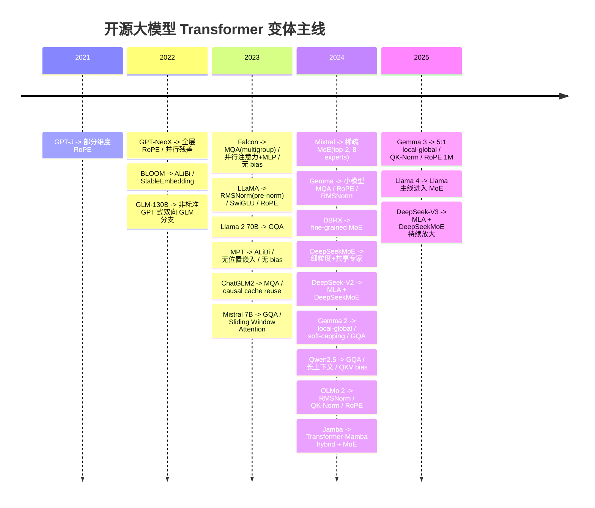
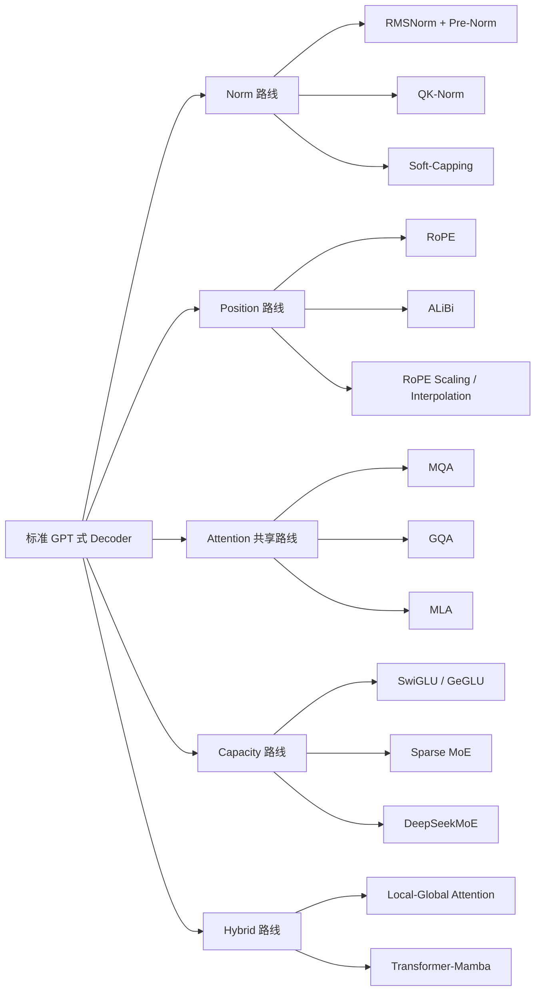

# 2021–2026 开源大模型中的 Transformer Block 变体研究报告

## 执行摘要

2021–2026 年开源大模型的骨干演化，大体可以概括为四条主线：一是 **归一化与前馈层** 从传统 LayerNorm/GELU 向 **RMSNorm + SwiGLU/GeGLU** 收敛；二是 **位置编码** 从 learned absolute embeddings 向 **RoPE / ALiBi / RoPE 扩展** 收敛；三是 **注意力 KV 共享** 从标准 MHA 向 **MQA / GQA / 更激进的 MLA** 演化；四是参数扩展方式从“全层致密”转向 **稀疏 MoE、局部-全局混合注意力、以及 Transformer 与其他序列模块的混合架构**。在工程上，这些变化几乎都围绕同一个目标：**在不线性增加推理延迟和 KV cache 的前提下，扩大能力、上下文长度或模型总参数。** citeturn22view2turn32view0turn41view4turn33view6turn45search1

若只看“后来成为行业默认选项”的修改，影响力最大的并不是最激进的 MoE，而是三件更基础的事：**RMSNorm、RoPE、GQA**。LLaMA 把 RMSNorm + pre-norm、SwiGLU、RoPE 组合成了 2023 年后最常见的开源骨干；Mistral、Llama 3、Qwen2.5、Gemma 2/3 等则在其上继续把 **GQA、滑窗/局部-全局注意力、QK-Norm、logit soft-capping、RoPE 扩展** 发展成“长上下文且可部署”的主流路线。相比之下，BLOOM 的 **ALiBi**、Falcon/ChatGLM2 的 **MQA**、DeepSeek-V2/V3 的 **MLA**、Mixtral/DBRX/DeepSeekMoE/Llama 4 的 **MoE**，更像是针对特定瓶颈的分支优化。 citeturn39view0turn42view2turn32view0turn43view3turn33view6turn41view4turn44search0turn12search0

从实证上看，开源社区已经有若干相对稳定的经验规律。**ALiBi** 在 BigScience 的 1.3B 级消融中相对 learned/rotary 表现更好，且天然支持长度外推；但后续主流还是转向 **RoPE**，原因主要是它与现代 fused attention、长上下文 RoPE scaling、以及 LLaMA 式生态兼容性更好。**GQA** 的收益通常体现为“性能近似 MHA，但 KV cache 和推理成本显著下降”；Gemma 2 的 9B 实验中，GQA 的 4 基准平均分略好于 MHA，且作者明确因为参数更少、推理更快而选用 GQA。**DeepSeek-V2 的 MLA** 则把这条路推到更激进的位置：通过对 K/V 做低秩联合压缩，把 KV cache 压到“约等于 2.25 组 GQA”的水平，同时保持强于 MHA 的能力。 citeturn36view0turn33view7turn41view5turn16search2

到 2025–2026，公开权重模型的前沿焦点已经从“把单层 Transformer 做得更强”转向“两级优化”：**块内更节省内存、块间更稀疏或更异构**。Gemma 3 用 **5:1 局部/全局注意力 + QK-Norm + 分层 RoPE 基频** 解决 128K 长上下文的 KV 爆炸；Llama 4 把 **MoE** 带入 Llama 主线；Jamba 把 **Transformer 与 Mamba** 混合；OLMo Hybrid 则进一步把 Transformer 与线性 RNN 层按理论可表达性重新组合。开源 Transformer 设计的开放问题也因此从“哪一种单点 trick 最好”转为“**哪些修改可以协同，哪些会互相抵消，哪些只在特定规模和硬件上成立**”。 citeturn34view0turn12search0turn45search0turn45search9

## 研究口径与标准基线

本文把“标准 Transformer”作为一个**对比基线**来使用：默认指 **decoder-only、绝对位置嵌入、标准多头注意力 MHA、致密 FFN、常规 LayerNorm、无专家路由、全局注意力** 的 GPT 式骨干；后文所有“改动”都相对这个口径描述。这个口径并不声称某个单一开源模型“完美等于原始 Transformer”，而是为了统一比较 2021–2026 年开源大模型的 block 级设计。凡是主要变化落在数据、训练目标或对齐流程，而**没有明显改变 block/attention/position/FFN/normalization 结构**者，本文只做简述，不把它们当作新的 block 变体。 citeturn22view2turn35view0

本文覆盖的“模型”按**家族/骨干版本**归并，而不是把所有微调版逐个拆开。纳入重点分析的包括 GPT-J、GPT-NeoX/Pythia、OPT、BLOOM、GLM/ChatGLM、Falcon、LLaMA/Llama 2/3/4、MPT、Baichuan、Mistral、Mixtral、Qwen/Qwen2.5、DeepSeek、Gemma、InternLM2、DBRX、Jamba、OLMo 2 等。像 RedPajama、OpenLLaMA、许多 Yi/Long 系列、以及大量蒸馏/指令微调变体，若骨干基本继承已有主线而没有新增 block 修改，本文按母架构归并，不再单列。相关细节在公开材料中缺失时，一律标注为 **未指明**。 citeturn27search3turn24view1turn24view2turn13search1turn19view4turn32view0turn24view6turn43view3turn45search2

为了避免把实现优化与架构修改混为一谈，本文只在两种情况下记录工程项：第一，它直接改变了 block 的数学形式或缓存形式，例如 **ALiBi、RoPE、MQA/GQA/MLA、soft-capping、QK-Norm、MoE 路由**；第二，它虽偏工程，但被作者明确作为骨干设计的一部分并影响模型可用上下文或推理路径，例如 **Mistral 的 SWA 滚动缓存语义、ChatGLM2 的 causal cache reuse**。相反，诸如纯粹的 FlashAttention、量化、分布式并行策略，一般不单独计入 block 变体。 citeturn32view0turn42view2turn41view5

## 时间线与修改族谱

下表只回答一个问题：**某种修改第一次在“有公开权重/公开技术说明的开源大模型”中何时出现，并在哪些后续家族中成为主流。**

| 修改 | 首次在开源大模型中显式出现 | 典型后续模型 | 主要收益 | 主要代价/限制 |
|---|---|---|---|---|
| 部分维度 RoPE | GPT-J-6B（2021；每头 256 维中 64 维做旋转） citeturn29view0 | GPT-NeoX、LLaMA、Gemma、Qwen、DeepSeek、OLMo 2 | 相对位置建模、易于长度扩展 | 部分维旋转的信号容量有限；超长上下文常需额外 scaling |
| 全层 RoPE + 并行残差 | GPT-NeoX-20B（2022；`pos_emb=rotary`, `rotary_pct=0.25`, `gpt_j_residual=true`） citeturn31view0turn29view3 | Pythia、许多 GPT-NeoX 系列复现 | 保留 GPT 兼容性，训练/实现成熟 | 仍是标准 MHA，KV 成本不降 |
| ALiBi | BLOOM 的设计阶段与 BLOOM 主模型（2022） citeturn36view0turn39view0 | Baichuan-13B、MPT | 长度外推、无需显式位置嵌入 | 与后续 RoPE 生态兼容性较弱；社区主流最终转回 RoPE |
| StableEmbedding | BLOOM（2022） citeturn39view0turn37view2 | 少量复现模型 | 超大模型训练稳定性 | BigScience 消融显示零样本性能有明显惩罚 |
| RMSNorm pre-norm + SwiGLU 主流化 | LLaMA（2023） citeturn22view2 | Llama 2/3、Gemma、Qwen、DeepSeek、OLMo 2 | 更稳训练、更高质量 FFN | 相比 GELU 有 kernel/hidden-size 对齐问题 |
| MQA | Falcon（2023，文档称 multigroup attention）、ChatGLM2（2023） citeturn38search2turn42view2 | 若干小中型长上下文模型 | 极大降低 KV cache | 能力常弱于 GQA/MHA，尤其大模型上 |
| GQA | Llama 2 70B / Mistral 7B（2023） citeturn19view3turn32view0 | Llama 3/3.1、Gemma 2/3、Qwen2.5、DeepSeek LLM | 近似保留 MHA 性能，同时显著降低 KV 成本 | 组数选择与模型规模耦合，过小可能伤害能力 |
| Sliding Window Attention | Mistral 7B（2023） citeturn32view0 | Mixtral、Gemma 2/3、若干长上下文模型 | 线性化解码内存，长上下文更可部署 | 需要跨层传播局部窗口外信息 |
| 稀疏 MoE FFN | DeepSeekMoE 研究模型（2024）与 Mixtral 8x7B（2024，主流开源） citeturn16search1turn32view1 | DBRX、DeepSeek-V2/V3、Llama 4、Jamba | 在近似固定激活参数下扩大总参数容量 | 路由稳定性、负载均衡、系统复杂度上升 |
| MLA | DeepSeek-V2（2024） citeturn41view4turn41view5 | DeepSeek-V3 | 大幅压缩 KV cache，同时保持强能力 | 实现复杂，推理系统需针对性适配 |
| Local/Global 交替 + logit soft-capping | Gemma 2（2024） citeturn33view6turn33view7 | Gemma 3（经改造后延续） | 长上下文更稳、格式鲁棒性更高 | 结构更异构，推理 kernel 更复杂 |
| QK-Norm | OLMo 2（2024）在 fully-open 主线中公开系统化采用；Gemma 3（2025）跟进并替换 soft-capping citeturn45search1turn34view0 | Gemma 3、部分后续长上下文模型 | 抑制注意力 logits 爆炸、提升训练稳定性 | 与现有初始化/缩放规则高度耦合 |
| Hybrid Transformer–Mamba | Jamba（2024） citeturn45search0 | Jamba-1.5、OLMo Hybrid | 兼具长上下文吞吐与 Transformer 质量 | 训练/推理栈复杂，不再是纯 Transformer |

下面的时间线图把“主线修改”放在同一张图里，便于观察哪些变化是**叠加式累积**，哪些是**分叉式探索**。相关时间点与模型来源见上表及后文分模型目录。 citeturn29view0turn39view0turn22view2turn32view0turn16search1turn41view4turn45search0

一个更重要的结构关系是：**RoPE、RMSNorm、GQA** 多数情况下是“可组合的通用底座”，而 **ALiBi、MLA、MoE、Hybrid** 更像“针对某个瓶颈的特化路线”。 citeturn22view2turn43view3turn41view4turn45search1

## 分模型编年目录

下面按“首次公开时间”给出**模型家族级目录**。同一家族若后续版本没有新的 block 改动，只在同一行中说明增量。

### 2021–2023

| 模型家族 | 关键修改与标准 Transformer 的差异 | 实现细节与代码线索 | 动机 | 实证效果与代价 | 兼容性与备注 | 主要来源 |
|---|---|---|---|---|---|---|
| **GPT-J-6B（2021）** | 引入 **RoPE**，把位置编码从“加到 token embedding 上”改成“在 Q/K 的一部分维度上做旋转”；与 GPT-2/3 的 learned absolute embeddings 不同。 | 28 层、16 头、`d_head=256`；**每头仅 64 维做 RoPE**。公开模型卡没有说明额外 block 级修改，因此并行残差等记为未指明。 | 以最小结构改动获得相对位置建模与更好的长度泛化。 | 官方未提供 RoPE 单独消融；可确认的经验事实是它成为后续 GPT-NeoX/LLaMA 主线的先声。代价是只旋转部分维度，位置容量相对保守。 | 与后续更大 head_dim、并行残差兼容；是“RoPE 进入开源 GPT 主线”的起点。 | 模型卡与文档。 citeturn29view0turn29view1 |
| **GPT-NeoX-20B / Pythia（2022–2023）** | 将 GPT-J 的思路系统化：**RoPE + 并行残差（parallel feedforward/attention，`gpt_j_residual=true`）**；和标准串行 residual 块不同，注意力与 MLP 并联到同一残差路径。 | 官方 `configs/20B.yml` 直接给出：`pos_emb=rotary`、`rotary_pct=0.25`、`gpt_j_residual=true`、`norm=layernorm`、`no_weight_tying=true`。Pythia 维持同骨干，服务于可解释性而非新架构。 | 提升训练/推理效率，同时保持 GPT 生态兼容；RoPE 便于长度泛化，并行残差减轻串行依赖。 | 官方论文强调 few-shot reasoning 很强，但没有把这些改动分别做成公开消融。工程上它成为许多后续开源实现的“通用 GPT 骨干模板”。 | 与 ALiBi、FlashAttention、MoE 等都可兼容；后续很多“类 GPT-NeoX”模型都从这里分叉。 | 官方仓库 README、20B 配置、论文与 Pythia 论文。 citeturn29view3turn31view0turn27search3 |
| **OPT（2022）** | **几乎不追求新 block 变体**；它的价值更像“公开的 GPT-3 风格对照组”。在本文口径下，可记录的结构变化很少。 | 公开技术报告强调是对 GPT-3 级 decoder-only Transformer 的开放复现；从已检索公开材料看，未突出新的 normalization/attention/FFN 变体。 | 目标是公开复现与发布全套权重，而不是提出新的 Transformer block。 | 架构层面“保守”本身就是结论：它让后续社区能更清楚地观察 LLaMA/BLOOM/Falcon 等修改的真实增益。 | 本文将 OPT 视为“保守基准线”；缺失细节处记为未指明。 | 技术报告。 citeturn24view1 |
| **BLOOM（2022）** | 两个关键修改：**ALiBi** 替代位置嵌入；**StableEmbedding**，即在词嵌入后再做一层 LN。前者把位置信号直接加到 attention score 上，后者不是标准 GPT 的默认做法。FFN 仍用 GeLU。 | 模型卡明确写出：Megatron-GPT2 改造、decoder-only、embedding 层应用 layer norm、ALiBi positional encodings、GeLU、176B/70 层/112 头/2048 序列。 | BigScience 的 1.3B 级架构消融显示：ALiBi 的零样本平均分 **43.70**，优于 learned **41.71** 与 rotary **41.46**；StableEmbedding 虽让 300B token 下平均分从 **43.46 降到 42.24**，但作者仍考虑其在 100B+ 训练上的稳定性价值。 | ALiBi 兼具更好零样本表现与长度外推；StableEmbedding 则体现典型工程权衡：**稳定性更好但能力略损**。 | ALiBi 与后续 MPT、Baichuan-13B 同路；但后续主流并未完全追随 StableEmbedding。 | 模型卡、架构消融论文。 citeturn39view0turn36view0turn36view1turn37view4 |
| **GLM-130B（2022）** | 这是**非 GPT 式分支**：官方明确说它不是 GPT-style，而是采用 **General Language Model** 算法，以**双向注意力优势 + 自回归 blank infilling** 为核心。 | 公开技术报告把它定义为 “bilingual bidirectional dense model with 130B parameters”；检索到的公开材料更强调目标函数与训练稳定性，而非逐层 block 微调，因此细粒度 block 改动为未指明。 | 动机是验证大规模双语模型在 GLM 路线上的可行性，并通过 blank infilling 兼顾双向建模与生成。 | 论文报告它在多项英文基准上优于 GPT-3 175B，并能做到近乎无损的 INT4 量化；但这更多体现训练与表示方案，而不是单一 block trick 的收益。 | 对本文主题的意义在于：它提醒我们，2022 年中文开源主线并不完全沿着 GPT decoder-only 演进。 | GLM-130B 论文与 ChatGLM 总结文。 citeturn13search1turn13search5turn13search9 |
| **Falcon（2023）** | 形成一条与 LLaMA 不同的效率路线：公开文档说明其使用 **multigroup attention / MQA 类 KV 共享** 与 **RoPE**；论文消融还表明采用 **parallel attention + MLP**、**移除线性层 bias**，并最终**不采用 SwiGLU**。 | 论文关于小 tweak 的结论很清楚：选择 parallel attention and MLP，并移除线性层 bias。Transformers 文档则把注意力形式概括为 multigroup attention，并强调 RoPE。 | 目标是把推理内存压低、让大模型更快更稳地部署；并行块与无 bias 是典型“有利于扩展训练”的小修改。 | 文档直接指出 multigroup attention 可显著降低推理内存；论文则因 A100-40GB 的训练内存压力而放弃 SwiGLU，反映这一路线更偏算子/系统友好。 | 与 RoPE、FlashAttention、并行残差兼容；它对后续“KV 共享优先”的模型有持续影响。 | 官方论文与文档。 citeturn38search2turn41view1turn41view3turn24view3 |
| **LLaMA / Llama 2（2023）** | LLaMA 把现代开源主线“定型”为 **pre-norm with RMSNorm + SwiGLU + RoPE**。和原始 Transformer 相比：LN 从子层输出移到输入，且换成 RMSNorm；FFN 从 ReLU 换成 SwiGLU；位置从 absolute 改成每层 RoPE。Llama 2 在此基础上，**70B 版加入 GQA**。 | 论文明示：对每个 sub-layer 输入做 RMSNorm；SwiGLU 使用 **`2/3 * 4d`** 而不是 PaLM 的 `4d`；RoPE 加在**每一层**。Llama 2 模型卡明示只有 **70B 用 GQA**。 | 动机分别是：训练更稳、FFN 表达更强、位置泛化更好、70B 推理可扩展性更高。 | 这是 2023 年后影响最大的组合：LLaMA-13B 以远小于 GPT-3 的参数达到更优或相当基准；Llama 2 70B 用 GQA 把大模型推理成本明显降下来。Code Llama 虽把生成稳定到 100K，上下文扩展主要来自训练长度而非新的 block。 | 该组合与后续 GQA、RoPE scaling、MoE、QK-Norm 都高度兼容，因此成为大量中文和国际开源模型的底座。 | LLaMA 论文、Llama 2 模型卡、Code Llama 公布说明。 citeturn22view2turn19view3turn12search5 |
| **MPT（2023）** | 明确走 **ALiBi + 无位置嵌入 + 无 bias** 路线；与标准 GPT 的 learned position embedding 和 bias 线性层不同。 | 官方模型说明写明：FlashAttention；ALiBi；**does not use positional embeddings**；**does not use biases**。StoryWriter 变体在此基础上把训练/微调 context 拉到 65K，并依赖 ALiBi 外推更长序列。 | 动机是更好的长上下文外推与更高效实现。 | MPT-7B-StoryWriter 声称 65K 训练、84K 生成演示；ALiBi 被官方文档明确解释为可在更短训练长度下降低计算与内存，同时支持更长推理长度。 | 与很多 LLaMA 系 trick 不同，MPT 证明“不用位置嵌入”仍然可以做长上下文产品化。 | 模型说明、官方博客、ALiBi 方法卡。 citeturn10search3turn10search7turn9search7turn10search19 |
| **Baichuan-7B / 13B（2023）** | 7B 走 **RoPE**，13B 转向 **ALiBi**。两者同属 decoder-only，但 13B 把位置方案切成 BLOOM/MPT 同路。 | 官方 README 直接给出表格：7B 为 32 层/32 头/1.2T tokens/**RoPE**/4096；13B 为 40 层/40 头/1.4T tokens/**ALiBi**/4096。 | 公开材料没有写出显式动机句，但可合理推断：13B 切到 ALiBi 是为了在 4K 上下文下获得更强长度泛化和更简单的长序列表达。 | README 给出中英多基准结果，13B 明显高于同尺度中文开源基线；同时量化版在显存上显著下降，说明 ALiBi 路线对部署友好。 | 这是中文开源里最早明确在同一家族里同时公开 **RoPE 与 ALiBi 两条位置路线** 的案例之一。 | 官方 README。 citeturn42view3 |
| **ChatGLM2 / ChatGLM3 / GLM-4 开源线（2023–2024）** | ChatGLM2 的关键 block 级改动是 **MQA**；配合**causal mask 训练**，允许多轮对话中复用历史 KV cache。 | 官方 README 明确说：基于 Multi-Query Attention，KV cache 显存占用更低；`ChatGLM2-6B` 在官方实现下，推理速度比一代提升 **42%**。 | 目标非常明确：更高效推理、更低显存、多轮会话缓存复用。 | 在 INT4 + 6GB 显存条件下，可支持的对话长度从一代的 **1119 tokens** 提升到 **至少 8192 tokens**；这几乎是 MQA 在中文开源对话模型中的最直观工程收益展示。 | 与 GLM 的混合目标函数兼容；但相较 GQA，MQA 往往更偏部署收益而非极致能力。 | 官方 README 与模型卡。 citeturn42view2turn14search7 |
| **Mistral 7B（2023）** | 在 LLaMA 栈上引入两处高影响变化：**GQA** 与 **Sliding Window Attention**。GQA 通过共享 K/V 降低解码成本；SWA 则把全局注意力改成局部滑窗注意力。 | 论文摘要直接写出使用 GQA 与 SWA；表中还给出了 `n_kv_heads` 和 `window_size` 字段，但当前抽取文本没有完整数值，因此具体窗口宽度记为未指明。 | 作者明言：GQA 用来加快推理并降低解码内存；SWA 用来以更低成本处理更长序列。 | 论文称其全面超越 Llama 2 13B；Instruct 版 MT-Bench **6.84**，高于 Llama 2 13B-Chat **6.65**；独立人评中其输出被偏好 **5020** 次，对比 Llama 2 13B 的 **4143** 次。 | GQA 与 SWA 的组合此后成为很多“中等参数、长上下文、可本地部署”模型的模板。 | 官方论文。 citeturn32view0 |

### 2024–2026

| 模型家族 | 关键修改与标准 Transformer 的差异 | 实现细节与代码线索 | 动机 | 实证效果与代价 | 兼容性与备注 | 主要来源 |
|---|---|---|---|---|---|---|
| **Mixtral 8x7B / 8x22B（2024）** | 把 Mistral 的 GQA/SWA 底座与 **Sparse MoE FFN** 结合：每层不再是单个 FFN，而是 **8 个 expert，router 为每个 token 选 top-2**。 | 论文写明：32 层、`n_kv_heads=8`、`num_experts=8`、`top_k_experts=2`、context 32K；每个 expert 是“标准 FFN”。 | 用稀疏激活扩大参数容量，同时控制每 token 的活跃计算量。 | 论文指出：总“可访问参数”约 **47B**，但每 token 只用 **13B active parameters**；在多数基准上超过 Llama 2 70B/GPT-3.5，并对长上下文检索表现稳定。代价是路由与 sparse kernel 系统复杂度显著上升。 | 它证明 **MoE 不必脱离 LLaMA/Mistral 栈** 才能成立；后续 DBRX、DeepSeek、Llama 4 都沿这一方向发展。 | 官方论文。 citeturn32view1 |
| **Qwen / Qwen1.5（2023–2024）** | 初代 Qwen 公开说明采用 **RoPE + SwiGLU + RMSNorm**，是中文开源里较早系统走 LLaMA 式栈的家族之一。Qwen1.5 被官方描述为 Qwen2 的 beta 版。 | Qwen-7B-Chat 模型卡明确写出：RoPE relative position encoding、SwiGLU、RMSNorm；并引入约 **15 万**词表。Qwen1.5 的更细 block 增量，在已检索公开材料中未单独展开。 | 动机是提高中英代码友好的编码效率，并把现代开源 block 组合带入中文多语言场景。 | 官方材料强调的是综合能力与词表优势，而非逐项 block 消融；因此单个修改的独立收益多为未指明。 | 可视作中文开源从“自有 GLM 系路线”向“LLaMA-like 主线”汇合的重要一步。 | 官方模型卡。 citeturn17search16turn18search2 |
| **DeepSeek LLM / DeepSeekMoE（2024）** | Dense 主线 DeepSeek LLM 已使用 **GQA**；随后 DeepSeekMoE 提出两件更激进的事：**细粒度 expert 切分** 与 **shared experts**，不同于普通 GShard/Switch 那种“少量大 experts + top-k”。 | Dense 67B 模型卡直接注明 GQA。DeepSeekMoE 论文则说明：把 experts 分得更细、激活更多小 expert，并隔离共享 expert 捕获共通知识。 | 目标是以更低计算量扩大总参数并提升 expert specialization。 | 论文给出代表性结果：DeepSeekMoE 2B 接近更大 GShard 模型；16B 以**约 40% 计算**达到 LLaMA2 7B 相当性能；145B 版本可用 **28.5%（甚至 18.2%）** 计算接近 DeepSeek 67B。 | DeepSeekMoE 与 GQA、RoPE、后续 MLA 完全可叠加，是 DeepSeek-V2/V3 的前置模块。 | DeepSeek LLM 论文、模型卡、DeepSeekMoE 论文。 citeturn16search0turn16search3turn16search1turn16search5 |
| **Gemma 1（2024）** | 关键特点是把 Gemini 系工程下放到开源轻量模型：**RMSNorm + RoPE**；其中 **2B 用 MQA，7B 用 MHA**。这使它在轻量规模上并没有直接照抄 7B+ 主流的 GQA。 | 论文表格明确：2B 的 `num_kv_heads=1`，即 MQA；7B 的 `num_kv_heads=16`，即 MHA。另有 RMSNorm 与 RoPE。 | 论文明确说：作者基于消融发现 **MQA 在小规模下工作良好**，因此把 2B 做成 MQA，以获得更高效率。 | 这是一个重要经验：**KV 共享并非越多越好，而是与模型规模有关**。Gemma 1 的小模型设计更面向单卡/端侧可用性。 | 后续 Gemma 2 把这条线改为统一 GQA，说明随着规模增大，GQA 成为更折中选择。 | 官方论文。 citeturn33view0turn33view2 |
| **DBRX（2024）** | 官方核心公开点是 **fine-grained MoE**，属于“更细粒度的稀疏专家”路线。 | 官方博文说明它是 fine-grained MoE，并强调 **36B active parameters**；已检索官方摘录未给出 router 的 top-k、专家数和具体 block 插入频率，因此记为未指明。 | 目标是把开放模型做到“高质量且高效率”。 | 官方称其推理可比 LLaMA2-70B **快至 2 倍**，在自家服务上可到 **150 tok/s/user**；这说明 MoE 在生产环境中不是只增参数，也能直接换吞吐。 | 从设计哲学看，它与 Mixtral、DeepSeekMoE 同属一类，但更强调平台级 serving 效率。 | 官方博客与研究页。 citeturn44search0turn44search10 |
| **DeepSeek-V2 / V3（2024–2025）** | 这是 2024 年最重要的新 attention 变体之一：**MLA（Multi-head Latent Attention）**。它不是简单共享 K/V，而是把 K/V **联合压缩到低秩 latent 向量** 并缓存 latent，而不是缓存完整 K/V。FFN 端继续用 **DeepSeekMoE**。 | 论文给出公式：先用 `W_DKV` 把隐藏态压到 `c_t^KV`，再用 `W_UK/W_UV` 解码；推理时只缓存 `c_t^KV`。V2 还披露：`d_c = 4 d_h`，`d_h^R = d_h / 2`；其 KV cache 量相当于 **只有 2.25 组的 GQA**。V3 延续 MLA + DeepSeekMoE。 | 动机非常直接：在能力不退化的前提下，进一步压缩 KV cache，并降低长上下文推理成本。 | V2 官方报告说，相比 DeepSeek 67B：**训练成本降 42.5%**、**KV cache 降 93.3%**、**最大生成吞吐提升 5.76 倍**；并称 MLA 比 MHA 能力更强。代价是注意力实现与推理系统耦合极深。 | MLA 与 RoPE/GQA/MoE 都是可叠加而非互斥的；在公开权重模型里，它是最像“下一代 attention memory format”的方案。 | 官方论文、README 与 V3 技术报告。 citeturn24view8turn41view4turn41view5turn41view6turn16search2turn24view9 |
| **Gemma 2（2024）** | 在 Gemma 1 基础上一次性加入四项关键变化：**Local/Global 交替注意力**、**logit soft-capping**、**pre-norm + post-norm 均用 RMSNorm**、**统一改用 GQA**。 | 论文表 1 直接给出：2B/9B/27B 都是 GQA；global span **8192**、sliding window **4096**。soft-capping 公式为 `soft_cap * tanh(logits / soft_cap)`，attention 层 `soft_cap=50`，final layer `soft_cap=30`。 | 目标是把 8K 长上下文做得更稳、更易部署，并减少注意力和最终 logits 的极值问题。 | 官方消融十分有价值：9B 上 **GQA 平均分 50.8，高于 MHA 的 50.3**，作者因此因“参数更少、推理更快”而选 GQA；滑窗从 4096 缩到 1024，验证 perplexity 仅从 **1.63** 变到 **1.64**，说明还能继续换一点推理速度。 | Gemma 2 是“局部-全局注意力”在开源主线中最系统的一次落地。 | 官方技术报告。 citeturn33view6turn33view7 |
| **Qwen2 / Qwen2.5 / Qwen2.5-1M（2024–2025）** | Qwen2.5 的公开骨干是 **RoPE + SwiGLU + RMSNorm + Attention QKV bias + GQA**；与多数 LLaMA 系不同，它明确保留 **QKV bias**。 | 官方 Qwen2.5-7B 模型卡写明：28 层，Q-head 28、KV-head 4、context **131,072**；1M 版保持相同架构，但把 full context 拉到 **1,010,000**。 | 动机是更强的长文本、代码、结构化输出与多语言能力。 | 官方模型卡强调：Qwen2.5 相较 Qwen2 在知识、代码、数学、长文本、JSON 输出和多语言上都有显著提升。具体 1M 版使用何种 RoPE scaling/YaRN 实现，当前公开模型卡摘录**未指明**。 | 这是中文开源中最成熟的“GQA + 128K/1M 长上下文”主线之一；与 QKV bias 的组合很有辨识度。 | 官方模型卡与技术报告。 citeturn43view3turn43view4turn43view6turn42view1turn24view11 |
| **InternLM2（2024）** | 公开材料显示其长上下文与部署栈大量围绕 **GQA** 展开，但现有公开模型卡对 block 细节披露较少。 | 模型卡强调 20B/7B 两个尺度与 **200K context window**；推理栈文档声称 GQA 优化后 `internlm2-20b` 可达 **16+ RPS**，约 **1.8×** 快于 vLLM。更细的 `n_kv_heads` 等超参在已检索材料中未指明。 | 动机是长上下文和高吞吐部署。 | 可确认的是，它显然属于“LLaMA/Mistral 之后的 GQA 长上下文家族”；但如果只追求严格的一手 block 细节，官方当前公开摘要仍不如 Qwen/Gemma 充分。 | 本文保留该条目，但把未公开细节明确标为未指明。 | 官方模型卡与部署文档。 citeturn15search6turn15search8 |
| **Llama 3 / 3.1（2024）** | 在 Llama 2 的基础上，**GQA 从 70B 扩展到所有主模型尺寸**。这意味着 Llama 主线正式把 GQA 视为默认 attention 形态，而不再是只给最大模型使用。 | Llama 3 模型卡明示：8B/70B 全都使用 GQA；Llama 3.1 模型卡进一步写明 8B/70B/405B 全部使用 GQA，并把 context 提到 **128K**。 | 动机是 improved inference scalability，尤其在更大上下文和更强多语言场景下。 | 官方材料没有把 GQA 做成单独消融，但从架构决策上已经清楚：Llama 3.x 把“GQA everywhere”定为标准做法。 | 它强化了 2024 年后的行业共识：中大模型默认不再回到纯 MHA。 | 官方模型卡与发布说明。 citeturn19view4turn19view5turn12search9turn11search8 |
| **Jamba / Jamba-1.5（2024）** | 这是边界案例，但很重要：**Transformer-Mamba hybrid + MoE**。它不再是纯 Transformer，而是在层间交替 Transformer 与 Mamba，并在部分层加入 MoE。 | 论文说明：interleave Transformer and Mamba layers，并在 some layers 加 MoE；Jamba-1.5 继续用该架构，Large 为 **94B active parameters**，effective context **256K**。 | 动机是同时获得 Transformer 的建模质量与状态空间模型的长上下文吞吐/内存优势。 | 论文声称可在单张 80GB GPU 上放下基础版；Jamba-1.5 则强调在 256K 长上下文上具有高吞吐和低内存。代价是训练与服务栈复杂度大幅增加。 | 虽非纯 Transformer，但它代表了“后 Transformer 时代”对 block 级组合的新方向。 | 官方论文。 citeturn45search0turn45search8 |
| **OLMo 2（2024–2025）** | 对“LLaMA 式栈”做了更系统的稳定性改写：**LayerNorm → RMSNorm、重排 norm 次序、QK-Norm、absolute position → RoPE**。 | 官方博客一句话概括了四项关键修改；论文摘要把重点放在“better training stability and improved per-token efficiency”。 | 目标是训练更稳、每 token 更高效。 | 这是 fully-open 主线里第一批把 **QK-Norm** 明确写进开放技术说明的模型；对后续 Gemma 3 一类长上下文模型具有明显示范意义。 | 与 RoPE、RMSNorm、GQA 等通用 trick 高度协同；代表“在成熟栈上继续做稳定性微创新”的方向。 | 官方博客、论文与模型卡。 citeturn45search1turn45search2turn45search5turn45search3 |
| **Gemma 3（2025）** | 在 Gemma 2 之上继续长上下文化：**5:1 local/global attention interleaving**、**QK-Norm 取代 soft-capping**、**global 层 RoPE 基频从 10K 提到 1M，local 层保留 10K**。 | 论文写明：5 个 local 层对 1 个 global 层，且第一层就是 local；local span **1024**；global/self-attention 长度用 positional interpolation 扩到 128K；1B 例外为 32K。 | 明确目标是遏制长上下文时 **KV cache explosion**，同时保持能力。 | 作者直接说这些改动是为了降低长上下文推理内存；并报告 Gemma3-4B-IT 可与 Gemma2-27B-IT 竞争，27B 逼近 Gemini-1.5-Pro 的若干基准区间。 | Gemma 3 说明：长上下文不一定靠“全层全局注意力 + 更大 RoPE”，也可以靠**局部层比重上升**来达成。 | 官方技术报告。 citeturn34view0 |
| **Llama 4（2025）** | 官方公开的关键信息是：Llama 主线进入 **MoE**，并且是 **open-weight natively multimodal**。 | 官方博客明确称其为 first open-weight natively multimodal models，并采用 MoE；但公开摘要中对专家数、路由位置、RoPE/iRoPE 细节披露有限，因此具体 block 超参多记为未指明。 | 目标是把更高能力、原生多模态和超长上下文引入 Llama 主线，同时保持部署可承受。 | 官方与复验基准页显示 Scout/Maverick 在多项基准上具备很强竞争力，但严格说这并不能归因于单个 block trick。 | 就架构史而言，它的重要性不在于某个“小改动”，而在于 **Llama 家族正式从致密 Transformer 转向 MoE**。 | 官方博客与基准报告；辅助技术综述用于补足未公开处。 citeturn12search0turn12search16turn11search2 |

围绕这些家族，有两点值得单独拎出来。第一，**“LLaMA stack”并不等于所有模型都一样**：Gemma 1 选择小模型 MQA、Gemma 2 做 local-global + soft-cap、Gemma 3 改成 QK-Norm；Qwen2.5 则保留了 QKV bias；OLMo 2 在 norm 顺序上继续动刀。第二，**“长上下文”已经不再是单一 trick 能解决的问题**：ALiBi、RoPE scaling、SWA、local-global、GQA、MLA、MoE、甚至 hybrid 架构，实际上是在不同资源约束下求解同一个成本函数。 citeturn39view0turn34view0turn43view3turn45search1turn41view5

## 修改对比与选型建议

| 修改 | 技术要点 | 主要优点 | 主要缺点 | 更适合的场景 | 代表开源模型 |
|---|---|---|---|---|---|
| **RMSNorm + pre-norm** | 把归一化移到子层输入，并用 RMSNorm 替代 LayerNorm。 | 训练稳定、实现简单、几乎已成开源默认。 | 单独收益不总能从最终分数里分离出来。 | 几乎所有中大规模 decoder-only LLM。 | LLaMA、Gemma、Qwen、OLMo 2。 citeturn22view2turn33view0turn43view3turn45search1 |
| **SwiGLU / GeGLU** | 用门控前馈层替代 ReLU/GELU FFN。 | 常带来更好的表达能力和下游得分。 | kernel/hidden-size 对齐不佳时吞吐会受损。 | 追求综合能力的主流 dense 模型。 | LLaMA、Qwen、Gemma 2。 citeturn22view2turn37view4turn43view3turn33view6 |
| **RoPE** | 在 Q/K 子空间做旋转，位置依赖进入 attention。 | 长度扩展友好，与现代 fused attention 生态兼容。 | 超长上下文通常还要配合 scaling/interpolation。 | 通用默认选项。 | GPT-J、GPT-NeoX、LLaMA、Qwen、Gemma 3、OLMo 2。 citeturn29view0turn31view0turn22view2turn43view3turn34view0turn45search1 |
| **ALiBi** | 直接在 attention score 加距离 bias，无需位置嵌入。 | 外推简单、长上下文成本低。 | 后续生态与主流 RoPE 工具链不完全同构。 | 以长度外推和部署简洁为先。 | BLOOM、MPT、Baichuan-13B。 citeturn36view0turn39view0turn10search3turn42view3 |
| **MQA** | 所有 query head 共享一组 K/V。 | KV cache 最省，部署收益立竿见影。 | 大模型能力可能不如 GQA/MHA。 | 小模型、对话模型、显存极紧张场景。 | ChatGLM2、Gemma 1 2B、Falcon 路线。 citeturn42view2turn33view2turn38search2 |
| **GQA** | query 头分组共享 K/V，介于 MHA 与 MQA 之间。 | 几乎是当前最稳妥的“性能/缓存”折中。 | 组数要调，不是越少越好。 | 7B–100B+ 主流开源模型。 | Llama 2 70B、Mistral、Llama 3、Gemma 2/3、Qwen2.5。 citeturn19view3turn32view0turn19view4turn33view7turn43view3 |
| **SWA / local-global attention** | 局部滑窗层与全局层交替。 | 显著降低长上下文推理成本。 | 全局信息需依赖跨层传播；实现更复杂。 | 长上下文但要可本地部署。 | Mistral、Gemma 2、Gemma 3。 citeturn32view0turn33view6turn34view0 |
| **Soft-capping / QK-Norm** | 约束 attention logits 的数值范围，或直接对 Q/K 归一化。 | 抑制数值爆炸、提升训练稳定性。 | 与初始化、温度、蒸馏策略耦合。 | 大规模训练稳定性、长上下文。 | Gemma 2、Gemma 3、OLMo 2。 citeturn33view6turn34view0turn45search1 |
| **稀疏 MoE** | 用 router 选择少数 experts 处理 token，而非所有 token 经过同一个 FFN。 | 在固定 active compute 下扩大总参数容量。 | 路由/负载均衡/kernel/部署更复杂。 | 追求高能力、训练预算有限。 | Mixtral、DBRX、DeepSeekMoE、Llama 4。 citeturn32view1turn44search0turn16search1turn12search0 |
| **MLA** | 不缓存完整 K/V，而缓存联合压缩后的 latent KV。 | 比 GQA 更激进地压缩 KV cache。 | 系统适配复杂，不是通用“掉包即用”。 | 超长上下文、高吞吐服务。 | DeepSeek-V2 / V3。 citeturn41view4turn41view5turn24view9 |
| **Hybrid Transformer–Mamba** | 在层级上混合 Transformer 与状态空间模块。 | 长上下文吞吐、内存占用更优。 | 训练和 serving 栈复杂度最高。 | 把长上下文作为第一目标。 | Jamba、Jamba-1.5。 citeturn45search0turn45search8 |

如果把这些修改放到真实选型问题里，一个相对稳健的结论是：**做通用文本模型时，优先级通常是 RoPE → RMSNorm/pre-norm → GQA → 门控 FFN；做长上下文服务时，再在其上加 SWA/local-global、RoPE 扩展、或更激进的 MLA；只有当训练预算远小于目标能力时，MoE 才会成为“必须上”的第一优先级。** 这正是 2023–2025 年开源主线从 LLaMA/Mistral 走到 Gemma/DeepSeek/Llama 4 的真实路径。 citeturn22view2turn32view0turn33view6turn41view4turn12search0

## 趋势与开放问题

最明显的趋势，是 **“单点 trick 时代”已经结束**。2021–2022 的重点还是“RoPE 还是 ALiBi”“GELU 还是 SwiGLU”“加不加 embedding norm”；到 2024–2026，主流问题已经变成“**长上下文 + 多语言 + 低延迟 + 高能力** 如何同时成立”。因此，后来的修改不再孤立出现，而是以**协同包**的形式出现：Gemma 2 把 local/global、GQA、soft-capping、RMSNorm 放在一起；Gemma 3 又把其中一部分替换为 QK-Norm 和层级化 RoPE；DeepSeek-V2/V3 则把 MLA 和 DeepSeekMoE 绑定成一套。 citeturn33view6turn34view0turn41view4turn41view6

第二个趋势，是 **KV cache 正在成为比 FLOPs 更核心的设计约束**。MQA、GQA、SWA、local-global attention、MLA、5:1 层间稀疏全局注意力，这些修改表面看彼此不同，但实质都在围绕同一个瓶颈做文章：**解码时每多一层、每多一组 K/V、每扩一倍 context，系统成本都按可怕的方式上升。** DeepSeek-V2 之所以重要，不只是因为它提出 MLA，而是它把“attention memory format”本身变成了可设计对象。 citeturn42view2turn33view7turn41view5turn34view0

第三个趋势，是 **MoE 已从“研究分支”进入主流家族**。2024 年前后，Mixtral、DBRX、DeepSeekMoE、DeepSeek-V2/V3 让开源社区基本接受了一个现实：如果希望在可承受 active compute 下继续放大总参数，**稀疏专家路由**是最直接的扩展方式。Llama 4 的出现，则意味着连最保守、最生态化的主线家族也开始接受 MoE。剩下的问题已不再是“MoE 有没有用”，而是 **router 该放在哪、专家该多细、shared experts 要不要保留、以及 serving 栈如何跟上。** citeturn32view1turn44search0turn16search1turn24view9turn12search0

仍未解决的问题主要有四个。其一，**RoPE vs ALiBi** 并没有一个普适终局：前者生态更强，后者长度外推更简单；是否存在统一的“长度友好且与主流 kernel 深兼容”的位置方案，仍是开放问题。其二，**GQA/MQA/MLA 的能力–缓存曲线** 还缺少跨规模系统研究，尤其在 30B–400B 尺度。其三，**QK-Norm、soft-capping、RMSNorm 次序、蒸馏和 RoPE scaling 的相互作用** 仍然缺少公开且可复验的大规模消融。其四，**混合架构** 是否会在通用开源 LLM 中取代纯 Transformer，目前仍是未决：Jamba 和 OLMo Hybrid 很有潜力，但尚未像 LLaMA 栈那样形成压倒性共识。 citeturn36view0turn45search1turn33view6turn41view4turn45search0turn45search9

如果把这五年的演化压缩成一句话，那么最准确的总结或许是：**开源大模型并不是在“发明越来越多的注意力花样”，而是在把 Transformer 改造成一种更可缓存、更可局部化、更可稀疏化、也更可与其他序列模块混搭的通用计算骨架。** 从 GPT-J 的“先把一部分维度旋起来”，到 DeepSeek-V2 的“干脆别缓存完整 K/V”，再到 Llama 4/Jamba 的“必要时让并不是每个 token 都走同一类块”，这条路线已经非常清晰。 citeturn29view0turn41view5turn12search0turn45search0