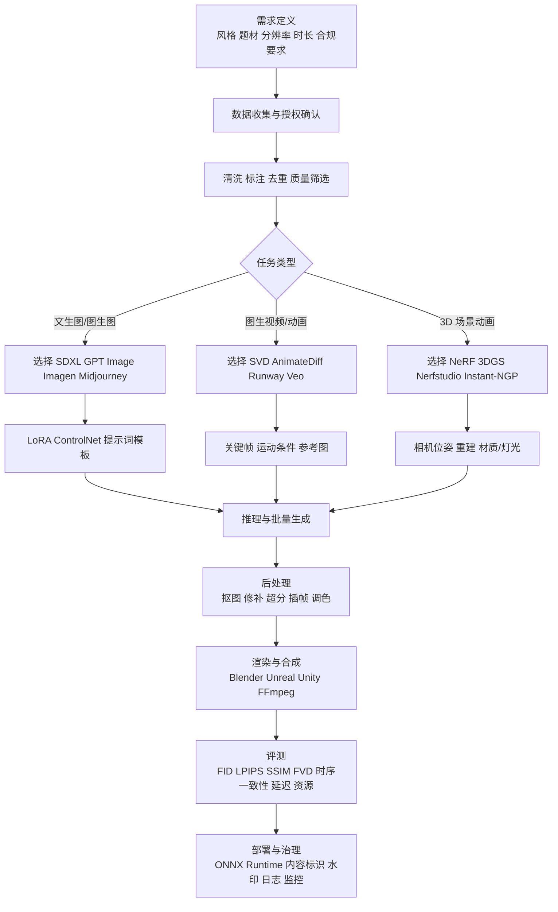

# 如何系统地使用 AI 生成图片和动画

## 执行摘要

当前 AI 图像与动画生成的主线，已经从早期的 GAN、VAE，演进到以潜空间扩散模型、扩散 Transformer、图像到视频模型，以及 NeRF / 3D Gaussian Splatting 为核心的多模态体系：GAN 仍适合低时延和特定风格任务，VAE 适合表示学习与压缩，扩散模型在质量、可控性与生态成熟度上最强，NeRF 与 Gaussian Splatting 则把问题从“生成单帧”扩展到“可漫游、可重建、可动画化的三维场景”。同时，基于物理的渲染与可微渲染开始成为连接“生成内容”和“可编辑 3D 资产”的桥梁。citeturn36search0turn36search1turn36search2turn36search3turn37search0turn26search2turn17search1turn17search12

从工程落地看，最稳妥的方法不是追逐单一“最强模型”，而是构建一条可复用流水线：先定义任务边界与输出规格，再收集/清洗数据，选择基座模型，优先用 LoRA、ControlNet、参考图、遮罩、关键帧等轻量控制手段做微调与约束，随后进入推理、插帧、合成、渲染、评测和部署。对于多数团队：私有化与可控性优先时，Stable Diffusion / SDXL + Diffusers + PyTorch + ONNX Runtime + Blender / FFmpeg 是最经济的组合；追求最快创意迭代时，可优先选 Midjourney、OpenAI GPT Image、Google Imagen、Runway；三维场景动画则优先选择 Nerfstudio / Instant-NGP / Gaussian Splatting，再接 Blender、Unity 或 Unreal 完成交付。citeturn22view0turn22view1turn23view2turn24view0turn25view0turn25view1turn23view3turn27view0turn26search13turn19search3turn29view3turn30search3

判断方案时，建议把“画质”拆开看：静态图像常用 FID、IS、LPIPS、SSIM；视频额外关注 FVD、光流/重投影一致性、帧间闪烁与运动合理性；线上系统则必须同时看 FPS、端到端延迟、显存/内存占用、可控性、可解释性，以及版权、深度伪造、个人信息和内容标识合规。很多团队失败并不是模型不够强，而是忽略了训练数据合法来源、版本固定、种子管理、时序一致性后处理和内容标识。citeturn9search0turn10search0turn9search2turn10search1turn11search0turn11search6turn32view0turn32view1turn31view2

## 技术路线与模型谱系

从技术本质看，GAN 通过生成器与判别器对抗学习，优势是采样快、结构相对直接，但训练稳定性与模式崩塌始终是工程难点；VAE 用显式潜变量建模，训练更稳、便于压缩与表示学习，但细节锐度往往不如 GAN/扩散；DDPM 与 score-based 模型把生成过程写成逐步去噪或逆向 SDE，质量高、控制接口丰富，已经成为图像、编辑与视频生成的事实主线；DALL·E 一类自回归 / Transformer 方法擅长离散 token 建模，MaskGIT 把串行解码改成并行迭代填充，显著提升速度；DiT 则把 Transformer 直接嵌入扩散主干，说明“扩散 + Transformer”的扩展性很强。citeturn36search0turn36search1turn36search2turn36search3turn37search3turn15search1turn15search0

NeRF 把三维场景表示为连续辐射场，能从稀疏视角合成新视图；Instant-NGP 用多分辨率哈希编码显著缩短训练时间；3D Gaussian Splatting 则把场景显式表示为高斯元，并利用快速光栅化实现更高渲染速度，因而在“3D 场景动画、可漫游展示、数字孪生预览”中更实用。若任务不仅要“看起来像”，还要拟合真实相机、灯光、材质和几何，PyTorch3D、Mitsuba、nvdiffrast 这类可微渲染工具就非常关键；而 Blender Cycles、Unreal PBR、Unity HDRP 则承担最终物理一致渲染。citeturn37search0turn26search1turn26search2turn27view1turn17search12turn17search14turn18search7turn18search20turn18search2turn18search13

| 路线 | 适合场景 | 主要优势 | 主要短板 | 工程判断 |
|---|---|---|---|---|
| GAN | 风格化、小模型、低时延图像任务 | 采样快 | 训练不稳、易模式坍塌 | 用于特定风格或轻量生成仍有价值 citeturn36search0turn9search0 |
| VAE | 表示学习、压缩、潜编码 | 稳定、可解释性较好 | 细节保真偏弱 | 常作为扩散的潜空间组件 citeturn36search1turn37search2 |
| Diffusion / LDM / SDXL | 文生图、修图、补图、超分 | 质量高、生态成熟、控制强 | 推理慢、显存敏感 | 当前图像生成主线 citeturn36search2turn37search2turn37search10 |
| Score-based | 高保真图像与逆问题 | 理论完整，可转 ODE/SDE | 推理复杂度高 | 与扩散高度同源，偏研究与高端控制 citeturn36search3 |
| AR / MaskGIT / DiT | token 生成、规模化建模、强提示遵循 | 扩展性强，MaskGIT 解码更快 | 训练成本高 | 商业模型和新一代主干的重要方向 citeturn37search3turn15search1turn15search0 |
| NeRF / 3DGS | 新视角合成、3D 场景动画 | 可生成相机路径动画 | 采集与重建链路更复杂 | 静态三维场景首选 3DGS，强调可解释几何时选 NeRF/可微渲染 citeturn37search0turn26search2turn27view1 |
| 风格迁移 / 可微渲染 / PBR | 风格统一、逆渲染、材质灯光拟合 | 与 3D 编辑链路衔接最好 | 学习门槛高 | 面向影视、游戏、数字资产最有价值 citeturn37search1turn17search14turn18search20turn18search2 |

在任务层面，图像到图像最经典的路线是 pix2pix、CycleGAN 与后来的 ControlNet：前两者擅长成对 / 非成对域变换，ControlNet 则把边缘、深度、分割、人姿等空间条件接到扩散模型上，显著提高可控性；视频方面，vid2vid 代表传统条件视频合成，AnimateDiff、Stable Video Diffusion、Make-A-Video 则代表扩散时代的图像到视频 / 文本到视频主线；关键帧插值可用 FILM、RIFE 或 FFmpeg 的 `minterpolate` 做后处理。citeturn16search0turn16search1turn16search2turn16search3turn15search2turn15search3turn21search2turn8search3turn8search11turn28view0

## 工具生态与系统化工作流

就工具分层而言，开源栈侧重“可控、可自托管、可组合”，商业栈侧重“开箱即用、风格强、协作快”。Hugging Face Diffusers 已经把文生图、图生图、视频、LoRA、优化、量化、编译、离线/多 GPU 部署做成统一接口；PyTorch 仍是主训练框架，ONNX Runtime 负责跨平台加速，Unity Sentis 与 Unreal NNE 则把 ONNX 模型接入实时引擎；Blender、FFmpeg 负责最终动画合成、转码和渲染。citeturn22view0turn22view1turn22view2turn23view0turn19search3turn30search3turn29view3turn7search0

| 工具 | 类型 | 强项 | 弱项 | 典型位置 |
|---|---|---|---|---|
| Stable Diffusion / SDXL + Diffusers | 开源 | 私有化、可微调、可接 ControlNet / LoRA | 需要算力与运维 | 企业私有图像生产线 citeturn21search0turn22view0turn22view1 |
| OpenAI GPT Image | 商用 API | 生成与编辑统一，支持多轮编辑与 API 集成 | 闭源、成本随尺寸/质量增长 | SaaS 应用、编辑式工作流 citeturn23view2turn5search20 |
| Midjourney | 商用 | 审美与创意探索强，Web/Discord 工作流成熟 | 自动化、可复现和工程接口较弱 | 概念设计、视觉探索 citeturn24view0turn24view1turn24view2 |
| Google Imagen / Veo | 商用云 | 高质量图像与视频 API，适合云原生集成 | 主要依赖云平台 | 企业内容生成服务 citeturn25view0turn25view1turn20search8 |
| Runway | 商用 | 图像/视频到视频链路完整，适合创作者协作 | 闭源、成本可观 | 广告、短片、预演动画 citeturn23view3turn20search23turn20search19 |
| Nerfstudio / Splatfacto / Instant-NGP | 开源 | 3D 场景重建与动画快 | 采集质量敏感 | 三维漫游、资产预览 citeturn27view0turn27view1turn26search13 |
| Blender / Unity / Unreal / FFmpeg | DCC / 引擎 / 媒体工具 | 最终渲染、交互、转码、插帧 | 配置复杂 | 交付与部署层 citeturn18search20turn30search3turn29view3turn28view0turn27view3 |

一个可复用的系统化工作流，可按下图实施：



该流程的关键不是“每一步都训练大模型”，而是先用强基座模型做 80% 的效果，再用 LoRA、ControlNet、参考图、掩码、关键帧与后处理来解决剩余 20% 的可控性与一致性问题。Diffusers 官方训练文档明确指出，单卡 24GB 结合 `gradient_checkpointing` 与 mixed precision 已可进行文生图训练，而 LoRA 进一步降低了可训练参数量与显存压力。citeturn22view0turn22view1turn8search4turn8search9

## 评价体系与性能优化

评价时应把“静态质量”和“动态质量”分开。静态图像最常见的自动指标是 FID、IS、LPIPS、SSIM：FID 衡量生成分布与真实分布差距，IS 更偏类别清晰度与多样性，LPIPS 更贴近感知差异，SSIM 更反映结构相似；视频则常用 FVD 评估时空一致性，但近年的研究也指出，仅靠 FVD、IS 或 CLIP 一类指标并不足以完整反映视频质量，往往还要增加文本-视频对齐与人工评审。citeturn9search0turn10search0turn9search2turn10search1turn11search0turn11search6

| 指标 | 适用对象 | 越高/越低更好 | 主要看什么 | 局限 |
|---|---|---|---|---|
| FID | 图像/视频帧分布 | 越低越好 | 真实分布接近度 | 不直接反映提示词遵循 citeturn9search0 |
| IS | 图像 | 越高越好 | 类别可分与多样性 | 易偏向 ImageNet 语义 citeturn10search0 |
| LPIPS | 图像/帧 | 越低越好 | 感知相似度 | 与任务相关性需结合人工判断 citeturn9search2 |
| SSIM | 图像/帧 | 越高越好 | 结构一致性 | 对风格变化不敏感 citeturn10search1turn9search7 |
| FVD | 视频 | 越低越好 | 时空一致性与质量 | 对文本对齐仍不充分 citeturn11search0turn11search6 |

性能优化最实用的策略有五类：一是精度下降，把 `float32` 改为 `fp16` 或 `bf16`；二是使用 PyTorch 2 的 SDPA / FlashAttention 类注意力后端；三是 `torch.compile`；四是模型分片、`device_map="balanced"`、`enable_model_cpu_offload()`、group offload；五是导出到 ONNX Runtime / TensorRT 执行提供器。Diffusers 文档显示，现代扩散模型显存压力很大，分片加载、平衡放置、CPU offload、CUDA stream 等都是官方建议；SVD 文档还指出，对 UNet 做 `torch.compile` 可换来约 20–25% 速度提升。citeturn23view0turn22view3turn22view2turn19search15turn19search6turn19search7

硬件上，若目标是“开始能做事”，24GB 显存已经足以完成不少文生图训练/微调；若做更快训练、更大 batch 或更复杂视频任务，则需要更高显存或多 GPU。Nerfstudio 的 Splatfacto 默认大约需要 6GB 显存，`splatfacto-big` 约 12GB；而视频模型比图像模型更容易 OOM，因为它往往一次生成整段帧序列。citeturn22view0turn27view1turn22view2

下面这组命令和代码片段，是最常用、且与官方文档一致的最小可用范式。citeturn23view1turn22view0turn22view1turn22view2turn28view0

```python
# 文生图：SDXL / Diffusers
import torch
from diffusers import AutoPipelineForText2Image

pipe = AutoPipelineForText2Image.from_pretrained(
    "stabilityai/stable-diffusion-xl-base-1.0",
    torch_dtype=torch.bfloat16
).to("cuda")

img = pipe(
    "赛博朋克城市夜景，雨后街道反光，电影级光影，细节丰富",
    num_inference_steps=30,
).images[0]
img.save("out.png")
```

```bash
# LoRA 微调：建议优先于全量微调
accelerate launch train_text_to_image_lora.py \
  --pretrained_model_name_or_path="stabilityai/stable-diffusion-xl-base-1.0" \
  --dataset_name="your_dataset" \
  --output_dir="./lora_out" \
  --rank=16 \
  --learning_rate=1e-4 \
  --mixed_precision="fp16"
```

```python
# 图生视频：SVD-XT
import torch
from diffusers import StableVideoDiffusionPipeline
from diffusers.utils import load_image, export_to_video

pipe = StableVideoDiffusionPipeline.from_pretrained(
    "stabilityai/stable-video-diffusion-img2vid-xt",
    torch_dtype=torch.float16,
    variant="fp16"
)
pipe.enable_model_cpu_offload()

image = load_image("keyframe.png").resize((1024, 576))
frames = pipe(image, decode_chunk_size=8, generator=torch.manual_seed(42)).frames[0]
export_to_video(frames, "generated.mp4", fps=7)
```

```bash
# 插帧 / 平滑运动：FFmpeg minterpolate
ffmpeg -i generated.mp4 \
  -vf "minterpolate=fps=24:mi_mode=mci:mc_mode=aobmc:me_mode=bidir:vsbmc=1" \
  out_24fps.mp4
```

常见故障排查也有相对固定的优先级：若 OOM，先降精度、开 SDPA/offload、减少分辨率与帧数，再考虑 ONNX / TensorRT；若提示词不稳定，先固定 seed、版本、参考图与负面提示，再引入 ControlNet；若视频闪烁，优先减小运动幅度、增加关键帧、做插帧/光流一致性处理；若 3D 重建几何破碎，优先检查采集重叠度、曝光一致性和是否有 COLMAP / SfM 初始化点云。citeturn22view3turn23view0turn16search2turn23view3turn27view1

## 案例研究

### 文本到图像私有部署

目标：在本地或私有云中生成“品牌一致、可复现、可批量”的商品图或概念图。推荐链路是 SDXL 基座 + LoRA 适配 + ControlNet 约束 + Diffusers 推理。原因是 SDXL 已经在开放生态中形成稳定基线，Diffusers 官方提供统一训练与推理接口，LoRA 能显著降低微调成本，而 ControlNet 能把边缘、深度、姿态等结构锁住。citeturn21search0turn21search1turn22view0turn22view1turn16search2

端到端步骤可简化为：先定义输出模板（比例、风格、背景、品牌颜色、禁止元素）；再准备可授权数据并清洗标题/描述；随后用 SDXL 做零样本基线，确认提示词模板；若风格不稳定，则用 LoRA 做轻量微调；若构图必须稳定，则接入 ControlNet；上线前用 FID/LPIPS/人工抽检做三重评测，并导出 ONNX 供服务端部署。这里的关键不是“追求更大的模型”，而是尽快把风格、构图与版本固定下来。citeturn22view0turn22view1turn19search3turn19search15

性能与效果对比上，私有 SDXL 的优势是可控、可审计、可离线；OpenAI GPT Image 的优势是生成与编辑接口统一，适合做 SaaS 图像编辑器；Midjourney 的优势是审美和创意探索快，适合前期概念探索，但在自动化、版本锁定和批量复现上不如自建管线；Imagen 适合深度使用 Google Cloud 的团队。citeturn23view2turn24view0turn24view2turn25view0

### 图像到动画

目标：把一张角色图、产品图或场景图扩展为短动画。若需要开源本地方案，Stable Video Diffusion 是当前最实用的起点：官方 Diffusers 教程给出的是 2–4 秒、576×1024 的图生视频流程，SVD 生成 14 帧，SVD-XT 生成 25 帧；若需要更强的创作者工作流和更快交付，可直接使用 Runway 的图生视频能力。citeturn22view2turn23view3

工程上最容易犯的错误，是在图生视频提示里继续描述静态内容。Runway 官方文档明确建议：当输入图已经提供主体、构图、颜色和光照时，文本提示应主要描述“运动”；SVD 也更适合作为“短时运动扩展器”，不是长视频叙事引擎。因此，最佳实践通常是“关键帧生成 + 短段运动 + 插帧 + 剪辑拼接”：先生成多个关键帧，再用 SVD 或 Runway 扩展成短段，随后用 FILM / RIFE / FFmpeg 做插帧，最后在剪辑器中拼接。citeturn23view3turn22view2turn8search3turn8search11turn28view0

效果对比上，本地图生视频的优点是成本可控、可离线、便于和 LoRA / ControlNet 合并，但时长、分辨率与显存压力受限；Runway 的 Gen-4 文档给出了 24fps、多种宽高比和 5/10 秒输出规格，适合广告分镜、社媒短视频与 VFX 预演。官方在线示例与界面截图，可直接参考 SVD 教程中的 rocket 示例，以及 Runway Gen-4 文档页面。citeturn22view2turn23view3

### 三维场景动画

目标：把一组照片或视频片段变成可绕拍、可漫游、可导入引擎的场景动画。这里更推荐“NeRF 家族 + Gaussian Splatting”而不是纯 2D 视频模型，因为目标不只是生成运动，而是重建相机与空间。Nerfstudio 已把 `ns-process-data`、`ns-train`、`ns-render`、`ns-export` 串成端到端流程，并内置 Nerfacto、Instant-NGP 和 Splatfacto。citeturn27view0turn27view1turn26search13

最小实现步骤是：先用手机或相机围绕场景采集高重叠度素材；再做 SfM / COLMAP 风格的数据预处理；之后用 `ns-train splatfacto --data <data>` 训练默认 3DGS 模型；训练完成后生成相机路径并渲染视频，最后把结果送入 Blender 做灯光、字幕和合成，或导入 Unity / Unreal 做交互展示。Nerfstudio 文档给出的经验是：默认 `splatfacto` 显存约 6GB、速度快；`splatfacto-big` 约 12GB、质量更高。citeturn27view1turn18search20turn30search3turn29view3

如果项目需要进一步编辑材质、重新打光、做逆向求解，建议把场景从“仅供渲染的 3DGS/NeRF”继续转入 PBR 与可微渲染工具链：Blender Cycles、Unreal PBR 负责最终物理一致外观，PyTorch3D / Mitsuba / nvdiffrast 负责相机、纹理、姿态与光照优化。换句话说，NeRF/3DGS 解决“重建与视图合成”，可微渲染解决“参数可优化”，PBR 解决“最终交付外观”。citeturn17search12turn17search14turn18search7turn18search20turn18search2

## 法律伦理与治理建议

在中国语境下，最重要的合规起点不是“输出端免责声明”，而是训练数据与服务环节双合规。《生成式人工智能服务管理暂行办法》第七条明确要求：预训练与优化训练应使用具有合法来源的数据和基础模型，不得侵犯知识产权，涉及个人信息时要取得同意或满足法定条件；同办法还要求对图片、视频等生成内容按深度合成规则进行标识。citeturn32view0

《互联网信息服务深度合成管理规定》进一步要求，对可能导致公众混淆或误认的人脸生成、人脸替换、人物图像/视频编辑、沉浸式拟真场景等深度合成内容，在合理位置显著标识；2025 年的《人工智能生成合成内容标识办法》又把显式标识与隐式标识写得更具体，要求图片、视频、虚拟场景在适当位置添加显著提示，并在文件元数据中加入隐式标识，且鼓励数字水印。对于图片和动画生产系统，这意味着“输出文件元数据、UI 提示、水印、日志”都应进入产品设计，而不是后补。citeturn32view1turn31view2

版权方面，中国司法实践已经出现分化：最高法知识产权法庭转述的北京互联网法院案例表明，若用户通过多次调整提示词和参数体现了足够的个性化表达与智力投入，AI 生成图片可能被认定受著作权保护；但另一类案件又显示，若只是简单提示词、无法证明创作过程，人类控制和独创性可能不足。美国版权局 2025 年报告则更明确：纯 AI 生成内容不受版权保护，是否构成作者身份要看个案中人类对表达性要素的控制程度，而“简单 prompts 通常不足”。citeturn33view0turn35view3turn35view4

伦理与国际治理上，欧盟 AI Act 已要求对构成 deepfake 的图像、音频、视频披露其“由 AI 生成或操纵”；OpenAI 也已在图像中加入 C2PA 与 SynthID 溯源信号，并提供验证工具。这一方向说明，未来高质量系统不应只追求“更像真的”，还应追求“更容易验证”。实际建议是：保存 prompt / seed / 模型版本 / 训练语料清单 / 权限证明 / 人工审校记录；对人物、声音、品牌资产建立白名单与授权链；默认开启显式标识与可验证水印；在高风险场景中引入人工审核。citeturn35view2turn31view0turn31view1

## 开放问题与局限

本报告聚焦的是“如何系统地做”，而不是“哪一款模型绝对最好”。原因在于商用模型版本、计费、默认分辨率与地区可用性变化很快；另外，视频质量评测仍未形成像图像 FID 那样统一、稳健的单一标准，很多最佳实践仍依赖人工评审与任务特定指标。citeturn24view0turn23view2turn23view3turn11search6

若把结论压缩成一句话：图片与动画生成的最优策略，不是单押某个“最强模型”，而是把扩散模型、结构控制、关键帧、插帧、三维重建、PBR 渲染和合规治理串成一条可审计、可迭代的生产线；在今天，这条线的默认答案通常是“Diffusion 为核心、NeRF/3DGS 管三维、FFmpeg/Blender 完成交付、内容标识与授权链保证可上线”。citeturn37search2turn22view2turn27view1turn18search20turn28view0turn32view0turn31view2