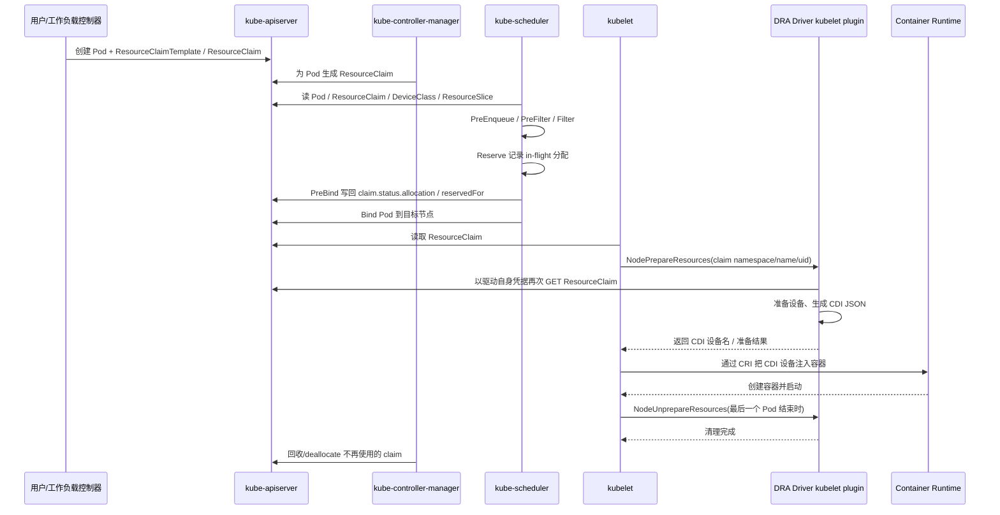

# Kubernetes 1.34 DRA 正式 GA 分析报告

## 执行摘要

Kubernetes 在 **v1.34** 将 **Dynamic Resource Allocation**（DRA，动态资源分配）提升为 **stable/GA 且默认启用**。DRA 的核心目标，不是替代存储卷管理，而是为 **GPU、FPGA、网络设备、可编程加速器等“设备型资源”** 提供一种比传统 extended resources 更丰富的声明、选择、调度、绑定与节点侧准备机制。它引入了 `DeviceClass`、`ResourceClaim`、`ResourceClaimTemplate`、`ResourceSlice` 等内建 API，并把调度前的设备选择与调度后的节点准备拆成清晰的控制面与节点面流程。citeturn13view1turn15view0turn7view0turn7view2turn8view1

最重要的判断是：**DRA 不是 PV/PVC/StorageClass/VolumeSnapshot 的新名字，也不是 CSI 存储驱动的升级版**。PV/PVC/StorageClass/VolumeSnapshot 解决的是**持久化存储与数据生命周期**问题；DRA 解决的是**设备能力发现、约束表达、调度置放和节点注入**问题。两者可以并存，但语义、API 和实现路径不同。Kubernetes 官方也明确将 DRA kubelet 插件描述为“**受 CSI 启发，但替换了 volume 为 resource 并移除了存储特有部分**”的独立接口；因此，**DRA 本身没有“最低 CSI 规范版本”前提**。citeturn38view2turn38view0turn38view1turn23view3

对实际落地而言，v1.34 的 GA 只覆盖 **DRA 核心能力**。与 DRA 相关的若干增强仍然分属 **beta 或 alpha**，例如 `DRAAdminAccess`（v1.34 beta，默认启用）、`DRAPrioritizedList`（v1.34 beta，默认启用）、`DRAConsumableCapacity`、`DRAExtendedResource`、`DRADeviceBindingConditions`（均为 v1.34 alpha，默认关闭）。这意味着：**现在可以稳定地用 DRA 做设备声明与调度，但诸如设备共享、条件化绑定、扩展资源兼容迁移等能力，仍需要显式评估特性门控和版本风险**。citeturn14view0turn14view1turn13view1turn13view6

对用户列举的主流 **存储类 CSI 驱动**（AWS EBS、GCE PD、Azure Disk、Ceph、Longhorn、OpenEBS），本报告的结论是：**它们在公开顶层文档中都仍然定位为 PV/PVC/StorageClass 路径上的“存储 CSI 驱动”，而不是 `resource.k8s.io` DRA 驱动**。因此，如果你的目标是持久化块存储或文件存储，**继续使用 CSI 存储栈**；如果你的目标是 GPU、SmartNIC、网络设备或其他设备型资源，才应考虑 DRA。对“从传统静态 PV/现有 CSI 工作负载迁移到 DRA”，更准确的表述通常是：**保留 CSI 处理存储，把设备类需求拆到 DRA**，而不是把存储卷工作负载整体“迁移成 DRA”。citeturn33view2turn34view1turn32view1turn34view2turn34view4turn34view5turn13view1turn23view3

## 背景与定义

DRA 的官方定义是：它允许你在 Kubernetes 中**请求并在 Pod 之间共享资源**，这些资源“通常是附着式设备”，例如硬件加速器。集群管理员或设备驱动定义可被工作负载申请的 `DeviceClass`，Kubernetes 再基于驱动发布的 `ResourceSlice` 信息，把匹配设备分配给 `ResourceClaim`，并把 Pod 放到**能够访问这些设备的节点**上。`ResourceClaim` 负责表达“我要什么”，`DeviceClass` 负责表达“这一类设备长什么样、附带怎样的配置”，`ResourceSlice` 负责发布“当前集群里实际有哪些设备与属性/容量”，`ResourceClaimTemplate` 则负责“给每个 Pod 自动生成一份 claim”。citeturn15view0turn7view0turn7view1turn7view2turn8view1

把 DRA 放到现有 Kubernetes 资源模型中看，会更清楚它与存储栈的边界。`PersistentVolume` / `PersistentVolumeClaim` 代表的是**持久化存储对象及其绑定关系**；`StorageClass` 代表的是**存储策略**；`VolumeSnapshot` 代表的是**卷在某个时间点的数据副本**；而 DRA 代表的是**设备申请与设备放置**。一个直观对应关系是：`StorageClass` 之于存储，近似对应 `DeviceClass` 之于设备；但 `VolumeSnapshot` 在 DRA 里没有等价物，因为 DRA 并不管理“卷数据内容”的时间点复制。citeturn38view2turn38view0turn38view1turn7view2

在调度时机上，存储与 DRA 也只是“思路相似”，并非同一机制。存储侧的 `StorageClass.volumeBindingMode: WaitForFirstConsumer` 会把卷绑定/供给延后到 Pod 首次参与调度时，以便满足拓扑约束；DRA 的核心设计则是**在 Pod 真的需要某个 claim 时才进行设备分配**，并由 scheduler 的 PreFilter / Filter / Reserve / PreBind 链路完成设备可行性检查与分配写回。换言之，存储的“延迟绑定”是 `StorageClass` 级策略；DRA 的“延迟分配”则是其核心调度模型本身。citeturn39view0turn22view0turn22view1turn22view4

在拓扑表达上，存储常见的是 `allowedTopologies`、PV `nodeAffinity` 以及 CSI 驱动的拓扑键；DRA 则把“设备哪些节点可访问”放进 `ResourceSlice` / `ResourceClaim.status.allocation.nodeSelector`：`ResourceSlice` 可以通过 `nodeName`、`nodeSelector`、`allNodes`、`perDeviceNodeSelection` 描述可见域；一旦设备必须绑定到特定节点，调度器会把对应 `nodeSelector` 写进 claim 的 allocation 结果。两者都涉及“资源在哪些节点可用”，但对象和算法路径不同。citeturn8view2turn7view0turn39view0turn39view2

DRA 与 CSI 的关系尤其容易混淆。官方 KEP 已明确：**DRA kubelet 插件接口受 CSI 启发，但它不是 CSI**。kubelet 通过**插件注册机制**发现 DRA 插件，插件类型是新的 `ResourcePlugin`；插件在其 Unix Domain Socket 上提供 `k8s.io/kubelet/pkg/apis/dra` gRPC 接口，kubelet 支持 `v1beta1` 和 `v1` 两个 DRA gRPC 版本。也正因为如此，**DRA 核心没有“需要 CSI 1.x.y”的规范前提**；CSI 版本是存储驱动自己的兼容矩阵，不是 DRA 的前置依赖。citeturn23view3turn23view1

## 设计与实现细节

从 KEP 演进看，理解 DRA 的最佳入口不是只看一个 KEP，而是看一个“主干 + 扩展”的集合。**KEP-4381**（DRA Structured Parameters）现在定义了 **DRA 的基础功能**，并明确写道：它最初是对“classic DRA”的扩展，但现在角色反转，**4381 变成基础，3063 变成可选扩展**。**KEP-3063** 是原始 DRA 设计，重要价值在于保留了 kubelet/driver RPC、调度器扩展点、控制器职责、故障模型等历史与兼容设计语义。v1.34 相关增强里，**KEP-4816** 使 `DRAPrioritizedList` 升到 beta；**KEP-5004** 讨论基于 DRA 的 extended resource 兼容迁移；**KEP-5075** 引入 consumable capacity；观测相关还有 **KEP-4817**（`ResourceClaim.status.devices`）与 **KEP-4680**（把设备健康暴露到 PodStatus）。需要强调的是：这些 KEP **并不都在 v1.34 达到 GA**，不能与“DRA core 已 GA”混为一谈。citeturn19view1turn19view6turn20view2turn19view11turn20view3turn40view0turn20view0

API 层面，v1.34 的核心 DRA 使用 **`resource.k8s.io/v1` 内建 API**，不是 CRD。`ResourceClaim` 表达“集群里需要什么资源以及如何配置”，其 `spec` 不可变，`status` 记录是否已分配、分到了什么；`ResourceClaimTemplate` 负责生成 ResourceClaim；`DeviceClass` 是集群级资源，包含 selector 与 vendor/admin 预设配置；`ResourceSlice` 由驱动发布，描述一个资源池里当前有哪些设备、它们的属性与容量、这些设备对哪些节点可见。citeturn7view0turn7view1turn7view2turn8view2

字段上，最关键的是四类。第一，`ResourceClaim.spec.devices` 中的 request / selector / constraint，用来表达设备筛选条件，支持 CEL，并可引用 device attributes / capacities。第二，`ResourceClaim.status.allocation`，这是**调度器把已选择设备写回 claim 的地方**，其中 `nodeSelector` 用来描述分到的设备在哪些节点可访问。第三，`ResourceClaim.status.devices`，这是**驱动可选上报的“分配后设备状态/元数据”**通道，在 v1.34 仍属于 `DRAResourceClaimDeviceStatus` beta 的范围。第四，`ResourceSlice.spec.pool.generation` 与“池包含多少 slices”的元数据，它们决定了消费者如何判断自己看到的是不是一个**完整且最新的池视图**。citeturn5search0turn7view0turn8view2turn40view0turn40view2

调度器实现并非“拿到 Pod 就直接改 API”。KEP-4381 明确写到：调度器插件会实现 `EventsToRegister`、`PreEnqueue`、`PreFilter`、`Filter`、`Reserve`、`PreBind`、`Unreserve` 等扩展点；在正常路径下，**主调度循环尽量不做 API 写操作**，而是在 `PreBind` 的独立 goroutine 中把 allocation / reservation 写回集群。这个设计既降低主调度路径的阻塞，也让并发竞争控制更可预测。citeturn22view0turn21view10turn21view9

下图给出 v1.34 核心 DRA 的典型交互路径。需要特别注意：图中的节点侧插件是 **DRA kubelet plugin**，不是 CSI 存储插件；CSI 存储卷挂载流程仍然存在，但不在 DRA 的核心 fast path 上。citeturn23view3turn22view2turn23view0



性能与延迟路径，是 v1.34 落地时最该认真评估的部分。`PreFilter` 会把 `DeviceClass` 的过滤条件、`ResourceSlice` 的设备池信息、`ResourceClaim.status` 的已分配信息以及 in-flight allocations 变成 `Filter` 可高效使用的内部格式。`Filter` 的耗时则取决于 **claim 数、每个 claim 的 request 数、ResourceSlice 中设备数、CEL 表达式复杂度、匹配属性与容量检查组合数**。KEP 直接指出，这一步“可能变得耗时”，因此调度器支持对单个节点的整次 `Filter` 设置超时；默认值是 **10 秒**，而官方 `scheduler_perf` 测试观测到的 `Filter` 用时大约是**稳态 10ms**、**集群填满场景最高约 200ms**。在实践中，这意味着真正的风险通常不是“默认值太小”，而是**表达式或组合搜索空间异常膨胀**。citeturn22view1turn19view2turn19view3

缓存与一致性方面，有四个非常关键的点。其一，**`ResourceSlice` 池更新必须按 generation 整体推进**；消费者只应使用最高 generation，并在必要时等待自己看到完整池视图。其二，kubelet 在启动时会先删除属于本节点的 `ResourceSlices`，避免节点重启后旧 slice 仍被调度器当真，从而把 Pod 调度到一个实际尚未恢复 DRA 驱动的节点。其三，kubelet 并不把 allocation result 通过 RPC 直接传给节点插件，而是只传 claim 的 namespace/name/uid，由插件用自己的凭据再去 GET claim；这样避免跨版本转换问题，但在“一条 claim 对应一个插件”的常见场景里，会导致**每个 claim 至少额外一次 GET**。其四，为了防止死锁和并发冲突，调度器在 `Reserve` 到 `PreBind/Unreserve` 之间维护 in-flight 状态。citeturn8view1turn23view1turn22view3turn21view9turn22view0

控制器行为上，`kube-controller-manager` 中的 ResourceClaim controller 一方面负责**为 `ResourceClaimTemplate` 创建 claim**，另一方面也负责在 claim 不再使用时做**回收/去分配**，并暴露 `resourceclaim_controller_resource_claims`、`resourceclaim_controller_allocated_resource_claims` 等指标。与存储卷管理器相比，KEP 认为 DRA 的节点侧开销理论上更低：多数场景只是创建或删除小尺寸的 **CDI JSON 文件**，而非卷 attach / publish / mount 的组合操作。citeturn7view1turn22view4

## 兼容性与依赖

在 **Kubernetes 1.34** 中，DRA 核心前提条件很明确：集群服务端需要是 **v1.34**，DRA 处于 **stable** 且**默认启用**。如果 `kubectl get deviceclasses` 返回 `the server doesn't have a resource type "deviceclasses"`，官方排障建议首先检查 kube-apiserver 是否正确暴露了 API；如果 Pod 上的 `.spec.resourceClaims` 被删掉，或者调度没有考虑 claim，则要检查 **kube-apiserver、kube-controller-manager、kube-scheduler、kubelet** 上是否把 `DynamicResourceAllocation` gate 关掉了。citeturn15view0turn14view0

核心 DRA 默认打开，但 v1.34 有一组相关的可选 gate 需要分清。`DynamicResourceAllocation` 在 feature-gates 表中显示为 **GA 1.34+，默认 true**。同一表中，`DRAAdminAccess` 是 **beta 1.34+，默认 true**；`DRAPrioritizedList` 是 **beta 1.34+，默认 true**；`DRAResourceClaimDeviceStatus` 从 1.33 起 beta，v1.34 仍默认 true。另一方面，`DRAConsumableCapacity`、`DRADeviceBindingConditions`、`DRAExtendedResource`、`DRASchedulerFilterTimeout` 在 **v1.34 都是 alpha 且默认 false**，`DRADeviceTaints`、`DRAPartitionableDevices` 也仍处在前置阶段。换言之，**1.34 的“DRA 已 GA”不等于“所有 DRA 生态增强都成熟”。** citeturn14view0turn14view1turn13view1turn13view6

如果你需要兼容老一点的 DRA 驱动或老工作负载，官方 v1.34 文档给了一个非常关键的说明：**只有在确实需要时**，才去打开旧 API 版本 `resource.k8s.io/v1beta1` 与 `resource.k8s.io/v1beta2`。打开方式不是额外 CRD，而是 kube-apiserver 的 `--runtime-config=api/<version>` 机制。也就是说，v1.34 的核心对象已经是 **`resource.k8s.io/v1` built-in API**；老版本 API 只是兼容开关。citeturn15view0turn18view0turn18view1

关于“**对 CSI 规范版本的最低要求**”，本报告给出的严格答案是：**对 DRA 核心本身，不适用**。因为 kubelet 与节点驱动之间走的是独立的 DRA gRPC 接口，KEP 明确写到该接口只是“受 CSI 启发”，并且 kubelet 支持的是 **DRA gRPC `v1beta1` 与 `v1`**。CSI 规范版本只对存储类 CSI 驱动自身成立，不是启用 DRA Core 的前提。citeturn23view3turn23view1

下表专门回答你提出的“主要 CSI 驱动是否已支持或计划支持 DRA”这一点。**表中的“未声明”是基于本报告检索到的官方顶层文档/README 范围，不等于绝对没有私下路线图；若官方未指定，本报告按“未指定”处理。** citeturn33view0turn34view1turn32view1turn34view2turn34view4turn34view5turn13view1

| 驱动 | 官方公开定位 | 在 DRA 语境下的支持状态 | 实现差异与已知限制 | 参考 |
|---|---|---|---|---|
| AWS EBS CSI Driver | Amazon EBS 的 **CSI 存储驱动**；官方 README 标明实现 **CSI spec v1.9.0**，提供 PV/PVC、快照、扩容、VolumeAttributesClass 等能力 | **公开顶层文档未声明 `resource.k8s.io` DRA 驱动支持或路线图** | 面向 **EBS volumes/snapshots**，不是 DRA `DeviceClass/ResourceClaim/ResourceSlice` 模型；不能直接充当 DRA 设备驱动 | citeturn33view0turn33view2turn23view3turn13view1 |
| GCE PD CSI Driver | GCE Persistent Disk 的 **CSI 存储驱动**；README 标明兼容 **CSI v1.2/v1.1/v1.0** | **公开顶层文档未声明 DRA 支持/计划** | 处理 PVC/PV 与磁盘生命周期，支持拓扑；不等于 DRA 设备驱动 | citeturn31view0turn34view1turn23view3turn13view1 |
| Azure Disk CSI Driver | Azure Disk 的 **CSI 存储驱动**；README 明示 `disk.csi.azure.com`，面向卷访问与拓扑/快照/扩容 | **公开顶层文档未声明 DRA 支持/计划** | 仍是卷驱动；某些部署还依赖 cloud provider config / ConfigMap，这属于驱动安装需求，不是 DRA Core 需求 | citeturn32view1turn23view3turn13view1 |
| Ceph CSI | Ceph 的 **CSI 驱动套件**（RBD、CephFS 与 sidecars）；README 提供 CSI/Kubernetes 兼容矩阵 | **公开顶层文档未声明 DRA 支持/计划** | 重点是 Ceph 卷动态供给、挂载与 Kubernetes sidecars；不是 DRA 设备池发布模型 | citeturn34view2turn34view3turn23view3turn13view1 |
| Longhorn | Kubernetes 分布式块存储；README 说明 `longhorn-manager` **包含 CSI driver** | **公开顶层文档未声明 DRA 支持/计划** | 提供持久化块存储、快照、备份；不替代 DRA 的设备声明/调度链路 | citeturn32view3turn34view4turn23view3turn13view1 |
| OpenEBS | 容器原生存储平台；README 表示**多数存储引擎 CSI compliant**，也有“不使用 CSI driver”的 HostPath 模式 | **公开顶层文档未声明 DRA 支持/计划** | 关注存储引擎与持久卷；即便部分引擎 CSI 化，也不代表实现了 DRA `resource.k8s.io` 驱动 | citeturn32view4turn32view5turn34view5turn23view3turn13view1 |

作为对照，真正的 DRA 驱动会像 `kubernetes-sigs/dra-driver-nvidia-gpu` 那样在项目说明中**明确自称 DRA Driver**，并围绕 DRA kubelet plugin / `resource.k8s.io` API 工作，而不是围绕 PV/PVC/StorageClass 工作。这个对照很重要，因为它解释了为什么“存储 CSI 驱动支持 DRA”这个问题在很多场景里本身就是**范畴不匹配**。citeturn10search2turn27search12

## 配置、示例与迁移

先给结论：**DRA Core 最小闭环不需要 `StorageClass`、`PVC`、`CRD`**。在 v1.34 中，`DeviceClass`、`ResourceClaim`、`ResourceClaimTemplate`、`ResourceSlice` 都是内建 API；只要集群已经安装了兼容的 DRA 驱动，驱动会自动发布 `ResourceSlice`，你通常只需要创建 `DeviceClass`、`ResourceClaim` 或 `ResourceClaimTemplate`，再在 Pod 中引用 claim。`StorageClass/PVC` 则属于存储栈对照路径，不是 DRA 必需。citeturn7view0turn7view1turn7view2turn8view2turn15view0

下面是一个**已安装兼容 DRA 驱动前提下**的最小示例。它直接基于官方 v1.34 示例对象关系：`DeviceClass` 负责筛选驱动，`ResourceClaimTemplate` 负责按 Pod 生成 claim，`Pod.spec.resourceClaims` 暴露 claim，容器通过 `resources.claims` 真正请求该 claim。citeturn15view1turn42view0turn42view1

```yaml
apiVersion: resource.k8s.io/v1
kind: DeviceClass
metadata:
  name: example-device-class
spec:
  selectors:
    - cel:
        expression: 'device.driver == "driver.example.com"'
---
apiVersion: resource.k8s.io/v1
kind: ResourceClaimTemplate
metadata:
  name: example-resource-claim-template
spec:
  spec:
    devices:
      requests:
        - name: gpu-claim
          exactly:
            deviceClassName: example-device-class
            selectors:
              - cel:
                  expression: |
                    device.attributes["driver.example.com"].type == "gpu" &&
                    device.capacity["driver.example.com"].memory == quantity("64Gi")
---
apiVersion: v1
kind: Pod
metadata:
  name: example-dra-pod
spec:
  restartPolicy: Never
  resourceClaims:
    - name: gpu
      resourceClaimTemplateName: example-resource-claim-template
  containers:
    - name: app
      image: ubuntu:24.04
      command: ["sleep", "3600"]
      resources:
        claims:
          - name: gpu
```

如果你只是想做**最小检查**，官方建议首先用 `kubectl get deviceclasses` 验证 API 是否可见，再检查 `kubectl get resourceslices` 看驱动是否已发布设备池。若你要兼容旧 DRA 驱动或旧工作负载，才需要在 apiserver 上显式启用旧 API 组；核心场景下 **不需要额外 FeatureGate/ConfigMap/CRD**。citeturn15view0turn18view0

```bash
# 仅在“确实需要兼容旧 DRA API”时使用
kube-apiserver \
  --runtime-config=resource.k8s.io/v1beta1=true,resource.k8s.io/v1beta2=true
```

如果你还想开启 v1.34 中**尚未 GA 的 DRA 增强能力**，则要显式评估并开启对应 gate，例如 `DRAConsumableCapacity`、`DRAExtendedResource`、`DRADeviceBindingConditions`。这些 gate 在 v1.34 都不是默认启用，因此**不建议把它们放进生产最小基线**。citeturn14view1turn13view6

为了满足你希望“包含 StorageClass、Pod、PVC”的要求，下面给一个**传统 CSI 存储路径的对照样例**。它**不是 DRA 配置**，只是帮助你把两条模型分开：存储仍用 `StorageClass + PVC + Pod`，设备则用 `DeviceClass + ResourceClaim + Pod`。对照存储侧，`WaitForFirstConsumer` 是“延迟卷绑定/供给”的典型做法。citeturn38view0turn39view0turn38view2

```yaml
apiVersion: storage.k8s.io/v1
kind: StorageClass
metadata:
  name: example-csi-sc
provisioner: example.com/example
volumeBindingMode: WaitForFirstConsumer
---
apiVersion: v1
kind: PersistentVolumeClaim
metadata:
  name: example-pvc
spec:
  accessModes: ["ReadWriteOnce"]
  storageClassName: example-csi-sc
  resources:
    requests:
      storage: 10Gi
---
apiVersion: v1
kind: Pod
metadata:
  name: example-csi-pod
spec:
  containers:
    - name: app
      image: nginx
      volumeMounts:
        - name: data
          mountPath: /data
  volumes:
    - name: data
      persistentVolumeClaim:
        claimName: example-pvc
```

场景上，可把 v1.34 DRA 的使用方式概括成三类。**按需分配**：手工 `ResourceClaim`，适合多个 Pod 或多个容器共享同一设备，或希望 claim 生命周期独立于某个 Pod。**延迟分配**：这是 DRA 本身的基础行为，claim 的 `status.allocation` 会在“被 Pod 需要”时出现，而不是创建 claim 当下就一定分配。**动态扩容**：如果你说的是“随着副本数增长而按需拿更多设备”，DRA 的标准做法不是改一个 claim 的尺寸，而是用 `ResourceClaimTemplate` 为每个 Pod 自动生成独立 claim；如果你说的是“同一设备被多个 claim 细粒度共享”，那更接近 v1.34 的 **`DRAConsumableCapacity` alpha**，并不属于已经 GA 的核心基线。citeturn42view1turn22view4turn13view0turn20view3

关于“从传统静态 PV / 现有 CSI 工作负载迁移到 DRA”，必须严谨地说：**如果这些工作负载真正使用的是持久化块存储/文件存储，就不应把它们整体迁移成 DRA**。因为 DRA 不负责卷内容复制、快照、恢复、扩容、回收策略等数据面语义。更合理的做法通常是：**保留存储 CSI 路径不变，把原先散落在 sidecar、daemon、annotation、device plugin 或定制脚本中的“设备申请需求”抽离到 DRA**。如果你的现状是 extended resources / device plugin，则 **KEP-5004** 的方向就是帮助应用和集群管理员**逐步迁移到 DRA**，甚至允许某些节点继续沿用旧路径、某些节点使用 DRA。citeturn38view1turn38view2turn19view13turn13view1

下面给两个可执行的操作清单。

**操作清单一：对现有有状态工作负载做“存储不动、设备迁到 DRA”的灰度试点。**

```bash
# 1) 基线确认
kubectl version
kubectl get deviceclasses
kubectl get resourceslices

# 2) 先创建或确认 DeviceClass
kubectl apply -f deviceclass.yaml

# 3) 创建每 Pod 独立 claim 的模板
kubectl apply -f resourceclaimtemplate.yaml

# 4) 导出当前 Deployment，给 Pod 增加 resourceClaims / resources.claims
kubectl get deploy myapp -n prod -o yaml > myapp-dra.yaml
# 手工编辑 myapp-dra.yaml 后：
kubectl apply -f myapp-dra.yaml

# 5) 观察 claim 与 Pod
kubectl get pods -n prod
kubectl get resourceclaims -n prod
kubectl describe pod <pod-name> -n prod
kubectl describe resourceclaim <claim-name> -n prod

# 6) 回滚
kubectl rollout undo deploy/myapp -n prod
# 等相关 Pod/claim 不再使用设备后，再删除模板
kubectl delete resourceclaimtemplate example-resource-claim-template -n prod
```

这条路径的核心思想，是把**PVC / StorageClass 保持原样**，只把“我要哪类设备”转到 DRA。回滚时不要急着卸载驱动，也不要在 claim 仍在节点上 prepared 的情况下删除驱动；否则最后的 `NodeUnprepareResources` 无法完成，Pod 可能卡在终止过程。citeturn41view3turn23view0turn23view1

**操作清单二：按官方 v1.34 示例做验证性测试。**

```bash
# 1) 检查 DRA API
kubectl get deviceclasses
kubectl get resourceslices

# 2) 应用官方示例对象
kubectl apply -f https://k8s.io/examples/dra/deviceclass.yaml
kubectl apply -f https://k8s.io/examples/dra/resourceclaimtemplate.yaml
kubectl apply -f https://k8s.io/examples/dra/resourceclaim.yaml
kubectl apply -f https://k8s.io/examples/dra/dra-example-job.yaml

# 3) 观察运行状态
kubectl get jobs,pods
kubectl get resourceclaims
kubectl describe job example-dra-job
kubectl describe pod <pod-name>
kubectl describe resourceclaim <claim-name>

# 4) 清理
kubectl delete -f https://k8s.io/examples/dra/dra-example-job.yaml
kubectl delete -f https://k8s.io/examples/dra/resourceclaimtemplate.yaml
kubectl delete -f https://k8s.io/examples/dra/resourceclaim.yaml
kubectl delete -f https://k8s.io/examples/dra/deviceclass.yaml
```

这组对象和字段都直接来自官方 v1.34 示例文档，是验证控制面 API、调度链路和 claim–Pod 引用关系最省事的办法。citeturn15view1turn42view1

## 运维、安全与故障排查

在排障上，最常见的第一类问题是**控制面未正确暴露或处理 DRA API**。如果 `kubectl get deviceclasses` 报 `the server doesn't have a resource type "deviceclasses"`，优先检查 kube-apiserver 暴露 API 是否正确；如果 Pod 的 `.spec.resourceClaims` 被移除，或者调度没有考虑 claim，则检查四个核心组件是否把 `DynamicResourceAllocation` gate 关掉了。第二类是**对象级 schema/兼容问题**，例如官方文档直接提到：当创建 Pod 时报 `must specify one of: resourceClaimName, resourceClaimTemplateName`，且你的 YAML 看上去没有问题时，一个已知原因是**集群里有基于 Kubernetes <1.32 API 编译的 mutating Pod webhook**，它会错误处理新字段。citeturn15view0turn42view1

第三类是**节点侧准备失败**。KEP 明确指出：如果 DRA kubelet plugin 没在目标节点运行、或 `NodePrepareResources` 调用失败，表现就是 Pod **已被调度但无法启动**；kubelet 会记录日志并发事件。对应地，如果 `NodeUnprepareResources` 失败，Pod 可能无法进入终态或无法彻底删除，`dra_resource_claims_in_use` 会保持非零，而 `dra_operations_seconds{method_name="NodeUnprepareResources"}` 的错误计数会上升。实际排障时，建议从**Job/Deployment → Pod → ResourceClaim** 逐层 `kubectl describe`，再看 kubelet 和驱动 DaemonSet 日志。citeturn21view8turn23view0turn42view1

日志定位上，建议把问题拆成三面。**控制面**看 kube-scheduler 的 dynamicresources 插件链路和 kube-controller-manager 的 resourceclaim controller。**节点面**看 kubelet 的 DRA manager / NodePrepare / NodeUnprepare 调用，以及设备未准备好的事件。**驱动面**看驱动 DaemonSet 是否成功注册 kubelet plugin、是否成功发布了 `ResourceSlice`、是否具备 liveness/healthcheck。官方“集群管理员最佳实践”还专门建议：驱动若支持 gRPC healthcheck，就把它直接接进 liveness probe；排空节点时，**尽量最后再驱逐 DRA driver**，避免清理过程失去执行者。citeturn41view3turn15view0turn21view8

监控指标方面，至少应覆盖三套。第一，**kube-controller-manager**：`resourceclaim_controller_create_total`、`resourceclaim_controller_create_failures_total`、`resourceclaim_controller_resource_claims`、`resourceclaim_controller_allocated_resource_claims`、`workqueue{name="resource_claim"}` 可以观察 claim 创建/回收与 controller backlog。第二，**kubelet**：`dra_operations_seconds` 监控与 DRA 插件的 RPC 耗时和 gRPC 状态码；`dra_resource_claims_in_use` 监控节点上还有多少 claim 处于 prepared/in-use。第三，**scheduler**：重点盯 `scheduler_framework_extension_point_duration_seconds` 中 **Filter** 的延迟分位，因为 DRA 的主要调度代价在这里。若启用了 `DRAResourceClaimDeviceStatus` 并由驱动上报 `status.devices`，还可辅看 apiserver 的 `apiserver_request_total{group="resource.k8s.io",resource="resourceclaims",subresource="status"}`。citeturn22view4turn23view1turn22view1turn40view2

性能基准测试，建议不要只做“能跑通”。一个可操作的方法是：先在不开 DRA 的基线工作负载上采样控制面 CPU/QPS 与 scheduler Filter 延迟；再逐步增加 `ResourceClaim` 数、`ResourceSlice` 中设备数、每个 claim 的 request 数和 CEL 复杂度，观察 Filter 用时是否接近或超过你设置的门限。官方 KEP 已经给出了两个很有价值的锚点：在 `scheduler_perf` 中，DRA Filter **稳态约 10ms**、**填满集群约 200ms**，而默认超时 **10 秒** 留了很大余量；因此真正应避免的，通常是“过度复杂或高组合度”的筛选表达式，而不是盲目调小默认超时。citeturn22view1turn19view3

安全与权限上，v1.34 阶段首先要把握三条边界。第一，**kubelet 只应对 `ResourceClaim` 保持只读**；KEP 明确说明这样是为了防止被攻陷的 kubelet 伪造调度相关状态，造成拒绝服务或错误放置。第二，**驱动 DaemonSet 的 ServiceAccount 权限必须最小化**；KEP 的安全章节列出了驱动至少需要的权限集，包括对 `ResourceSlice` 的 get/list/watch/create/update/patch/delete，以及对 `ResourceClaim`、`Node` 的读取。第三，`adminAccess` 是特权模式，v1.34 文档明确强调它会授予对在用设备的更高权限，且只能在带有 `resource.kubernetes.io/admin-access: "true"` 标签的 namespace 中被授权使用，不应开放给普通多租户用户。citeturn21view4turn19view5turn13view1

如果你在规划更长期的安全加固，还应关注 **v1.36** 引入的 DRA synthetic subresources 与 node-aware verbs。虽然这不是 v1.34 的基线要求，但它提供了更细粒度的最小权限模型：`resourceclaims/binding` 用于 scheduler / allocation controller 更新 `status.allocation` 与 `reservedFor`，`resourceclaims/driver` 用于驱动更新 `status.devices`，并支持 `associated-node:update` 这类节点感知动词。这是后续版本中值得优先采用的加固方向。citeturn41view0turn41view1

## 最佳实践与建议

对于**小型集群**，建议只采用 **v1.34 GA 的核心 DRA 能力**，不要把 `DRAConsumableCapacity`、`DRAExtendedResource`、`DRADeviceBindingConditions` 这类 alpha gate 一起打开。对象设计上，让 `DeviceClass` 尽量少而清晰，CEL 表达式尽量简单，可显著降低调度器 `Filter` 路径的复杂度。驱动层面，优先选择带 liveness probe、最好支持 seamless upgrade 的实现。citeturn14view1turn22view1turn41view3

对于**中型集群**，推荐把 DRA 当成“设备能力目录 + 调度策略层”来治理：先统一 `DeviceClass` 命名与 selector 规范，再统一 `ResourceClaimTemplate` 的生成模式，让扩缩容工作负载通过“**每 Pod 一份 claim**”获得可重复的设备申请行为。运维上，至少把 `scheduler_framework_extension_point_duration_seconds`、`resourceclaim_controller_*`、`dra_operations_seconds` 纳入默认大盘；兼容方面，除非确有老驱动依赖，否则不要额外打开 `resource.k8s.io/v1beta1/v1beta2`。citeturn42view1turn22view1turn22view4turn15view0

对于**大型集群**，DRA 的成本主要体现在：对象数增加、调度器评估更复杂、kube-controller-manager 与 kubelet/driver 之间的 API 往返更多。官方最佳实践已经明确提醒，随着 DRA 使用增多，scheduler 和 controller-manager 的 CPU、内存、API QPS 需求会高于无 DRA 的集群；如果 QPS/Burst 配置过低，调度器可能先找到候选节点，却在后续绑定和状态写回上拖慢整体吞吐。大型集群应优先做三件事：一是控住 claim 与设备组合复杂度；二是监视并必要时调优 scheduler / controller-manager 的 QPS 与 burst；三是要求驱动支持无缝升级，避免节点面短暂停机对准备/清理路径造成堆积。citeturn41view3turn22view1turn23view1

对于**云原生托管环境**，建议把策略写得更直接一些：**托管云的存储继续用云厂商或社区维护的 CSI 驱动；DRA 仅用于厂商明确支持的设备型资源驱动。** 例如 AWS EBS、GCE PD、Azure Disk 这些官方/半官方驱动都公开定位为 CSI storage drivers；如果你的需求是 persistent disk，就不要期待“升级到 DRA”会带来额外收益。相反，如果你在做 GPU、网络设备、智能网卡、可编程设备的编排，则应优先选用厂商公开声明支持 DRA 的驱动，而不是把存储 CSI 驱动强行套进 DRA 语义。citeturn33view0turn31view0turn32view1turn13view1turn10search2

从**成本与性能权衡**看，DRA 的收益在于更强的表达力：你可以按属性、容量、驱动、匹配属性、多设备关系去声明设备，并把选择、放置、准备拆成更清晰的职责边界；代价则是更多 API 对象、更多控制面计算、更多节点侧驱动守护进程，以及对 CDI / 驱动生命周期管理的额外要求。对于只需要 PVC、快照、扩容、克隆和卷拓扑的系统，DRA 不会比 CSI 存储栈更简单；对于需要**精细设备选择与共享策略**的系统，DRA 的价值就非常明确。citeturn22view1turn22view4turn20view3turn38view1

最后给出本报告的**局限说明**。第一，“主流存储 CSI 驱动是否计划支持 DRA”这一问题，官方公开顶层文档大多**未指定**，因此本报告只能给出“未在公开文档中声明”的结论，而不会臆断为“永远不会支持”。第二，v1.36 的 DRA 安全硬化机制非常值得参考，但它属于**后续版本增强**，不应被误读为 v1.34 的硬性前提。第三，若你的真实目标是设备插件/extended resources 迁移，而不是存储卷迁移，那么应该把 KEP-5004、厂商 DRA driver 文档与实际硬件平台能力作为下一步决策依据。citeturn41view0turn41view1turn19view13

## 关键参考链接

以下链接按“**官方优先**、**KEP 次之**、**驱动仓库作为补充**”排序列出；点击引用即可打开对应原文。

- Kubernetes v1.34 DRA 概念页：DRA 在 v1.34 为 **stable/默认开启**，并给出 AdminAccess、ExtendedResource、ConsumableCapacity 等特性状态。citeturn13view1turn13view0
- Kubernetes v1.34 集群配置页：如何验证 DRA 是否启用、何时需要打开 legacy API groups。citeturn15view0turn15view1
- Kubernetes v1.34 工作负载使用页：官方 `DeviceClass`、`ResourceClaimTemplate`、`ResourceClaim`、`Job` 示例。citeturn42view0turn42view1
- Feature Gates 参考：`DynamicResourceAllocation` 在 1.34 GA，相关 beta/alpha gates 状态总表。citeturn14view0turn14view1
- API 参考：`ResourceClaim`、`ResourceClaimTemplate`、`DeviceClass`、`ResourceSlice`。citeturn7view0turn7view1turn7view2turn8view2
- KEP-4381：当前 DRA 基础功能主干；含 scheduler plugin、节点插件接口、性能与监控、缓存一致性设计。citeturn19view1turn22view0turn22view1turn23view3turn22view4
- KEP-3063：DRA 原始设计与历史兼容语义；对 version skew、故障模型、可选扩展仍有参考价值。citeturn19view8turn19view9
- KEP-4816：`DRAPrioritizedList`，v1.34 beta。citeturn20view2
- KEP-5004：DRA Extended Resource 迁移方向，强调可渐进迁移、可与旧路径并存。citeturn19view11turn19view13
- KEP-5075：Consumable Capacity，v1.34 alpha，设备共享与容量消费模型。citeturn20view3
- KEP-4817 与 KEP-4680：设备状态与健康观测方向。citeturn40view0turn40view2turn20view0
- 安全与运维最佳实践：DRA 集群管理员最佳实践、DRA Hardening Guide、后续版本的最小权限 RBAC 模型。citeturn41view3turn41view0turn41view1
- 存储栈对照文档：PersistentVolume、StorageClass、VolumeSnapshot。citeturn38view2turn38view0turn38view1turn39view0
- 主要存储 CSI 驱动仓库：AWS EBS、GCE PD、Azure Disk、Ceph CSI、Longhorn、OpenEBS。citeturn33view0turn31view0turn32view1turn34view2turn32view3turn32view5