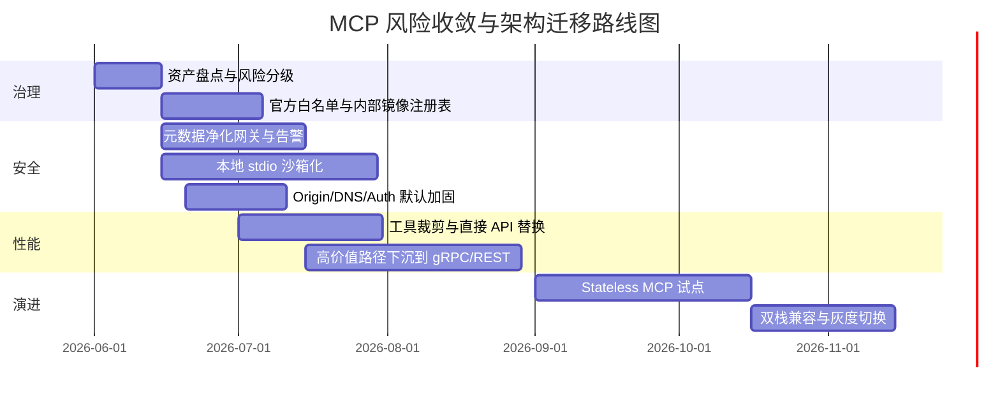

# MCP 的限制和先天性不足研究报告

## 执行摘要

在未额外限定上下文时，当前技术语境中最主流、且与“官方规范、RFC、实现代码库、厂商页面、漏洞、安全报告、性能基准”这些线索最匹配的 **MCP**，是 **Model Context Protocol，模型上下文协议**。国内厂商与技术媒体的中文材料通常也按此含义使用该缩写；其源头则是 Anthropic 于 2024 年底发布的开放协议。综合官方规范、SDK/示例仓库、厂商接入文档、NVD/GitHub Advisory、NSA 报告、学术预印本与公开基准后，可以得出一个明确结论：**MCP 的最大问题并不只是“实现还不成熟”，而是它把关键的安全、权限、可信元数据、性能治理、部署边界等责任系统性地外包给宿主应用、SDK、服务器实现者和运维者**。这使它非常适合“快速接通工具生态”，却**天然不适合被直接当作安全边界、强约束控制平面或高性能数据平面**。其先天性不足集中体现为：依赖自然语言工具描述进入模型上下文、初期偏本地/stdio/状态化设计、授权模型复杂且可选、工具扩张导致上下文/令牌成本上升、以及生态增速快于治理与审计能力。对于企业或高风险场景，更合理的定位应是：**把 MCP 当成“集成外壳与发现层”，而不是“最终执行与控制层”**；高价值路径应逐步下沉为更强类型、更强鉴权、可观测性更成熟的 OpenAPI/REST 或 gRPC 服务。citeturn25search0turn25search2turn2search1turn1search9turn3view0turn26view0turn18view2

## 研究对象界定与方法

本文将 **MCP** 明确界定为 **Model Context Protocol**。原因有三点：一是中文官方/半官方资料（如阿里云、Red Hat 中文页面）均直接将 MCP 解释为“模型上下文协议”；二是 Anthropic 官方公告与 MCP 项目主页把它定义为连接 AI 应用与外部工具/数据源的开放标准；三是用户要求审阅“官方规范、RFC、实现代码库、漏洞数据库、主要厂商接入页面”，这些都与 Model Context Protocol 完全吻合。由于 MCP 首次公开发布于 2024 年 11 月，因此“近 10 年优先”的时间窗在本议题上实际上主要落在 **2024–2026**。citeturn25search0turn25search2turn2search1turn1search9

本报告采用“**官方规范与实现优先，漏洞数据库与安全通报次之，学术论文与案例研究补充，厂商工程实践作外部交叉验证**”的方法。中文材料用于术语确认和国内生态视角，但由于真正的一手规范、SEPs、SDK、漏洞修复与治理文档仍以英文为主，因此核心证据主要来自 MCP 官方站点、Anthropic/OpenAI/Google/GitHub 等原始资料，以及 NVD、GitHub Advisory、NSA 与 arXiv。需要说明的是，**目前关于 MCP 的学术研究相当一部分仍是预印本而非正式同行评审论文；性能基准也多为工程社区基准而非标准化行业基准**，这本身就是该生态成熟度尚在形成期的体现。citeturn3view1turn3view2turn24view0turn24view2turn2search1turn28view0turn18view2turn15view0turn15view1turn15view2turn31view0turn23search7

本文主要来源如下。表中只列代表性来源，不是完整清单。  

| 来源类别 | 代表来源 |
|---|---|
| 官方规范与治理 | MCP Specification、Security Best Practices、Versioning、Extensions、Roadmap、SDK Tiering、Registry Moderation Policy。citeturn3view0turn3view1turn3view2turn3view7turn19view0turn3view4turn24view1turn24view0turn24view2 |
| 官方起源与厂商接入 | Anthropic 原始发布与捐赠说明、OpenAI MCP 文档、Google Cloud MCP/gRPC 页面、GitHub MCP 工程博客、阿里云与 Red Hat 中文页面。citeturn2search1turn2search2turn28view0turn18view2turn17search0turn18view3turn25search0turn25search2turn34view0 |
| 实现代码与示例 | 官方 servers 仓库、官方 SDK 页面、SDK tiers、参考实现与 archived servers 说明。citeturn29view0turn23search1turn24view0 |
| 学术与研究 | MCP 安全/维护性研究、跨实体生态安全研究、MCP-Universe、Tool Description Smells、Threat Modeling、MCP Safety Audit。citeturn15view0turn15view1turn15view2turn16view0turn16view1turn16view2turn31view0 |
| 漏洞与安全报告 | NVD、GitHub Advisory、Tenable、Trail of Bits、Invariant、OX Security、NSA。citeturn30search1turn30search2turn11view0turn11view1turn11view2turn11view3turn11view4turn11view5turn11view6turn11view7turn11view8turn11view9turn30search6turn38view1turn38view2turn38view0turn8search2turn8search6turn26view0 |

## 按维度的详细分析

下表给出按维度的系统评估。这里的“严重性”不是对某个单一 CVE 的 CVSS，而是对 **MCP 在真实生产采用中的结构性风险强度** 的判断。  

| 维度 | 主要限制或先天不足 | 严重性 |
|---|---|---|
| 架构设计 | MCP 只标准化“上下文交换”，并不规定 LLM 如何使用这些上下文；官方规范明确承认协议层**无法强制执行**安全原则。工具描述、注释等元数据会先进入模型上下文，再进入审批/执行阶段，因此**即便工具未被调用，也可能先影响模型行为**。citeturn3view6turn3view0turn38view2 | 高 |
| 协议与接口复杂性 | 底层是 JSON-RPC，上层又叠加 stdio、Streamable HTTP、可插拔自定义传输、可选扩展、日期型协议版本、注册表版本、以及 OAuth/OIDC 体系，易形成“看似简单、落地复杂”的双层复杂度。授权在规范中还是**可选**能力；HTTP 场景又要求 OAuth 2.1、PKCE、资源指示符、DCR/CIMD 等机制。citeturn3view1turn20view0turn3view2turn21view0turn19view0 | 高 |
| 可扩展性 | MCP 官方后来明确承认，**早期状态化会话模型**会阻碍水平扩展、负载均衡和多实例部署；这也是为什么已接受的 SEP 要把 MCP 改成无状态，并在 draft 中移除 `initialize` 握手与 session header。也就是说，扩展性问题并非边缘问题，而是官方已承认的核心设计短板。citeturn36search2turn36search3turn36search5turn35view0 | 高 |
| 性能瓶颈 | MCP 的性能开销并不只来自网络，还来自**工具元数据进入模型上下文**这一机制。GitHub 的实践显示，一个 40 工具的 MCP 服务器每轮可增加 10–15KB schema；删掉未用工具后，每次调用可减少 8–12KB 上下文、每次运行节省数千 token。GitHub 将默认工具从 40 个缩到 13 个后，在 SWE-Lancer/SWEbench-Verified 上提升 2–5 个百分点，且平均延迟下降 400ms。citeturn18view3turn17search0 | 高 |
| 可靠性与容错 | 规范建议设置超时、取消与最大超时，但主要是 SHOULD，而非统一强制实现。安全最佳实践还专门列出多实例状态化 HTTP 的会话劫持和事件注入风险。官方 Python SDK 已出现多起会导致服务崩溃或 500 错误、需要人工重启的 DoS 类漏洞，说明协议在异常路径与资源清理上对实现质量高度敏感。citeturn3view3turn4view1turn11view7turn11view8 | 中 |
| 安全性 | 这是 MCP 最突出的先天短板。官方文档、OpenAI 文档、Trail of Bits、Invariant、NSA 与多份学术研究都指向同一事实：**MCP 把不可信的工具描述、输出、上下文与高权限执行面紧密耦合**。其后果包括 tool poisoning、line jumping、ANSI 终端欺骗、conversation exfiltration、DNS rebinding、localhost 攻击、token passthrough/confused deputy、提示词注入导致的跨服务器数据外泄，以及本地安装/stdio 命令执行风险。citeturn3view0turn3view7turn4view0turn4view1turn4view2turn5view0turn38view0turn38view1turn38view2turn28view0turn16view1turn31view0turn26view0 | 高 |
| 隐私与合规 | OpenAI 明确提醒：任何 MCP 服务器在查询过程中都可能接触到敏感数据，哪怕服务器本身并不恶意；而且即使服务器把动作标成只读，宿主侧也仍可能发生写操作。NSA 报告进一步指出，MCP 协议不定义会话与身份绑定、缺少在实例化时交换 RBAC 权限的能力，这会造成模糊且难追踪的数据访问边界。citeturn28view0turn26view0 | 高 |
| 可维护性与可部署性 | 官方 servers 仓库明确声明：这些 server 只是**参考实现与教学示例，不是生产级方案**；同时不少早期参考服务器已被归档。直到 2026 年官方才建立 SDK tiering 与 conformance tests，侧面说明此前跨语言 SDK 的一致性、覆盖度和维护承诺并不稳定。citeturn29view0turn24view0turn23search7 | 中 |
| 互操作性 | MCP 的优点是开放，但代价是行为收敛慢。扩展是可选、默认关闭、且独立演进；MCP Apps 相关提案甚至明确指出，若不标准化，不同 host 会出现行为差异、审计与安全模式不一致。传输层也已经经历 HTTP+SSE 到 Streamable HTTP 的迁移，draft 又在推进去会话化。citeturn3view4turn3view1turn36search10turn36search5 | 中 |
| 生态与社区支持 | 生态增长极快，官方称活跃服务器在一年内从少数实验项目增长到数千，官方 Registry 预览期已有接近两千条目；但 Registry 同时声明：预览期、可能发生破坏性变化，且**基本不做深度审核**，不会主动移除低质量或存在安全漏洞的服务器。生态繁荣与质量控制并不对称。citeturn35view0turn24view2 | 中 |
| 实现差异与配置陷阱 | 这类问题非常实际，也非常严重。TypeScript、Python、Go、Java 官方 SDK 都暴露过 DNS rebinding / Origin 校验相关漏洞或默认配置问题；换言之，**即便规范写了 MUST/SHOULD，真实 SDK 仍可能默认不安全**。同时，本地 HTTP server、no-auth、localhost 绑定、跨域检查、host header 验证、工具只读标签等都容易让开发者产生“已经安全”的错觉。citeturn12view0turn11view0turn11view1turn11view2turn11view3turn28view0 | 高 |
| 升级与迁移成本 | 协议版本采用按日期命名，而 Registry 上又推荐语义化版本；服务器元数据、扩展版本与底层包版本之间还要对齐。官方已经要求为旧 transport 维护兼容路径，而 draft 的 stateless 改造将进一步影响 initialize/session 等既有假设，因此中长期迁移几乎不可避免。citeturn19view0turn19view1turn3view1turn36search5 | 中 |

把这些维度串起来看，MCP 的先天性不足可以归纳为三条主线。**第一条是“自然语言元数据即控制面”**：工具名、工具描述、服务器说明、输出内容，本质上都可能在模型推理前就改变决策；所以 MCP 的最危险攻击往往不是传统 API 那种“调用时越权”，而是“在调用前诱导”。这不是简单的实现 bug，而是协议把“发现工具”和“信任工具”放在了同一条上下文链上的结构性结果。citeturn38view2turn16view2turn31view0

**第二条是“本地优先、云上补课”**。MCP 的 transport 起步很明显带有本地 stdio 与桌面代理工具的影子：官方规范甚至要求客户端尽量支持 stdio；而真正远程化、可扩展、可治理的 Streamable HTTP、OAuth、Tasks、Stateless MCP、SDK Tiering、Conformance 等能力，大都在 2025 年以后才密集补齐。这说明它不是一开始就按“企业级零信任、多租户、高并发控制平面”去设计的，而是在事实标准化后再为企业化场景持续修补。citeturn3view1turn20view0turn35view0turn36search3turn24view0

**第三条是“生态速度快于治理速度”**。官方一方面强调开放、可插拔、可扩展，另一方面又承认 Registry 基本不做深度审核、示例 server 不保证生产可用、许多实现已经归档或质量参差不齐。学术研究也支持这一点：大规模研究在 1,899 个开源 MCP 服务器中发现 7.2% 含通用漏洞、5.5% 存在 MCP 特有工具投毒；另一项跨注册表研究分析了 67,057 个服务器，指出注册表层面的弱审核与所有权检查会给后续宿主接入埋下系统性风险。citeturn24view2turn29view0turn15view0turn15view1

## 漏洞与事件时间线

下面的时间线不是穷举，而是选取**最能代表“先天设计问题 + 实现脆弱性 + 治理补课”三条主线**的事件。需要特别指出的是，MCP 官方 Registry 明确不会主动移除“有安全漏洞的服务器”，而针对 MCP 特有问题的标准化漏洞目录也还不完善，因此公开事件很可能只是冰山一角。citeturn24view2turn15view0

| 时间 | 事件 | 影响与含义 |
|---|---|---|
| 2025-04-01 | Invariant 披露 **Tool Poisoning / Rug Pull / Shadowing**。恶意服务器可以在工具描述中嵌入恶意指令，甚至在用户已批准后再修改描述；多服务器并挂时还可污染其他可信服务器的访问与行为。citeturn38view0 | 这是对 MCP 最核心先天缺陷的首次集中命名：**工具元数据本身就是攻击面**。 |
| 2025-04-21 至 2025-04-29 | Trail of Bits 系列研究披露 **line jumping** 与 **ANSI terminal deception**。工具描述/输出可在不调用恶意工具的前提下直接操纵模型；终端 ANSI 序列还能把恶意内容对用户隐藏、对模型可见。citeturn38view1turn38view2 | 说明人类确认机制并不可靠，因为用户看到的界面未必等于模型拿到的内容。 |
| 2025-06-13 | **CVE-2025-49596**：MCP Inspector 0.14.1 之前存在关键 RCE，原因是 Inspector client 与 proxy 之间缺少鉴权；Tenable 给出时间线，GitHub Advisory 将其标为 Critical。citeturn30search1turn30search2turn30search6 | 调试工具链本身成为高危攻击面，暴露了“开发者工具默认信任本地环境”的脆弱假设。 |
| 2025-07 | 官方/社区实现集中暴露多类漏洞：Filesystem 服务器出现允许目录前缀匹配绕过与 symlink 越界读取问题；Python SDK 出现 malformed request/streamable session 异常导致 500 或崩溃；第三方 git-mcp-server 出现命令注入。citeturn11view5turn11view6turn11view7turn11view8turn11view9 | 说明即便核心协议不变，**围绕文件系统、Git、HTTP 会话等常见 server 功能的实现面**也很容易出错。 |
| 2025-09 至 2025-12 | MCP Registry 上线预览并迅速增长；同一时期官方开始补 governance、SDK tiering、extensions、tasks、auth extensions。citeturn22search1turn35view0turn24view0 | 生态爆发带来治理补课，也意味着大量早期实现已在“规范快速演化”中运行。 |
| 2025-12-02 及之后 | TypeScript 与 Python 官方 SDK 曝出 **DNS rebinding 防护默认未启用**；随后 Go 与 Java SDK 也出现同类或近似问题。citeturn11view0turn11view1turn11view2turn11view3 | 这类漏洞最能说明配置陷阱：规范已写明 Origin 校验，但 SDK 或默认配置仍可能不安全。 |
| 2025-12 至 2026-01 | 官方 git 参考服务器相关问题被持续揭示，例如 **CVE-2025-68143** 中 `git_init` 接受任意路径，可把任意目录变为后续 git 操作目标。citeturn11view4 | 参考实现并不等于生产可用；对开发者有很强的误导风险。 |
| 2026-04 | OX Security 披露**系统性 stdio 命令注入 / RCE 供应链问题**，声称影响 150M+ SDK 下载、波及大量生态实现，并给出 10 个 CVE 的完整 advisory。citeturn8search2turn8search6 | 即便对 OX 的影响面数字应保守解读，这一事件仍表明 **“通过配置或元数据驱动本地命令执行”是 MCP 生态的系统性危险模式**。 |
| 2026-05 | NSA 发布《Model Context Protocol: Security Design Considerations》，明确指出 MCP 安全模型发展落后于采用速度，协议设计灵活但欠规范，缺少清晰访问控制与 RBAC 交换，动态工具调用、隐式信任和上下文共享带来系统性风险。citeturn26view0 | 这意味着对 MCP 风险的担忧已经从社区研究上升到国家级网络安全指导文件层面。 |

## 替代方案对比

如果把问题限定在“**让 AI/Agent 调用外部工具和数据**”，那么与 MCP 最直接可比的替代方案是：**OpenAPI/REST + 模型函数调用**，以及 **gRPC/Protobuf**。A2A 也是重要标准，但它主要解决 **agent-to-agent** 协作，不是 MCP 这种 **agent-to-tool / agent-to-data** 的同构替代，因此更适合作为互补协议。Linux Foundation 与 A2A 官方都明确指出二者是互补关系：A2A 负责 agent 之间通信，MCP 负责 agent 连接内部工具和数据源。citeturn37search0turn37search1turn37search2turn2search6turn28view1

| 维度 | MCP | OpenAPI/REST + 函数调用 | gRPC/Protobuf |
|---|---|---|---|
| 抽象层级 | 面向“AI 能力接入”：tools/resources/prompts，带动态发现与模型上下文耦合。citeturn3view6turn23search12 | 面向 HTTP API 契约，服务语义清晰，便于已有 API 网关、审计和治理接入。citeturn37search0turn37search3 | 面向强类型 RPC 与流式调用，天然适合内部服务网格和高吞吐系统。citeturn37search1turn18view2 |
| 契约强度 | JSON Schema 只是局部强约束，很多行为仍依赖自然语言描述。citeturn16view2turn38view2 | OpenAPI 对路径、方法、参数、响应建模成熟，可直接生成 SDK/测试。citeturn37search0turn37search3 | `.proto` 强类型最严格，方法、消息、错误路径都更清晰。citeturn37search1turn18view2 |
| 动态发现能力 | 强；`tools/list`、Registry、扩展机制有利于快速接生态。citeturn29view0turn22search1 | 弱到中；通常依靠事先分发 OpenAPI 文档，不是运行时动态生态。citeturn37search0turn37search3 | 弱到中；可用 reflection，但不是围绕 AI 工具发现设计。citeturn37search1 |
| 安全与权限 | 协议层安全约束较弱，授权还可选；大量安全责任下放到宿主与部署。citeturn3view0turn20view0turn26view0 | OAuth、API gateway、WAF、审计、RBAC 生态成熟，治理路径最清晰。citeturn37search0turn37search3 | mTLS、方法级鉴权、强认证、追踪与 backpressure 更成熟。citeturn18view2turn37search1 |
| 性能 | 易受工具数量、上下文窗口和宿主模型轮次影响；高并发性能差异巨大。citeturn18view3turn18view1turn33view0 | HTTP 开销可控，且可把“读取型确定任务”从 LLM 工具循环中拿出来。GitHub 与 Red Hat 都在实践中走向这种路径。citeturn18view3turn34view0 | 二进制编码、双向流、流控与低延迟优势明显，Google 明确以此作为 MCP 生产化的方向之一。citeturn18view2 |
| 最适合场景 | 需要快速接入多厂商工具、原型迭代快、允许较强宿主治理。 | 已有成熟 API 资产，希望最大化审计、合规与可预测性。 | 高价值、低延迟、强类型、强治理的内部关键路径。 |

综合来看，**MCP 的优势在“生态接入速度”，而不在“安全边界清晰度”或“数据面效率”**。这也是为什么 Red Hat 在构建 MCP server 时，最终选择通过既有 REST API 暴露能力，而不是让 MCP server 直接贴近数据库；GitHub 也在部分数据读取场景中直接用 CLI/API 代替 MCP 调用，以减少多余上下文与模型轮次。对于关键业务链路，一个更稳妥的模式是：**前台保留 MCP 作为发现与统一入口，后台逐步把稳定、确定、敏感或高吞吐能力迁移到 OpenAPI 或 gRPC 服务**。citeturn34view0turn18view3turn18view2

## 改进建议与迁移路线图

从工程上看，MCP 最可行的改进思路不是“等协议自己变安全”，而是采用 **短期包裹、长期收敛** 的策略。短期要做的是把宿主、网关、注册表、服务器安装与高权限执行面包起来；长期要做的是把当前依赖宿主自觉的很多行为，逐步变成**默认开启、可被测试、可被认证、可被审计**的能力。相关建议如下。  

| 建议 | 类型 | 难度 | 风险 | 预期影响 |
|---|---|---|---|---|
| 只允许接入**官方或服务提供方自营**的 MCP 服务器；建立企业白名单与内部镜像注册表，不直接消费公共 Registry 的长尾结果。OpenAI 已明确建议优先连接服务商自己托管的 server；Registry 本身也声明基本不做深入审核。citeturn28view0turn24view2 | 短期可行 | 低 | 低 | 高 |
| 在宿主与 MCP server 之间增加 **gateway / interceptor**：对工具描述、server instructions、tool outputs 做静态与运行时净化，至少剥离 ANSI 控制字符、危险链接、隐藏指令、超长/异常模式；对已审计 metadata 做冻结与变更告警。Trail of Bits 和 Invariant 的研究都表明，攻击点常在“元数据进入上下文”之前。citeturn38view1turn38view2turn38view0turn38view3 | 短期可行 | 中 | 低 | 高 |
| 禁止“一键安装不透明本地 stdio server”；若必须安装，本地命令要完整展示、显式确认，并放入容器/沙箱运行，默认关闭任意网络与主目录访问。官方安全文档已把本地 server compromise 作为一整类风险，并要求展示准确命令。citeturn5view0 | 短期可行 | 中 | 中 | 高 |
| 对所有 HTTP server **默认开启** Origin 校验、DNS rebinding 防护、鉴权、中间件限流；不允许 localhost + no-auth 暴露给浏览器可达面。过去数个官方 SDK 的漏洞说明，“靠开发者手工打开选项”是不可靠的。citeturn12view0turn11view0turn11view1turn11view2turn11view3 | 短期可行 | 低 | 低 | 高 |
| 对每个工作流做 **最小工具集裁剪**；把“稳定、确定、总会被读取的数据”改为预抓取或直连 API/CLI，减少 schema 和模型轮次。GitHub 的数据已给出直接收益。citeturn17search0turn18view3 | 短期可行 | 低 | 低 | 高 |
| 对高价值或高吞吐能力，采用 **MCP façade + 后端 OpenAPI/gRPC** 双层架构：MCP 只保留发现、轻编排、低风险命令；核心执行由更强类型、更成熟鉴权的服务承担。Google 正推动 gRPC 作为 MCP 自定义 transport，Red Hat 的实践则展示了利用现有 REST API 的可行性。citeturn18view2turn34view0 | 长期架构性 | 中到高 | 中 | 高 |
| 关注并逐步试点 **stateless MCP**。官方已接受相关 SEP，draft 也已去掉会话与初始化握手；但在 оконч未最终定版前，建议通过适配层保持新旧双栈兼容，避免一次性切换。citeturn36search2turn36search5 | 长期架构性 | 高 | 中 | 高 |
| 推动“**可信元数据**”标准化：包括签名的 server/tool manifest、不可抵赖的来源证明、版本冻结与内容摘要。当前 Rug Pull、Shadowing、最小审核 Registry 的问题，本质上都指向“发现不等于可信”。citeturn38view0turn24view2turn15view1 | 长期架构性 | 高 | 中 | 高 |
| 以 conformance tests、SDK tiers、漏洞 feed 与企业策略打通“准入门槛”。官方直到 2026 年才系统引入这套机制，说明这是生态当前最需要补的治理层。citeturn24view0turn24view1 | 长期架构性 | 中 | 低 | 中到高 |

下面给出一个更现实的迁移路线图。它的核心思想是：**先控风险，再控成本，最后再做协议演进**。之所以不建议直接“全面迁移到下一版 MCP”，是因为 MCP 已经经历过 transport 变更，而 stateless draft 还在继续重构初始化与会话语义，过早把业务与其内部机制强绑定，会把升级成本前置。citeturn3view1turn36search5

如果只能给一个最简判断：**短期不要把 MCP 拆掉，而要把它“围起来”；长期不要把所有能力都做成 MCP，而要把 MCP 变成一个薄入口。** 这也是从 GitHub、Google、Red Hat 与 MCP 官方路线图共同抽出来的最稳健方向。citeturn17search0turn18view3turn18view2turn34view0turn24view1

## 结论与开放问题

结论很明确。**MCP 的价值是真实的**：它确实显著降低了 AI 应用接入外部工具和数据源的碎片化成本，也因此在极短时间内获得了 Anthropic、OpenAI、Google Cloud、GitHub 以及大量第三方工具生态的支持。**但它的核心短板同样是结构性的**：它把“工具发现”“工具描述”“工具信任”“工具执行”放进了同一条 AI 上下文与代理循环里，而协议本身又对安全、权限、可信元数据、运行边界和性能治理只提供有限约束，导致一旦从原型阶段进入生产环境，就会暴露出连续的、同构的攻击与运维问题。citeturn2search1turn28view0turn18view2turn17search0turn35view0turn3view0turn26view0

因此，若问题是“**MCP 是否值得用**”，答案是 **值得，但不能裸用**；若问题是“**MCP 是否足以成为企业级安全与执行控制平面**”，答案在当前阶段应是 **不能**。更准确的用法是：把它当作 **通用集成层、发现层、兼容层**；而把 **鉴权、审计、敏感数据访问、高性能执行、关键业务逻辑** 放在已有的 OpenAPI/gRPC/网关/策略引擎/沙箱体系里。换句话说，MCP 适合作为“AI 世界的 USB-C”，但不适合作为“AI 世界的 TPM、service mesh 或高性能 RPC 总线”的直接替代。citeturn1search9turn37search0turn37search1turn18view2turn34view0

仍然存在的开放问题主要有三类。其一，**stateless MCP** 虽已被接受并进入 draft，但尚未完全固化为长期稳定规范，真实迁移成本仍需观察。其二，**可信元数据与注册表治理** 还没有形成像软件供应链签名、SBOM、漏洞同步那样的标准化闭环。其三，**标准化公开基准** 仍然不足：MCP-Universe 主要衡量任务完成，工程社区基准则偏实现性能，二者之间还缺 “协议级成本—安全—可观测性” 的统一测量框架。也正因为这些问题尚未完全解决，当前对 MCP 最稳健的策略不是“全栈押注”，而是“**分层采用、受控扩张、保留退出路径**”。citeturn15view2turn36search5turn24view2turn24view1turn33view0