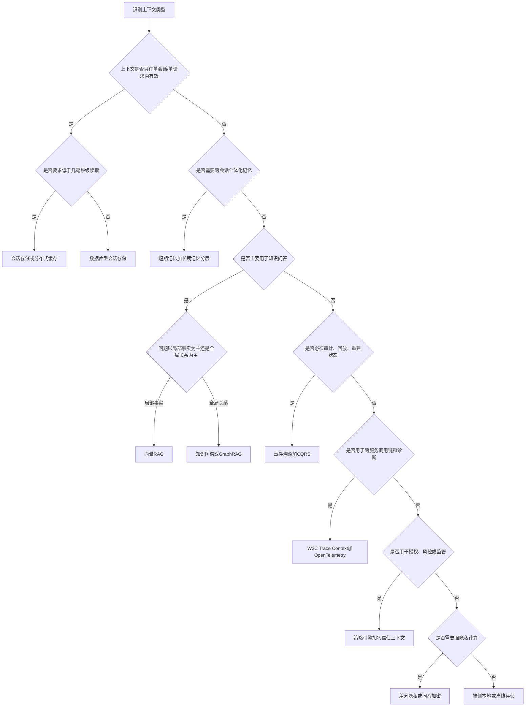
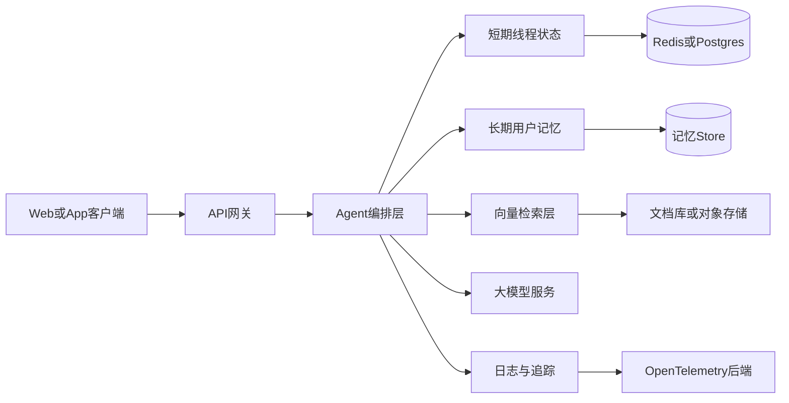
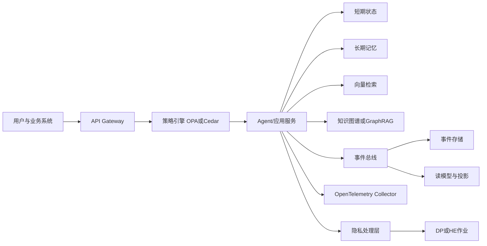

# 通用软件系统与对话式AI中的上下文管理方案研究报告

## 执行摘要

“上下文管理”不是单一技术，而是一组围绕**上下文的采集、建模、存储、检索、传播、治理与过期处理**的工程能力。对对话式 AI 来说，它解决的是“模型在有限上下文窗口内如何记住会话、检索外部知识、跨会话延续偏好并避免把无关或敏感信息送进提示词”的问题；对通用软件系统来说，它还包括多节点会话状态、跨服务调用链上下文、端侧离线状态、权限决策所需环境属性，以及满足数据最小化、用途限制和审计要求的合规上下文。W3C Trace Context/W3C Baggage、OpenTelemetry、LangGraph 的 memory/persistence 文档、以及 GDPR 的数据处理原则，都从不同层面说明了“上下文”既是运行时元数据，也是业务状态和治理对象。citeturn10view0turn33view0turn11view0turn29view3turn25search5

本报告的核心结论是：**不存在一个“最优方案”，只有分层组合**。在大多数系统里，最稳妥的架构不是把所有上下文都塞进同一种存储，而是把它拆成若干层：高频、短寿命、强时效的上下文放在会话存储或分布式缓存；跨会话但仍偏个体化的上下文放在长期记忆/用户画像存储；大规模领域知识放在向量检索或知识图谱；强审计、可回放、可重建的业务上下文放在事件溯源/事件流；跨服务诊断上下文通过 W3C Trace Context/Baggage 与 OpenTelemetry 传播；敏感上下文则由策略引擎、差分隐私、加密计算等机制做约束。Redis、Django/Spring Session/ASP.NET Distributed Cache、LangGraph、RAG、GraphRAG、EventStoreDB/Kafka、OPA/Cedar、Google Differential Privacy 与 Microsoft SEAL 分别覆盖了这些层次。citeturn13view0turn13view1turn39view1turn29view1turn28view2turn20view2turn36view0turn16search7turn17view0turn17view1turn35view0turn17view2

从适配性看，**小型 MVP** 最应该避免过度设计：优先采用“会话状态存储 + 基础 RAG + 端侧轻量缓存 + 统一日志/追踪”的组合；**中等规模系统** 再引入“分层记忆 + 检索重排 + 上下文策略治理 + 统一可观测性”；**企业级或强监管场景** 才值得认真考虑“GraphRAG/知识图谱 + 事件溯源/CQRS + 策略引擎 + 差分隐私/同态加密 + 零信任式上下文访问控制”的组合。这个判断与 Martin Fowler 对 CQRS“会引入风险性复杂度”的提醒、微软 GraphRAG 仓库对索引成本“先从小规模开始”的警告，以及 OpenTelemetry 对 Baggage 敏感信息传播风险的建议是一致的。citeturn36view3turn20view1turn11view0

从工程可行性看，最常见失败原因不是缺少某个“高级方案”，而是**上下文边界不清晰**：不知道哪些数据应该只活在单线程/单会话，哪些应该跨会话持久化，哪些只能留在端侧，哪些只允许以脱敏统计形式流动。报告后文给出的建议是：先做上下文分层与数据分类，再决定一致性模型、TTL、回放要求、可解释性与合规边界；没有清晰治理边界之前，不要直接上 GraphRAG、事件溯源或隐私计算。citeturn29view3turn36view1turn33view3turn17view0turn17view1

## 概念界定与评估框架

在本报告中，“上下文管理”定义为：**围绕某个交互、请求、实体、用户、设备、策略或工作流，把对当前决策有意义的信息，按生命周期进行捕获、归一、存储、检索、传播、治理和失效处理**。W3C Trace Context 将其落在“跨服务分布式请求的唯一标识与供应商扩展元数据”；W3C Baggage 将其扩展为“与分布式请求或工作流执行相关的一组应用自定义属性”；OpenTelemetry 则明确把上下文传播视为日志、指标、追踪三类信号相关联的基础；LangGraph 又把 AI 记忆进一步拆成线程级短期记忆与跨线程长期记忆。citeturn10view0turn33view0turn11view0turn29view3

因此，本报告将范围明确为**通用软件系统与对话式 AI 中的上下文管理**，并覆盖六类场景：其一，对话式 AI/聊天机器人中的短期会话记忆、长期用户记忆、外部知识检索与上下文压缩；其二，分布式系统中的会话状态、控制面状态、事件流与上下文传播；其三，移动应用与浏览器中的端侧状态、离线数据与扩展存储；其四，操作系统或框架级 UI/场景恢复；其五，权限、风险、设备态势等用于授权决策的策略上下文；其六，涉及数据最小化、用途限制、隐私预算与加密计算的隐私/合规上下文。相关官方文档分别来自 LangGraph、OpenTelemetry/W3C、MDN、Chrome Developers、Android Developers、Apple Developer、OPA/Cedar、NIST 和 GDPR/AI Act 文本。citeturn29view1turn11view0turn32view0turn32view2turn32view3turn7search4turn24search1turn17view0turn17view1turn33view3turn25search5turn25search3

为了比较不同方案，本报告采用统一评估框架。最重要的维度包括：**功能适配性**，即是否天然支持会话、跨会话、跨服务或跨设备；**性能**，即延迟、吞吐、命中率、索引构建成本与存储放大；**扩展性**，即是否易于横向扩容、分片、分层；**复杂度**，即开发、调试、运维、模式演化与数据迁移成本；**安全与隐私**，即是否容易产生明文泄露、越权访问、敏感元数据扩散或隐私预算失控；**一致性与容错**，即支持强一致、最终一致、回放恢复还是仅软状态缓存；**可观测性与调试难度**，即是否能做 tracing、time-travel、历史重建和上下文来源解释；**迁移难度与反模式**，即从现有 CRUD/无状态架构迁入时的冲击面。这个评估框架与 OTel 对上下文相关性、LangGraph 对 persistence/time-travel/fault tolerance、Azure 对 CQRS/Event Sourcing、NIST 对零信任资源保护，以及 GDPR 的最小化/用途限制原则高度一致。citeturn11view0turn29view2turn36view1turn37view0turn33view3turn25search5

## 方案谱系与架构模式

### 会话状态存储与分布式缓存

这一类方案处理的是**高频、短寿命、与当前会话或请求强相关**的上下文。典型形态是“浏览器/客户端只保存不透明 session ID，服务端在 Redis、数据库或缓存中保存真实会话状态”。Redis 官方会话示例明确采用“cookie 里仅放 session ID，状态存 Redis，并用 TTL 自动过期”；Django 官方文档指出 session 数据默认存数据库，也可切换到文件系统或缓存；ASP.NET Core 文档将 distributed cache 定义为“由多个应用服务器共享的外部缓存服务”，强调其可提升性能与可扩展性，并建议生产场景优先使用 Redis。citeturn13view0turn13view1turn39view1

这类方案的优点是明显的：实现简单、读写延迟低、TTL 语义自然、易于做水平扩展，而且对“登录态、购物车、页面过滤条件、工作流步骤状态、Agent 单线程状态”等都很适配。Redis 还提供 server-assisted client-side caching，使热点数据可下沉到应用内存，从而进一步降低网络往返与后端负载。其缺点也同样明确：如果把它误当作长期事实库，就会遇到失效、淘汰、数据恢复和版本演化问题；如果使用本地内存 session，在多进程或多节点环境下容易不一致；如果使用客户端缓存，又必须认真处理失效通知与陈旧读。Django 明确警告 local-memory cache 不适合作为生产 session 后端，Redis 文档也专门强调 client-side caching 的失效策略困难与带宽/CPU 成本。citeturn13view1turn13view2

当上下文不只是“每个用户一份”，而是**分布式系统的关键控制面状态**时，常见实现会转向 etcd 一类强一致分布式 KV。etcd 官方将自己定义为“强一致、分布式键值存储”，Kubernetes 官方文档则明确它是 Kubernetes 所有集群数据的后端存储，并强调要做备份、使用奇数节点、避免资源争抢、在生产中运行于专用机器或隔离环境。换言之，etcd 适合“配置、领导选举、服务发现、租约、资源元数据”这类需要强一致和 watch 语义的上下文，但不适合承载高容量历史语料或复杂检索。citeturn33view1turn33view2

综合判断：**当上下文寿命以秒、分钟、小时计，且主要目标是快速取回当前状态时，优先选会话存储/分布式缓存；当它是分布式系统的控制真相时，优先选 etcd 这类强一致 KV；不要用这类方案替代长期知识库、事件审计库或复杂推理层。** citeturn13view0turn39view1turn33view1

### AI 短期记忆、长期记忆与层次化上下文

对话式 AI 的上下文管理，本质上是在解决**有限上下文窗口**与**长期任务连续性**之间的矛盾。LangGraph 的 memory 概念文档把 AI 记忆区分为线程级短期记忆和跨线程长期记忆：短期记忆存放在 agent state 中，并通过 checkpointer 持久化；长期记忆放在 custom namespace 下，可跨不同会话召回。LangGraph 的 persistence 文档进一步指出，checkpointer 除了提供 memory，还支持 human-in-the-loop、中断恢复、time travel 与 fault tolerance。citeturn29view3turn29view2

这类方案的优势在于它能把“会话上下文”从一次请求扩展到**可追溯的会话线程**，再扩展到**可跨会话复用的用户偏好/事实/经验**。例如，LangGraph 推荐在生产中使用 Postgres checkpointer，而不是单纯的内存 saver；Agent Server 还能自动处理 checkpointing。对多轮客服、Copilot、长任务代理、多步骤工作流来说，这种“线程状态 + 长期存储”的分层能力是非常实用的。MemGPT 则把类似思想推到了更系统化的方向：其论文把问题类比为操作系统中的分层内存，通过“虚拟上下文管理”在快慢内存之间移动信息，以缓解 LLM 有限上下文窗口带来的限制。citeturn29view1turn29view2turn29view0

但这类方案也有两个典型风险。第一，**记忆提取与遗忘并不自动正确**。长期记忆如果提取得太激进，会把偶然噪声当作事实；如果提取得太保守，又失去个性化价值。第二，**长上下文并不等于高质量上下文**。LangGraph 文档直接指出，长对话即使放得进上下文窗口，模型也往往会被陈旧或离题内容“分心”，而且响应时间更慢、成本更高。因此，实际工程中通常必须配合 trimming、message summarization、namespace 隔离、优先级注入和敏感字段脱敏，而不是简单地“把全部历史都塞回去”。citeturn29view3turn29view1

从可行性看，这类方案非常适合**个人助理、长期客服、任务型代理、具有用户偏好积累的业务 AI**；但它并不替代知识库检索，更不应承担合规上的唯一真实来源。更稳妥的角色是：**把 AI 记忆层当作“个体化和线程化上下文层”，而不是企业事实总账。** citeturn29view3turn29view2

### 向量检索、RAG 与知识图谱

RAG 的理论基础非常清楚。原始论文把它定义为把**参数化记忆**与**外部非参数化记忆**相结合：外部记忆表现为稠密向量索引，检索器按查询取回相关文档，再把检索结果送入生成模型。论文还明确指出，这种方式能比纯参数模型生成更具体、更多样、更事实性的内容。Faiss、Milvus、Qdrant 分别代表了三个工程实现层次：Faiss 是高效向量相似搜索库，可在 RAM、磁盘和 GPU 上运行；Milvus 是面向 GenAI 的向量数据库，支持从原型到分布式亿/十亿级扩展；Qdrant 则强调 AI-native、语义搜索、混合检索、多向量与边缘离线部署。citeturn28view2turn27view1turn27view2turn27view3

向量 RAG 的最大优点是：**把上下文从模型内参数移到可更新的外部知识层**。它天然适合 FAQ、知识库问答、文档助手、代码库助手、企业私有语料问答。相比纯会话记忆，它更容易做知识更新、证据引用和按语料库扩展容量。相比知识图谱，它的建模门槛更低、MVP 成本更小。其主要问题则在于：检索质量高度依赖 chunking、embedding、过滤条件、召回/重排策略与索引设计；当问题需要跨多文档综合、全局主题理解或复杂关系推理时，baseline RAG 很容易“只找到局部片段，却无法连点成线”。微软 GraphRAG 文档正是针对这个短板，指出 baseline RAG 在“连接分散信息”和“对大语料整体总结”类问题上表现差。citeturn20view2turn28view2

当业务更强调**实体关系、全局结构、解释性和复杂推理**时，知识图谱与 GraphRAG 就更有吸引力。GraphRAG 项目把流程描述为：从原始文本中抽取实体、关系和 claim，构建知识图谱，做社区层次聚类和摘要，再在查询时综合 global search、local search 和 DRIFT search。GraphRAG 论文显示，在面向百万 token 级别私有语料的“global sensemaking questions”上，GraphRAG 相比传统 RAG 基线在答案完整性和多样性上有显著提升。Apache Jena 提供 RDF、SPARQL、推理与持久三元组存储；Neo4j 提供图数据库、ACID 事务和以关系遍历为核心的查询能力。citeturn20view2turn20view3turn26view0turn26view2

缺点同样不能忽视。GraphRAG 仓库明确提醒索引可能“非常昂贵”，建议务必从小规模开始；知识图谱路线通常还需要额外的实体标准化、关系本体、图更新策略与抽取质量控制。也就是说，**GraphRAG/知识图谱不是 RAG 的默认替代品，而是适合在“问题复杂度高于普通检索问答”的场景中增配的结构化上下文层**。如果语料规模很小、文档更新极快或问题主要是局部事实问答，普通向量 RAG 往往性价比更高。citeturn20view1turn20view2

### 事件溯源、 CQRS 与分布式上下文传播

如果系统不仅需要“当前上下文”，还需要回答“**它为什么会变成现在这样**”，那么事件溯源通常比普通 CRUD 更合适。Martin Fowler 对 Event Sourcing 的定义非常经典：把应用状态的所有变化存为事件序列，从而不仅能查询当前状态，还能重建过去状态并处理追溯修正。Azure 的 Event Sourcing 模式文档则更工程化：事件追加到 append-only store，事件流是系统记录的权威来源，当前状态通过 replay 事件流重新水合，读侧通常通过 materialized view 优化查询。citeturn36view2turn36view1

当读写模式明显不对称时，CQRS 会与事件溯源自然组合。Azure 文档指出，CQRS 允许读模型和写模型分别针对性能、扩展性与安全性独立优化；但如果读写分离到不同 data store，就必须处理同步、最终一致性与消息故障。Martin Fowler 也明确提醒：CQRS 在某些场景有价值，但“对大多数系统会增加有风险的复杂度”。这几乎可以作为选型时最重要的警戒线。citeturn37view0turn36view3

在具体实现上，EventStoreDB 官方文档直接把自己定位为“为 Event Sourcing 设计的数据库”；Kafka/Confluent 文档则强调 Kafka Streams 支持有状态处理、窗口、聚合、join、exactly-once semantics，并能构建高扩展、容错的流式应用。它们都适合把“业务上下文变化”放在 append-only log 中，再投影出查询视图或下游集成。此类方案的长处是审计、重放、回溯、解耦和吞吐；短处则是 schema 演化、事件顺序、幂等处理、投影延迟、补偿逻辑与运维复杂度。citeturn36view0turn16search7turn16search2turn36view1

另一条常被忽视的上下文路线，是**分布式调用链中的传播上下文**。W3C Trace Context 将 `traceparent`/`tracestate` 标准化为跨服务传播的请求标识与供应商元数据；W3C Baggage 则允许传播用户自定义键值对。OpenTelemetry 明确说明默认 propagator 使用 W3C TraceContext，并强调它可以把 traces、metrics、logs 关联起来；同时又明确警告，对外部不可信服务要谨慎接收/发送上下文，尤其不要把凭据、API key 或 PII 放进 Baggage，因为这类数据可能被记录日志或被不可信下游接收。citeturn10view0turn33view0turn11view0

因此，事件溯源/CQRS 与分布式上下文传播虽然不相同，但可以视为两种互补的“系统级上下文管理”：前者保存**业务事实历史**，后者传播**请求执行上下文**。一个适合回答“数据为何变化”，另一个适合回答“请求如何流经系统”。二者都不适合被“偷懒式滥用”：简单 CRUD 后台不要硬上 Event Sourcing/CQRS；Baggage 更不应被用作跨服务传递敏感业务载荷。citeturn36view3turn11view0turn33view0

### 端侧、浏览器扩展、移动应用与操作系统级上下文

并非所有上下文都应该回传服务端。对于**与用户当前设备、界面、离线行为和交互恢复强相关**的上下文，端侧存储往往更合适。Web 平台上，MDN 将 Web Storage API 定义为浏览器端 key/value 存储，比 cookie 更直观；但当需要存储大量结构化数据和离线查询时，IndexedDB 更合适，因为它使用索引支持高性能检索，并且可在 Web Worker 中使用。citeturn32view0turn32view1

在浏览器扩展中，Chrome `chrome.storage` API 提供专门的扩展级持久状态存储；官方文档强调它是异步的、支持 bulk read/write、可跨扩展上下文访问，而且还提供用于企业策略的 managed storage 区域。更重要的是，Chrome 还明确不推荐在扩展里依赖一般 Web Storage：扩展 service worker 不能使用 Web Storage，content scripts 还会与宿主页共享存储。这个区别对“扩展上下文管理”非常关键。citeturn32view2

在 Android 侧，Jetpack DataStore 已被官方定位为取代 SharedPreferences 的数据存储方案，并支持 Preferences DataStore 与 Proto DataStore；它的 `updateData` 是事务性的原子 read-write-modify 操作。与之互补的是 `SavedStateHandle`，它是一个 key-value map，专门用于在进程死亡之后恢复界面相关状态。换言之，**DataStore 更适合持久用户设置与轻量业务上下文，SavedStateHandle 更适合短周期 UI 恢复上下文。** Apple 的 UIKit 状态恢复文档与相关 API 也体现了同类思想：状态恢复让应用在下次启动时回到之前状态，基于 `NSUserActivity` 的 scene state restoration 甚至由系统对磁盘上的恢复状态进行加密。citeturn32view3turn32view4turn24search2turn24search1

这类方案的优点是超低延迟、离线可用、降低服务端压力，并且在一定程度上改进隐私，因为不必把所有界面态与草稿态上传云端。缺点则是跨设备同步、冲突合并、端侧安全、配额与浏览器/平台差异。最典型的反模式包括：把权威业务状态只存在客户端；在扩展 service worker 里依赖 `localStorage`；在 Compose UI 中直接频繁读写 DataStore；以及没有设计离线冲突合并就假定“本地即真实状态”。Android 官方明确建议把 DataStore 操作留在 data layer，而不是直接在 composable 中读写。citeturn32view2turn32view3

### 策略引擎、上下文决策与隐私保留技术

当上下文不仅用于“记住”，还用于“**决定是否允许、推荐什么、在多大风险下执行**”时，方案会从存储/检索转向决策与治理。Open Policy Agent 把自身定义为“通用策略引擎”，强调将 policy decision-making 与 policy enforcement 解耦；Cedar 则把策略写成“谁可以在什么上下文下对什么资源执行什么动作”的授权规则，并将业务逻辑与授权逻辑分离。这类技术非常适合把用户身份、设备态势、环境属性、地域、风险评分、租户边界等上下文统一纳入授权决策。NIST 的零信任架构文档进一步给出原则性约束：不再基于网络位置或资源归属给予隐式信任，而是在建立会话前对主体和设备完成认证与授权。citeturn17view0turn17view1turn33view3

如果问题是“基于上下文做动态优化”，Contextual Bandits 则是另一类方案。Yahoo! 的经典论文把新闻推荐建模为 contextual bandit，并在 3300 多万事件数据上得到相对标准无上下文 bandit 约 12.5% 的点击提升；Vowpal Wabbit 官方教程则把 contextual bandit 定义为“观察 context、选择 action、仅观察被选动作 reward”的问题，并指出其特别适合选项变化快、动作集合有限的动态环境。相比静态规则，它能在线适应用户/环境差异；相比 RL 全量状态建模，它实现更轻、更可控。citeturn30view0turn31view0

隐私保留技术属于更高约束级别的上下文管理。差分隐私原始论文将目标概括为：在数据库参与者隐私风险增加可控的前提下，仍能提供有用统计结果；Google 的开源库则把工程重点放在 ε / (ε,δ)-DP 统计、privacy accounting、secure noise generation 与分布式数据管线集成上，并特别提醒调用方必须提前做每用户贡献上限约束。换言之，DP 更适合**统计、训练、指标、实验分析**层面的上下文利用，而不适合保存原始个体上下文本身。citeturn17view3turn35view0

同态加密则从另一方向提供隐私保障。Microsoft SEAL 官方说明，其价值在于“直接对密文计算”，从而让服务端在不接触明文的情况下完成存储与计算；但同态加密的工程实用性至今仍伴随显著效率挑战，相关综述明确把其主要代价归结为巨大的计算开销。这意味着 HE 更适合强监管、高敏感、可容忍较高延迟与成本的特定计算场景，而不适合绝大多数实时交互链路。与此对应，GDPR 第 5 条对合法性、公平透明、用途限制、数据最小化等原则的要求，以及 EU AI Act 对 AI 系统风险分类和强监管的引入，都意味着上下文不是“能存就存”，而应当按目的、最小必要性和风险等级做治理。citeturn17view2turn34search20turn25search5turn25search3

## 对比与选型方法

下表给出关键方案的对比。**成本列为经验估算，用于相对比较，按“自建开源为主、不含大模型推理费”的月度资源量级粗略划分。**

| 方案名称 | 核心原理 | 典型实现 | 优点 | 缺点 | 适用场景 | 成本估算范围 |
|---|---|---|---|---|---|---|
| 服务端会话存储 | 以 `session_id` 为键保存会话态，配合 TTL 过期 | Redis Session、Django sessions、Spring Session Redis citeturn13view0turn13view1turn39view0 | 简单、低延迟、天然适合登录态/购物车/线程态 | 不适合长期事实；失效与淘汰需要治理 | Web 会话、Agent 单线程状态 | 低，数百~数千元/月 |
| 分布式缓存 | 外部共享缓存供多节点复用热点上下文 | Redis、ASP.NET `IDistributedCache`、NCache/Postgres/SQL cache citeturn39view1 | 高吞吐、可横向扩展、减轻数据库压力 | 缓存一致性、陈旧读、回源风暴 | 热点配置、结果缓存、短寿命上下文 | 低到中，数百~万元/月 |
| 强一致控制面 KV | Raft/强一致 KV，支持 watch、租约与故障恢复 | etcd、Kubernetes backing store citeturn33view1turn33view2 | 强一致、适合控制面与元数据 | 运维要求高，不适合大容量知识检索 | 服务发现、领导选举、配置/资源元数据 | 中，数千~数万元/月 |
| AI 分层记忆 | 线程级短期记忆 + 跨线程长期记忆 + checkpoint | LangGraph checkpointer/store、MemGPT citeturn29view1turn29view2turn29view0 | 支持多轮、跨会话、恢复、time-travel | 记忆抽取难；长上下文成本高、易分心 | 多轮 Copilot、长期客服、任务代理 | 中，数千~数万元/月 |
| 向量 RAG | 检索外部非参数化记忆并注入生成 | Faiss、Milvus、Qdrant、Pinecone citeturn28view2turn27view1turn27view2turn27view3 | 可更新知识、证据友好、易做 MVP | chunking/召回/重排决定上限；全局推理弱 | 文档问答、知识库助手、代码助手 | 中，数千~数万元/月 |
| 知识图谱/GraphRAG | 从文本抽取实体关系，按图结构与社区摘要检索 | Microsoft GraphRAG、Neo4j、Apache Jena citeturn20view2turn20view3turn26view0turn26view2 | 关系推理强、解释性好、擅长全局问题 | 抽取/索引昂贵，本体与演化复杂 | 复杂语义发现、合规/研发知识网络 | 中高到高，万元~十万元/月 |
| 事件溯源 | 将状态变化追加为事件流，可回放重建状态 | EventStoreDB、Kafka 事件流 citeturn36view0turn36view1turn36view2turn16search2 | 审计、回溯、重放、天然历史 | 事件演化、顺序、幂等与投影复杂 | 金融、订单、库存、审批、审计型系统 | 中高，万元级起 |
| CQRS | 分离读模型和写模型，独立优化 | Azure CQRS pattern、Kafka/Kafka Streams 投影 citeturn37view0turn16search7 | 读写各自扩展、读模型可物化优化 | 增加系统复杂度与最终一致性处理 | 读多写少、复杂领域模型 | 中高，万元级起 |
| 分布式上下文传播 | 用标准 header 传播请求与应用元数据 | W3C Trace Context、Baggage、OpenTelemetry citeturn10view0turn33view0turn11view0 | 强可观测性，便于定位上下文来源 | 头污染、伪造、Baggage 泄露敏感信息 | 微服务、异步链路、跨团队系统 | 低到中，数百~数千元/月 |
| 端侧本地/离线存储 | 在浏览器/设备本地保存 UX 与离线上下文 | Web Storage、IndexedDB、Chrome Storage、DataStore、SavedStateHandle citeturn32view0turn32view1turn32view2turn32view3turn32view4 | 延迟低、离线可用、减少服务端负担 | 同步冲突、端侧安全、跨设备一致性差 | PWA、移动端设置、扩展状态、草稿与 UI 恢复 | 低 |
| 策略引擎 | 以策略即代码方式做上下文驱动授权/准入 | OPA、Cedar、零信任架构 citeturn17view0turn17view1turn33view3 | 解耦授权逻辑、便于审计与多系统复用 | 策略建模与测试要求高 | 多租户、细粒度授权、风控准入 | 中 |
| Contextual Bandits | 基于上下文在线选动作并利用反馈更新策略 | Yahoo! LinUCB、Vowpal Wabbit CB citeturn30view0turn31view0 | 实时个性化、比静态规则更自适应 | 需要探索、日志与离线评估；解释成本较高 | 推荐、排序、动态参数调优 | 中 |
| 差分隐私与同态加密 | 对统计结果加噪；或在密文上直接计算 | Google DP、Microsoft SEAL citeturn35view0turn17view2turn17view3 | 强隐私保护，可满足高敏场景要求 | 精度损失或计算开销大，工程门槛高 | 统计分析、敏感协作计算、监管场景 | 高到极高 |

如果把这些方案压缩成决策规则，可以得到一个很实用的判断：**先按寿命分层，再按一致性与风险分流。** 短寿命、高 QPS、对历史不敏感的上下文，优先放缓存/会话；跨会话且与用户偏好相关的，放长期记忆；大规模知识问答，先上向量 RAG；问题涉及关系网络与全局语义，再增配 GraphRAG/图谱；必须可回溯重建的业务事实，转向事件溯源；跨服务调试与观测，必须引入 W3C + OTel；授权和风控上下文，交给策略引擎；统计类敏感数据，再考虑 DP/HE。citeturn13view0turn29view3turn28view2turn20view2turn36view1turn11view0turn17view0turn35view0turn17view2

下面给出一个推荐的架构决策流程图。

对典型架构，建议把“AI 记忆、知识检索、治理、观测”拆开，而不是直接耦合在一个大 prompt 管道中。下面是一个适合中小团队落地的**MVP 级对话式 AI 上下文架构**。

如果是企业级、强监管、复杂知识密集型系统，则应额外加入图谱、事件与策略层。下面是一个更稳妥的**企业级受监管 AI 上下文架构**。

## 实施可行性与迁移路线

实现上下文管理，最容易犯的错误是“先选技术，再倒逼业务”。更可行的路径是按以下顺序推进。首先，做**上下文分类**：区分会话态、个体长期记忆、知识上下文、系统传播上下文、授权上下文、敏感统计上下文。其次，定义**每类上下文的生命周期**：创建条件、所有权、TTL、是否可回放、是否跨设备、是否允许进 prompt、是否允许跨服务传播。OpenTelemetry 对外部服务传播风险、LangGraph 对 short/long-term memory 的边界、GDPR 对用途限制与最小化的原则，都说明这一步比技术选型更基础。citeturn11view0turn29view3turn25search5

随后进入**基线实现阶段**。对大多数团队，建议先做一条可观测的最小链路：服务端会话状态或线程状态、基础检索层、统一 tracing/logging、最小权限控制。只有在基线能够稳定回答“上下文从哪里来、为什么进入模型、何时过期、如何审计”之后，再逐步增加 GraphRAG、事件溯源或隐私计算。这个顺序与 GraphRAG 仓库“先从小规模开始”的提醒、CQRS/Event Sourcing 的复杂度警告、以及 LangGraph persistence 对调试/恢复价值的说明是一致的。citeturn20view1turn36view3turn29view2

在技术风险上，最重要的有六类。**上下文膨胀**：会导致 LLM 成本与延迟快速失控，缓解方式是会话摘要、消息裁剪、命名空间隔离和检索前过滤。**陈旧上下文**：缓存失效、向量索引未刷新、投影滞后都属于这一类，缓解方式是 TTL、版本戳、事件驱动刷新与回源策略。**敏感信息扩散**：尤其是 Baggage、长期记忆与日志，缓解方式是 redaction、策略引擎、字段级分类与对外部服务禁止传播。**索引/图谱成本失控**：GraphRAG、图谱抽取和大规模重嵌入最明显，缓解方式是先做普通 RAG、只对高价值语料做图化。**顺序与幂等问题**：事件流与最终一致读模型里极易出现，缓解方式是序列号、幂等键、死信与补偿机制。**隐私技术误用**：DP 若不控制每用户贡献上界会破坏保证，HE 若放进低延迟热路径会拖垮体验。citeturn29view3turn13view2turn11view0turn20view1turn36view1turn35view0turn17view2

性能测试应按上下文类型分别设计，而不是只测“整体 QPS”。比较推荐的指标如下：

| 指标域 | 推荐指标 | 说明 |
|---|---|---|
| 会话/缓存 | p50/p95 读取延迟、写入延迟、命中率、失效率、过期率 | 判断热点上下文能否支撑交互链路 |
| AI 记忆 | 每轮 token 数、上下文命中率、摘要压缩比、恢复成功率、错误记忆率 | 判断记忆层是否真正提高质量而不是堆成本 |
| RAG/GraphRAG | Recall@k、MRR、重排命中率、索引构建时长、重嵌入耗时 | 判断检索层质量与更新成本 |
| 事件/投影 | 事件写入吞吐、投影滞后、重复事件率、单实体重放时长 | 判断审计层与读模型新鲜度 |
| 上下文传播 | 追踪覆盖率、跨服务 span 串联成功率、Baggage 过滤率 | 判断可观测性是否完整 |
| 策略/隐私 | 决策延迟、策略命中率、隐私预算消耗、密文作业耗时 | 判断治理层是否可放进生产路径 |

这些指标与官方文档给出的关注点一致：Redis/ASP.NET 强调缓存性能特征与基准测试，OpenTelemetry 强调跨信号关联，LangGraph 强调 persistence 与恢复，Azure 强调投影与最终一致性，Google DP 强调 privacy accounting 与贡献边界。citeturn39view1turn11view0turn29view2turn36view1turn35view0

在迁移路线图上，可以按三档推进。**小型 MVP**：通常用 2–4 人，4–8 周可完成“会话状态 + 基础 RAG + tracing + 端侧本地状态”；此阶段不建议上事件溯源和 GraphRAG。**中等规模**：通常 4–8 人，2–4 个月，可以补齐长期记忆、重排、策略引擎、读写分离缓存、统一 OTel 与数据分类。**企业级**：通常 8–15 人，6–12 个月，才适合引入 GraphRAG/图谱、事件溯源/CQRS、数据脱敏流水线、隐私计算试点与合规审计回放链路。这里的关键不是“技术多”，而是每一层都要有明确角色：哪层提供事实，哪层提供个性化，哪层提供证据，哪层提供治理。这个角色分离做不到，再多技术也会互相打架。citeturn20view1turn36view3turn29view2turn17view0

## 案例研究与参考实现

**Kubernetes 与 etcd** 是“强一致控制面上下文”的典型案例。Kubernetes 官方文档明确指出 etcd 是所有集群数据的 backing store，并把备份、奇数节点、资源隔离和集群稳定性视为生产前提。这说明：当上下文本身就是“系统控制真相”时，缓存式或弱一致做法并不合适，可重放知识库更不合适，强一致 KV 才是正确层。对可复用组件而言，watch、lease、snapshot 和 Raft 一致性是核心，而不是复杂查询能力。citeturn33view2turn33view1

**Yahoo! 新闻推荐中的 contextual bandit** 是“上下文驱动决策”的经典参考实现。论文在 3300 多万事件数据上验证了基于上下文的 bandit 方法比 context-free bandit 带来 12.5% 点击提升。可复用组件不是特定算法名字本身，而是日志制度：你必须记录动作、概率、奖励与上下文，才能做可靠离线评估；Vowpal Wabbit 官方教程也把 action、probability、reward/cost 和 context 作为输入格式核心。如果你的系统没有 exploration logging，就不要轻易声称自己在做 bandit。citeturn30view0turn31view0

**微软 GraphRAG** 则是“复杂知识上下文”的代表。官方文档强调它通过实体关系图、社区分层与摘要去改进对私有语料的整体性问题回答；论文指出它在 global question 上优于传统 RAG；但仓库 README 同时警告 GraphRAG indexing 可能非常昂贵，并建议 prompt tuning 与从小规模开始。这对工程落地非常重要：GraphRAG 适合作为二期增强，而不是所有问答系统的一期默认方案。最值得复用的组件包括实体/关系抽取流水线、社区摘要、global/local/drift 三类查询模式，以及独立于主业务链路的异步索引作业。citeturn20view2turn20view3turn20view1

**LangGraph** 提供了“有状态 Agent”的参考实现。其官方文档把短期记忆、长期记忆、checkpoint、time-travel、fault-tolerance 组织得比较清晰，非常适合作为对话式 AI 的“线程状态层”。对工程团队来说，最可复用的不是某个特定 prompt，而是 thread_id、checkpoint、state schema、namespace store 与 resume 机制。注意事项是：不要把长期记忆等同于“永不删除”，也不要把所有会话历史直接回灌给模型。citeturn29view1turn29view2turn29view3

**Web/移动端状态恢复** 充分说明了端侧上下文的价值。Chrome Storage 针对扩展状态、Android DataStore/SavedStateHandle 针对应用设置与 UI 恢复、Apple 的 state restoration/`NSUserActivity` 针对场景恢复，说明很多“上下文”其实是 UX state，而不是服务端业务事实。可复用原则是：把离线、草稿、过滤条件、界面恢复交给端侧；把权威业务事实留在服务端；把跨设备同步做成显式能力，而不是默认为客户端本地状态天然一致。citeturn32view2turn32view3turn32view4turn24search2turn24search1

## 结论与优先阅读资料

综合来看，**上下文管理最合理的工程形态不是“选一种方案”，而是“为不同寿命、不同一致性、不同风险等级的上下文选不同层”**。如果只能记住一句实践建议，那就是：**把上下文分成“会话态、个体记忆、知识证据、业务历史、传播元数据、治理约束”六层，再分别落在最合适的技术上。** 只有这样，系统才能同时获得低延迟、可扩展、可观测、可审计与可合规。citeturn13view0turn29view3turn28view2turn36view1turn11view0turn17view0

面向不同情景，本报告给出三条直接建议。对于**小型 MVP**，优先采用“Redis/数据库会话 + 普通向量 RAG + 端侧轻量状态 + OTel tracing”，先把上下文边界与可观测性打通，再考虑长期记忆。对于**中等规模系统**，建议补齐“分层记忆 + 检索重排/过滤 + 策略引擎 + 统一数据分类”，并把敏感字段显式排除出 Baggage、日志和 prompt。对于**企业级与强监管场景**，只有在确有复杂全局推理、强审计和高敏协作需求时，才引入 GraphRAG/知识图谱、事件溯源/CQRS 和 DP/HE。若你的系统主要是 CRUD 管理后台或标准 FAQ，直接上这些高级模式大概率得不偿失。citeturn36view3turn20view1turn11view0turn17view2turn35view0

优先阅读资料建议按下面的顺序进行：

**官方文档与标准**
- W3C Trace Context 与 W3C Baggage：理解跨服务上下文传播的最低标准。citeturn10view0turn33view0
- OpenTelemetry Context Propagation：理解上下文如何关联 traces、metrics、logs，以及如何处理外部服务和 Baggage 风险。citeturn11view0
- Redis Session Store / Client-side Caching / ASP.NET Distributed Cache / Django Sessions：理解会话态与缓存的基本工程权衡。citeturn13view0turn13view2turn39view1turn13view1
- LangGraph Memory / Persistence：理解 AI 短期记忆、长期记忆、checkpoint、time-travel 与 fault-tolerance。citeturn29view1turn29view2turn29view3
- OPA 与 Cedar 文档：理解策略引擎如何把上下文用于授权与治理。citeturn17view0turn17view1
- Android DataStore / SavedStateHandle、Chrome Storage、MDN IndexedDB/Web Storage、Apple State Restoration：理解端侧和 OS 级上下文。citeturn32view0turn32view1turn32view2turn32view3turn32view4turn24search2turn24search1

**原始论文与方法论文**
- *Retrieval-Augmented Generation for Knowledge-Intensive NLP Tasks*：理解向量 RAG 的原点。citeturn28view2
- *From Local to Global: A Graph RAG Approach to Query-Focused Summarization*：理解 GraphRAG 为什么适合全局性复杂问题。citeturn20view3
- *MemGPT: Towards LLMs as Operating Systems*：理解层次化 AI 记忆与虚拟上下文管理。citeturn29view0
- *A Contextual-Bandit Approach to Personalized News Article Recommendation*：理解上下文决策的工程与评估。citeturn30view0
- Cynthia Dwork 的 *Differential Privacy*：理解差分隐私的原始定义与目标。citeturn17view3turn40view0

**架构模式与工程指导**
- Martin Fowler 的 Event Sourcing 与 CQRS：理解模式收益与复杂度警告。citeturn36view2turn36view3
- Azure Architecture Center 的 Event Sourcing 与 CQRS：理解 materialized view、最终一致性、读写分离与实现细节。citeturn36view1turn37view0
- EventStoreDB / Kafka Streams / Confluent Event Sourcing：理解事件流上下文的数据库和流式实现路径。citeturn36view0turn16search7turn16search2

### 开放问题与局限

本报告优先采用官方文档、原始论文与权威架构文档，因此对**具体商品化服务的实时价格、各厂商最新 SLA、国内外云价格差异**没有做逐项报价级比较。成本区间因此只能作为架构层面的经验估算，而不是采购依据。另一个局限是：虽然报告覆盖了隐私与合规上下文，但不同法域下的数据跨境、行业专规与本地监管要求差异很大，真正上线到医疗、金融、政务时，仍需结合具体法务与安全评审落地。citeturn25search5turn25search3turn33view3