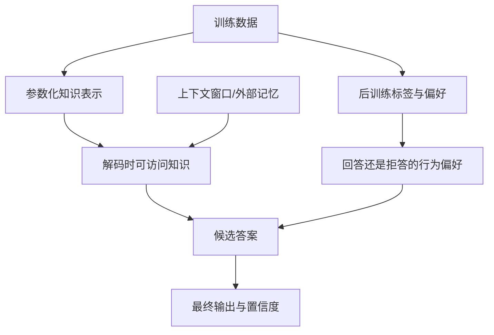
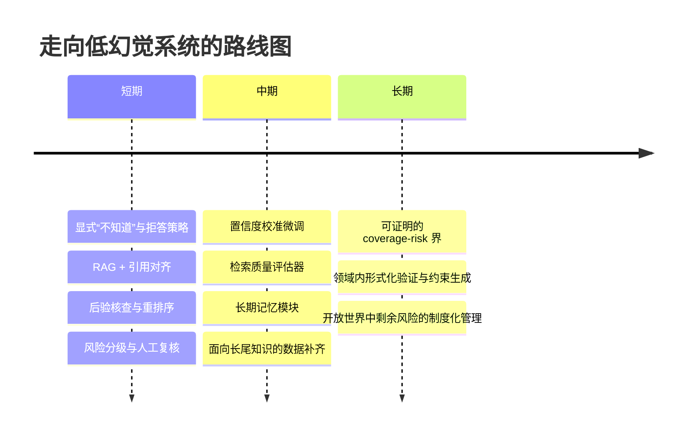

# 为什么会存在幻觉

## 执行摘要

- 在生成式大模型里，“幻觉”不是单一故障，而是一组相关但不同的失真：既包括对现实世界的事实性错误，也包括对给定上下文的违背、无依据细节的臆造、引用/出处/案例号等可验证对象的虚构，以及模型在本应拒答或承认不知道时仍给出看似流畅答案的“过度作答”。这一点已在摘要任务、问答基准、官方系统卡与专门的幻觉基准中被反复观察到。citeturn9view2turn22search2turn36search1turn34view0

- 幻觉的直接近因，是“局部概率最优”不等于“全局事实最优”。自回归模型按 token 条件概率逐步生成；温度、top-k/top-p、beam search、重排序等解码策略会重整概率质量。只要某一步把一个语义上错误但仍有非零概率的 token 放进候选集，后续条件分布就会围绕这个错误前缀继续自洽展开，从而把“小概率早期偏差”放大成“高损失的完整错误答案”。已有研究明确指出：top-p 的逐步随机性会伤害事实性，而似然最大化解码本身也会诱发退化与不忠实输出。citeturn18view1turn20view2turn20view3turn22search2turn19view0

- 更深层的原因，是信息缺失与目标错配共同作用：训练数据覆盖不足、长尾知识极稀疏、训练数据本身包含误导信息、参数记忆容量有限、上下文窗口与记忆机制不完备、后训练阶段更奖励“回答得像样”而不是“知道时才回答”，都会把输出推向“貌似合理但未经证实”的区域。2025 年来自 entity["organization","OpenAI","ai company"] 的研究把这一问题直接解释为“训练与评测奖励猜测而非承认不确定性”，并把幻觉归约为统计学习中的错误分类问题。citeturn32view0turn32view1turn33view2turn30view0turn29view0

- “消灭幻觉”在开放世界生成任务中几乎不可能作为普适目标达成；能逼近零幻觉的，往往是高约束、可检索、可验证、允许拒答的封闭工作流。现实工程目标不是“绝对零错”，而是把风险压到可审计、可度量、可干预的范围：显式不确定性、检索增强、后验核查、约束解码、交互式澄清、多阶段系统设计，通常比单纯继续增大模型更有效。citeturn32view1turn13search0turn17view0turn17view3turn17view2

## 幻觉的定义与测量

本报告采用一个工程上更有操作性的定义：**幻觉是指模型输出与真实世界事实、给定输入上下文、可验证证据，或输出内部的语义约束不一致，同时模型没有以恰当方式表达自己的不确定性**。这一定义同时覆盖开放域事实错误与闭域上下文不忠实两类问题；前者可对应官方系统卡中的 open-domain hallucination，后者则对应 closed-domain hallucination 或 faithfulness failure。citeturn9view2turn22search2turn36search7

| 类型 | 典型表现 | 判定标准 | 常用指标 |
|---|---|---|---|
| 开放域事实性错误 | 把“某人出生地”“某论文结论”“某法律案例结果”说错 | 是否与外部可靠知识源一致 | Accuracy、attempted accuracy、hallucination rate、TruthfulQA、SimpleQA citeturn9view1turn27search16turn24search1 |
| 闭域忠实性错误 | 摘要、问答、RAG 回答中编入输入里没有的内容 | 是否被输入文档/检索证据蕴含 | Entailment、faithfulness/factuality human eval、RARR/CoVe 后验检查 citeturn22search2turn15search6turn17view3 |
| 虚构细节/实体 | 人名、机构、时间、数字、案例名被编造 | 实体与属性是否真实存在且关系正确 | 命名实体错误率、atomic fact precision、FActScore citeturn18view1turn36search0turn36search12 |
| 语义不一致 | 答案前后自相矛盾，或与同一轮上下文冲突 | 逻辑一致性、自洽性、与上下文一致性 | 自一致性、NLI/entailment、SelfCheckGPT 分歧度 citeturn36search2turn36search14turn22search2 |
| 引用/出处错误 | 虚构论文、案例号、参考文献、作者列表 | 引用对象是否存在；引用内容与原文是否匹配 | 引用准确率、出处存在率、citation accuracy、人审核查 citeturn34view0turn17view0turn25search5 |
| 不可答问题上的过度作答 | 模型本应说“不知道”却仍强答 | 在应 abstain 的样本上是否拒答 | Coverage、attempted accuracy、risk-coverage curve、honesty/abstention metrics citeturn9view1turn31view3turn32view1 |

用于检测“幻觉检测器”自身性能时，常见指标是精确率、召回率、F1、AUROC 与 AUPRC；用于衡量“模型自己对自己有多清楚”时，常见指标是可靠性图、ECE、Brier score 与 coverage-risk 曲线。Guo 等把**校准**定义为“模型给出的置信度应当等于真实正确率”；在语言模型里，这一思想被扩展为对“是否该回答”“答案语义是否可靠”的估计。citeturn35view0turn23search0turn8search0

常用公式可以直接写成：

\[
\mathrm{Precision}=\frac{TP}{TP+FP},\qquad
\mathrm{Recall}=\frac{TP}{TP+FN}
\]

\[
\mathrm{ECE}=\sum_{m=1}^{M}\frac{|B_m|}{n}\left|\mathrm{acc}(B_m)-\mathrm{conf}(B_m)\right|
\]

\[
\mathrm{Brier}=\frac{1}{n}\sum_{i=1}^{n}(p_i-y_i)^2
\]

其中 \(B_m\) 是按置信度分桶后的样本集合；可靠性图画的是 \(\mathrm{acc}(B_m)\) 对 \(\mathrm{conf}(B_m)\) 的关系。对长文本，二元“整段对/错”通常过粗；因此 FActScore 把回答拆成 atomic facts，再测原子事实被可靠知识源支持的比例，而 LongFact/SAFE 则用“事实精确率 + 长度偏好下的召回”构造长文 F1。citeturn35view0turn36search0turn17view4turn17view5

一个重要但常被忽略的工程点是：**accuracy 与 hallucination rate 不是一回事**。SimpleQA 和 PersonQA 都把“正确回答”和“错误作答/幻觉”分开统计；理想模型不是“什么都答”，而是在有把握时回答、没把握时拒答。这意味着评估体系本身已经把“知道自己不知道”视作能力，而不是缺陷。citeturn9view1turn24search1turn24search8

## 概率解码如何放大错误

自回归语言模型的基本形式是：

\[
p_\theta(y\mid x)=\prod_{t=1}^{T} p_\theta(y_t\mid x,y_{<t})
\]

解码要做的，是在每一步根据 \(p_\theta(y_t\mid x,y_{<t})\) 选 token。问题在于：训练目标通常是 token 级负对数似然，而用户关心的是答案级事实损失。也就是说，**局部概率高**并不保证**整体答案真**；一个早期实体 token 的偏差，就足以把后续整段答案拉进另一条“自洽但错误”的轨道。Maynez 等在摘要任务中指出，最大似然训练和近似 beam-search decoding 会导致不忠实输出；Holtzman 等则指出，仅仅改变解码策略，就能让同一个模型在质量上表现出截然不同的结果。citeturn22search2turn20view2turn20view3turn19view0

```mermaid
flowchart LR
A[条件分布 pθ(y_t | x, y_<t)] --> B[温度/截断/beam 等解码规则]
B --> C[候选 token 概率被重整]
C --> D[早期错误 token 被采样或保留]
D --> E[后续条件分布围绕错误前缀重新展开]
E --> F[表面流畅但事实错误的完整答案]
G[数据缺失/长尾/噪声] --> A
H[评测奖励猜测] --> A
```

温度缩放把 logits \(z_i\) 变成

\[
q_T(i)=\frac{e^{z_i/T}}{\sum_j e^{z_j/T}}
\]

若错误 token \(w\) 的 logit 略低于正确 token \(c\)，则

\[
\frac{q_T(w)}{q_T(c)}=e^{(z_w-z_c)/T}
\]

当 \(z_w<z_c\) 时，增大 \(T\) 会让这个比值朝 1 靠近，也就是**抬高尾部错误 token 的相对机会**。top-k 与 top-p 则在截断后重新归一化；一旦错误 token 被保留在候选集里，它的相对概率会因重新归一化而上升。Holtzman 等把这一现象概括为对“概率分布不可靠尾部”的处理问题。citeturn20view3turn18view2

这就是为什么“小概率但高损失”的 token 会被放大。设第 \(t\) 步一个错误 token 的质量为 \(\varepsilon_t\)，一旦采样到它，就会触发一个高损失错误续写，其序列级损失为 \(L_{\text{wrong}}\gg L_{\text{right}}\)。那么单步对答案级风险的贡献至少是 \(\varepsilon_t L_{\text{wrong}}\)；而长度为 \(T\) 的回答，其“至少一次事实偏航”的概率近似为

\[
1-\prod_{t=1}^{T}(1-\varepsilon_t)\approx \sum_{t=1}^{T}\varepsilon_t
\]

因此，回答越长、可偏航的位置越多，风险通常越高。EMNLP 2023 的知识生成研究也明确观察到：长形式知识生成比短形式更容易出错。citeturn30view2turn19view0

top-p 的经验结果尤其直观。NVIDIA 的 2022 工作报告，在 factual prompts 上，greedy decoding 的命名实体错误率 NEER 为 39.9%，top-p=0.9 却升到 52.4%；他们提出对 top-p 逐步衰减的 factual-nucleus sampling 后，NEER 可降到 41.1%，同时比纯 greedy 保留更多多样性。换句话说，**随机性本身不是坏事，但“每一步都均匀加随机性”会伤害事实性**。citeturn18view1

beam search 代表另一类风险。它近似优化的是整句的对数似然和，形式上可写为

\[
\hat y_{\text{beam}}=\arg\max_y \sum_{t=1}^{T}\log p_\theta(y_t\mid x,y_{<t})
\]

但高似然往往偏好训练分布里更常见、更模板化、更“语言上顺”的续写，而不一定更真实。Holtzman 等已表明，以 likelihood 为解码目标会产生退化文本；在机器翻译中，“beam search curse” 甚至表现为 beam 变大后质量下降。这一点并不证明 beam search 必然更“会幻觉”，但它说明**对数似然最优**与**用户效用最优/事实最优**之间并无天然等价。citeturn20view2turn21search16

更关键的是，token 概率不是“真值概率”。Guo 等说明现代神经网络容易过度自信；GPT-4 技术报告则给出一个很罕见但重要的例子：预训练模型在一个 MMLU 子集上的 ECE 约为 0.007，而后训练版本升至 0.074，说明后训练虽然提升了任务表现，却显著伤害了概率校准。也就是说，模型可以变得“更会答题”，同时却“不再准确反映自己有多确定”。citeturn35view0turn12view2turn12view3

这又解释了为什么会出现“高置信度幻觉”。2025 年的 CHOKE 研究显示：模型有时**明明能稳定答对原问题**，但只需一个看似无伤大雅的扰动，就会切换到高确定性的错误答案；这类错误与“本来就不知道”不同，更像是提示分布、表面模式与知识检索路径之间的脆弱耦合。基于 semantic uncertainty/semantic entropy 的方法之所以有效，正因为它们试图在“语义层”而不是“单 token 层”上度量不确定性。citeturn16view0turn23search0turn8search0

## 信息缺失的工程来源

如果把幻觉当作一个工程故障树，最上层故障并不是“模型突然胡说”，而是**信息没有以正确的形式、在正确的时间，被模型可靠地取出并保留到最终答案里**。这个缺失既可能来自训练分布，也可能来自参数容量、上下文接口、后训练目标，甚至来自评测和产品交互本身。citeturn32view0turn33view2turn30view0



下表把用户关心的关键变量，按“影响方向—机制—证据—可量化指标”整理成工程清单。这里的“显著放大/抑制/不确定”不是绝对理论结论，而是对现有公开证据强弱的归纳。

| 变量 | 机制解释 | 影响方向与强度 | 代表证据 | 可量化指标 |
|---|---|---|---|---|
| 训练数据覆盖度 | 预训练里没有、或几乎没有出现的事实，很难可靠存入参数 | 缺失时**显著放大** | Kandpal 等发现 QA 准确率与相关预训练文档数存在强相关与因果关系；相关文档少的长尾知识需要“多数量级扩模”才接近可用水平。citeturn30view0turn30view1 | relevant document count、entity co-occurrence、topic frequency |
| 长尾知识稀缺 | 罕见事实在数据里只出现很少次，参数化记忆难以稳固 | **显著放大** | 长尾知识研究与 EMNLP 2023 知识生成研究都观察到：罕见知识比高频知识更不可靠。citeturn30view0turn30view2 | pageviews、出现频次、按频率分桶的 accuracy/FActScore |
| 数据噪声与误导信息 | 训练语料里混有错误、争议、误解与谣言，会把“错答案”也学成高似然模式 | **显著放大** | TruthfulQA 的设计目标，就是测模型是否会模仿人类文本中的常见误解；而 OpenAI 2025 的理论分析还说明，若训练分布非无噪声，错误率下界会更高。citeturn27search16turn32view0turn33view2 | contradiction rate、label disagreement、misinformation prevalence |
| 参数容量与知识压缩 | 参数不是逐条存事实，而是压缩统计结构；稀有事实、冲突事实、细粒度关系更易丢失 | 总体上增大容量会**抑制**很多事实错误，但对误解/伪知识呈**混合效应** | Knowledge Capacity Scaling Laws 给出“约 2 bits/parameter”的信息论估计；Scaling Laws 说明模型/数据/算力与 loss 呈幂律；但 TruthfulQA 又显示更大模型在“模仿人类误解”上可能更差。citeturn29view0turn28search0turn27search16 | 参数量、知识 bits/param、cross-entropy、TruthfulQA |
| 上下文窗口与记忆碎片化 | 超长上下文中，关键信息可能被稀释；训练时的文档切块也会造成实体关系错配 | **显著放大** | Transformer-XL 把固定上下文和 fragmentation 作为核心限制；Memorizing Transformers 表明外部记忆可提升长文本任务；NVIDIA 工作进一步指出 chunking 会造成实体错误关联。citeturn26search2turn26search1turn18view1 | context length、retrieval latency、memory hit rate、long-form error rate |
| 答案长度 | 可出错位置越多，早期偏差越容易滚成整段错误 | **显著放大** | EMNLP 2023 研究直接观察到，长形式知识生成具有更高错误率。citeturn30view2 | sentence count、atomic facts per answer、error-per-100-facts |
| 后训练与目标错配 | 监督微调/RLHF/DPO 常把“回答得像人”放在前面，未必优化“只在知道时回答” | **混合效应** | GPT-4 报告显示后训练伤害校准；OpenAI 2025 认为主流评测奖励猜测；FLAME 则发现用更“事实丰富”的 RAG 输出做监督，反而可能诱导模型输出陌生信息、增加幻觉。citeturn12view2turn32view1turn31view1turn31view2 | ECE、attempted accuracy、abstention rate、reward model preference |
| 指令/提示分布偏差 | 训练见过的问法与线上真实问法不同，提示表层变化会触发不同检索/续写路径 | **显著放大** | CHOKE 研究显示轻微扰动即可触发高确定性幻觉；FLAME 引用了“面对 unfamiliar queries 时更容易幻觉”的并行工作。citeturn16view0turn31view0 | OOD accuracy、prompt sensitivity、semantic entropy、perturbation gap |
| 模型校准失真 | 置信度与真实正确率不一致，会把“该拒答”的样本误报成“可作答” | **显著放大** | Guo 等与 GPT-4 技术报告都表明现代网络和后训练模型可能过度自信；法律领域研究也给出 ECE 比较。citeturn35view0turn12view3turn34view0 | ECE、Brier、reliability curve、coverage-risk |
| 梯度噪声/优化噪声 | 影响训练稳定性与可并行性，可能间接影响知识拟合与校准 | 目前对幻觉的直接证据**不确定** | 梯度噪声规模研究与 OpenAI 的训练扩展文章表明该量可预测有用 batch size，但其到“幻觉率”的公开因果链仍不充分。citeturn28search1turn28search19 | gradient noise scale、critical batch size、loss variance |
| 外部检索/显式记忆 | 用非参数记忆弥补参数记忆的缺口 | 引入后通常**显著抑制** | RAG、RETRO、Memorizing Transformers 和 long-tail work 都显示外部记忆/检索能减轻对预训练覆盖的依赖。citeturn13search4turn26search3turn26search1turn30view0 | retrieval recall、citation accuracy、knowledge hit rate |

把这些变量连起来看，可以得到一个非常工程化的结论：**幻觉并不是一个单点 bug，而是“表示—访存—决策”链路上的累积误差**。当训练里没有足够证据、参数里压不住长尾、上下文里调不出正确事实、解码时又鼓励把不确定内容说满时，系统就会落入“流畅优先于可靠”的工作点。citeturn30view0turn29view0turn32view1

## 实证研究与基准综述

过去几年最有价值的进展，不只是“又造了一个更强模型”，而是把幻觉拆成可测量的机制与基准。下面按时间顺序列出最具代表性的原始论文与公开评测。

| 时间 | 代表工作 | 主要问题 | 关键结论 | 支持的机制 |
|---|---|---|---|---|
| 2020 | *The Curious Case of Neural Text Degeneration* | 解码为什么会出错 | 似然作为解码目标会产生退化；nucleus sampling 通过截断不可靠尾部改善质量。citeturn20view2turn20view3 | 概率尾部、解码重整 |
| 2020 | *On Faithfulness and Factuality in Abstractive Summarization* | 条件生成为何不忠实 | 摘要模型高度容易生成与输入文档不一致的内容；文本蕴含比 ROUGE 更贴近忠实性。citeturn22search2 | MLE 与近似搜索不等于忠实性 |
| 2021 | *TruthfulQA* | 模型是否模仿人类误解 | 最佳模型 truthful 仅约 58%，而人类约 94%；更大模型往往更会模仿常见错误观念。citeturn27search16 | 数据噪声、缩放的混合效应 |
| 2021 | *Browser-assisted QA with Human Feedback* | 能否通过检索与引用提升事实性 | 让模型边浏览边回答并附支持证据，使长答案的事实评审更可行。citeturn25search5 | 外部证据、引用约束 |
| 2022 | *Factuality Enhanced Language Models* | 开放式生成的事实性如何提升 | 在 factual prompts 上，top-p=0.9 的 NEER 高于 greedy；对 530B 模型，训练+解码可把实体错误从 33.3% 降到 14.5%。citeturn18view1 | 采样随机性、训练目标改造 |
| 2023 | *Large Language Models Struggle to Learn Long-Tail Knowledge* | 长尾知识为什么总错 | 准确率与预训练相关文档数存在强相关与因果关系；检索增强能减轻这一依赖。citeturn30view0turn30view1 | 覆盖度、长尾缺失 |
| 2023 | *SelfCheckGPT* | 黑盒模型如何做零资源幻觉检测 | 若模型真知道某事实，多次采样应更一致；若不知道，样本间会分歧。citeturn36search2turn36search14 | 采样分歧≈不确定性 |
| 2023 | *FActScore* | 长文事实性如何细粒度评估 | 用 atomic facts 替代整段二元判分；在人物传记上，ChatGPT 仅约 58%。citeturn36search0turn36search12 | 原子事实精度 |
| 2023 | *HaluEval* | 如何构造专门的幻觉识别基准 | ChatGPT 在其数据上约 19.5% 响应含臆造性不可证实信息；知识与推理步骤有助识别。citeturn36search1turn36search9 | 识别盲区、检测困难 |
| 2023 | *DoLa* / *ITI* | 能否只在推理时抑制错误 | DoLa 在 TruthfulQA 上可给 LLaMA 带来 12–17 个百分点提升；ITI 把 Alpaca 的 truthfulness 从 32.5% 提到 65.1%。citeturn16view3turn25search0 | 内部表征可被读出/干预 |
| 2024 | *Long-form Factuality in LLMs* | 长文事实性如何自动评估 | entity["organization","Google DeepMind","ai lab"] 提出的 SAFE 在约 1.6 万条事实上与众包人评 72% 一致，在 100 个分歧样本中赢 76%，且成本低 20 倍以上。citeturn17view4turn17view5 | 自动评估、长文 F1 |
| 2024 | *Detecting hallucinations using semantic entropy* | 新问题上能否事先识别幻觉 | 语义熵可检测一类“编造型”幻觉，且不依赖已知答案数据库。citeturn8search0 | 语义层不确定性 |
| 2024 | *Factuality-Aware Alignment* / *Alignment for Honesty* | 后训练如何减少“明明不知道还硬答” | 更“事实丰富”的外部监督不一定更好；关键是让模型学会识别知识边界并在缺知识时拒答。citeturn31view1turn31view3 | 后训练目标错配、abstention |
| 2025 | *Why Language Models Hallucinate* | 为什么幻觉长期存在 | 训练与评测过程奖励猜测；主流基准多数不给“IDK”信用，因此模型被优化成“会考试而不是会拒答”。citeturn32view0turn32view1turn33view0 | 奖励设计与社会技术反馈 |
| 2025 | *Trust Me, I’m Wrong* / *HalluLens* | 幻觉是否总与“不知道”相同 | CHOKE 说明模型可能“知道答案却在轻微扰动下高确定性出错”；HalluLens 则把内生/外生幻觉系统化入同一基准。citeturn16view0turn36search3turn36search7 | 提示脆弱性、统一分类 |

如果只看近两年的公开官方结果，结论并不乐观。entity["organization","Anthropic","ai company"] 在 Claude 3 发布文档里，已经把开放式困难问题分成“正确、错误、承认不确定”三类来统计；entity["organization","OpenAI","ai company"] 的系统卡则直接报告 accuracy 与 hallucination rate。以 2025 年 o3/o4-mini 系统卡为例，o3 在 SimpleQA 上 accuracy 为 0.49、hallucination rate 为 0.51；在 PersonQA 上 accuracy 为 0.59、hallucination rate 为 0.33。更小的 o4-mini 在 PersonQA 上只有 0.36 accuracy、0.48 hallucination rate。也就是说，**即便是推理型前沿模型，知识问答里的 attempted-answer 错误仍然高得不能忽视**。citeturn11view0turn9view4turn24search0

另一个值得重视的事实是：**“更强”与“更可信”不是同一坐标轴**。GPT-4 技术报告一方面显示其在内部事实性评测上较 GPT-3.5 提升 19 个百分点，另一方面又明确指出后训练损害校准；法律研究也发现，模型并不擅长预测自己何时会在法律问题上幻觉，且在默认配置下会“自信地错”。这意味着只看单一 accuracy 是不够的，必须把**覆盖率、错误率、校准、拒答能力**一起看。citeturn9view6turn12view3turn34view0

## 缓解方法与工程权衡

缓解幻觉的方法，最好按**训练层—解码层—系统层**三层看，而不是把所有方案都笼统地归类为“加个 RAG”。这三层解决的是不同问题：训练层改善模型内部表示，解码层改善答案选择，系统层则用外部证据与流程把错误隔离在最终输出之前。citeturn13search4turn17view0turn17view3

| 层面 | 方法 | 优点 | 缺点 | 实现复杂度 | 已公开的量化证据 |
|---|---|---|---|---|---|
| 训练 | 更大/更干净/更长尾均衡的数据 | 从根源提升参数化知识覆盖 | 代价最高，且会继续吸收语料噪声 | 高 | 长尾研究显示相关文档数越多，闭卷 QA 越准。citeturn30view0turn30view1 |
| 训练 | 事实性感知训练与对比/偏好学习 | 能直接压低事实错误 | 若监督引入模型未知信息，可能反而诱导幻觉 | 中到高 | Factuality-enhanced training 把 530B 模型实体错误从 33.3% 降到 14.5%；FLAME 发现“更事实化”的 RAG 监督不一定更好。citeturn18view1turn31view2 |
| 训练 | honesty/abstention 对齐 | 更会说“不知道”，适合高风险场景 | 覆盖率下降，容易过度保守 | 中 | Alignment for Honesty 把“缺知识时主动拒答”设为目标，并报告诚实度显著提升。citeturn31view3turn31view4 |
| 训练 | 长期记忆模块/显式外部记忆 | 弥补参数容量与上下文窗口限制 | 系统复杂，需解决检索延迟与污染问题 | 高 | RETRO 用 25 倍更少参数达到类似 GPT-3/Jurassic-1 的 Pile 表现；Memorizing Transformers 在多类长文本任务上提升困惑度。citeturn26search3turn26search1 |
| 训练 | 知识蒸馏 | 降成本，可继承教师的拒答/校准风格 | 公开“降幻觉”证据弱于 RAG/校准；也可能迁移教师缺陷 | 中 | 目前更强证据来自“行为特征可被蒸馏迁移”的工作，提示应把蒸馏视作辅助手段而非主方法。citeturn8search9 |
| 解码 | 温度/Top-p/Top-k 调参与事实性感知采样 | 便宜、即插即用 | 只能改“怎么选”，不能补“本来就没有的信息” | 低 | factual-nucleus sampling 在事实性上明显优于固定 top-p。citeturn18view1 |
| 解码 | 层对比/激活干预/重排序 | 不改权重即可提升 truthfulness | 依赖模型内部可访问性；迁移性有限 | 低到中 | DoLa 在 TruthfulQA 上提升 12–17 个百分点；ITI 把 Alpaca truthfulness 从 32.5% 提到 65.1%。citeturn16view3turn25search0 |
| 解码 | 置信度校准 | 能把“可答/应拒答”边界调对 | 需要额外校准数据；对开放式长答更难 | 中 | “Must Be Taught to Know What They Don’t Know” 显示，少量额外参数与校准数据即可获得更可靠的不确定性估计。citeturn16view1 |
| 系统 | RAG | 对长尾知识最有效，且便于提供出处 | 检索失败会把错误引入生成；知识库维护成本高 | 中 | 原始 RAG 报告更 specific/diverse/factual；长尾研究也证实 RAG 可减轻对预训练文档覆盖的依赖。citeturn13search4turn30view0 |
| 系统 | Self-RAG / CRAG | 把“是否检索、检索是否可信”也做成模型决策 | 架构更复杂，延迟更高 | 中到高 | Self-RAG 在 QA、推理、核验和长文引用准确性上优于多种基线；CRAG 在四个数据集上显著提升 RAG 性能。citeturn17view0turn17view2 |
| 系统 | 后验核查与修订 | 可在输出后拦截 unsupported claims | 多一轮推理与检索，成本上升 | 中 | CoVe 在多类任务上减少幻觉；RARR 可自动寻找出处并修订 unsupported text。citeturn17view3turn15search0turn15search3 |
| 系统 | 浏览并附引用 | 让事实性评审更直接 | 依赖联网与网页质量；可能受检索操纵 | 中 | WebGPT 的核心设计就是边检索边给出处，以便评审长答案事实性。citeturn25search5 |
| 系统 | 多模型投票/分歧检测 | 可把模型间不一致当作风险信号 | 成本高，且“多数同错”并不少见 | 中到高 | 公开主流证据仍少于 RAG 与核查方法，通常更适合作为风险路由层。citeturn24search10 |
| 系统 | 交互式澄清与风险提示 | 对含糊、假前提、没有唯一答案的问题极有效 | 增加会话轮数，牺牲“秒回”体验 | 低到中 | 医学多模型研究中，prompt-based mitigation 使平均幻觉率从 66% 降到 44%，最优模型从 53% 降到 23%；单纯调温度无显著收益。citeturn24search10 |

从实践上看，**最划算的组合通常不是单招，而是“检索 + 约束解码 + 校准/拒答 + 后验核查”**。原因很简单：训练层负责抬高“知道”的上限，解码层负责减少“瞎选”的概率，系统层负责在最终输出前做最后一道闸。任何单一层面都难以独立把风险压到工程可接受范围。citeturn13search4turn17view0turn17view3turn16view1

需要特别强调的一点是，**RAG 不是幻觉的“终极解药”**。RAG 解决的是“参数里没有”的问题，但会引入“检索错了怎么办”的新问题；CRAG 的动机正是因为静态语料检索质量不稳，自身也需要一个“检索评估器”来决定是否重检或做大规模网页搜索。换句话说，RAG 把幻觉从“生成问题”转成了“检索—生成耦合问题”，系统设计仍是关键。citeturn17view1turn17view2

## 边界、路线图与实验设计

### 是否可能零幻觉

如果任务是开放世界、开放表述、允许用户提问训练分布之外的新问题，那么“零幻觉”几乎不能作为普适目标来保证。OpenAI 2025 把幻觉归约为统计学习里的错误分类，并指出：一旦错误陈述与事实在训练/测试中不可充分区分，幻觉会作为自然统计压力出现；分布偏移、计算上困难的问题、以及语料噪声，都会抬高这一下界。Kandpal 等又进一步表明，对支持极少的长尾知识，仅靠扩模要跨越很多数量级才可能接近可用。citeturn32view0turn32view2turn33view2turn30view0

从决策理论看，想要在开放任务上“绝对不幻觉”，最稳妥的通用策略其实是**总拒答**；但那会把覆盖率降为零，显然没有产品价值。真正可行的，是在允许 abstention 的前提下，把“回答阈值”调到与场景风险相匹配。OpenAI 2025 明确讨论了这种阈值观：当期望得分设计得当时，模型应在自身正确概率高于阈值时才作答，这本质上是 coverage–risk tradeoff，而不是单一 accuracy 最大化。citeturn33view3

因此，更合理的目标分三层。**理论上**，开放世界自由生成很难证明“零幻觉”；**工程上**，封闭知识库、确定性 schema、可验证引用、允许拒答的工作流可以逼近极低幻觉；**治理上**，还需要承认剩余风险不会消失，只能被监控、分级与隔离。citeturn13search4turn17view2turn25search5

### 工程路线图



短期最现实的路径，是把系统从“默认回答”切到“默认判定是否该回答”：加入显式 uncertainty policy、检索增强、出处展示、输出后核查，以及对高风险任务的人工复核。这些策略不需要重训万亿 token，却往往比单纯升模型尺寸更快降低实际事故率。citeturn31view3turn13search4turn17view3turn25search5

中期研究重点，会落在两个方向：一是**把不确定性做成一等公民**，让 calibration 与 abstention 像 accuracy 一样被优化；二是**把记忆从纯参数化改成参数 + 检索 + 外部状态的混合体系**，减少对单次前向传播里“凭参数想起来”的依赖。近期的校准微调、RETRO、Memorizing Transformers、Self-RAG 与 CRAG，本质上都在沿这个方向收敛。citeturn16view1turn26search3turn26search1turn17view0turn17view1

长期来看，真正有希望接近“可证明低幻觉”的，不是通用闲聊，而是高约束任务：输入结构化、输出有 schema、证据可检索、规则可形式化、系统允许拒答并记录证据链。开放世界自由文本助手则更像风险管理问题，而不是一个终将被完全“解决”的 bug。citeturn32view1turn25search5turn13search4

### 可操作实验设计

下面给出一套可直接落地、用于验证关键假设的实验框架。

| 假设 | 变量操控 | 对照组 | 推荐数据集 | 评价指标 | 统计检验 |
|---|---|---|---|---|---|
| 解码尾部会放大事实错误 | 温度 \(T\)、top-p、top-k、beam size、长度惩罚、是否启用 factual-nucleus / DoLa / SLED | 同一模型、同一 prompt、固定检索、固定最大长度 | FACTUALITYPROMPTS、LongFact、人物传记 | FActScore、NEER、atomic precision、hallucination rate、ECE | 配对 bootstrap 置信区间；配对比例用 McNemar；多组比较用重复测量 ANOVA 或 Friedman test citeturn18view1turn16view3turn16view4turn36search0 |
| 训练覆盖不足是长尾幻觉主因 | 按 relevant document count/实体频次/页面热度分桶；加与不加检索；不同规模模型 | 同问法、同解码、同评估器 | TriviaQA/closed-book QA、PopQA、LongFact | bucketed accuracy、attempted accuracy、risk-coverage、RAG 增益 | logistic regression 或 mixed-effects logistic regression；趋势检验看频次与正确率斜率 citeturn30view0turn30view1 |
| 后训练会提升能力但可能伤害校准 | 比较 pretrain/base、instruction-tuned、RLHF/DPO、calibrated variants | 同评测集、同 prompt 模板 | TruthfulQA、SimpleQA、PersonQA、HaluEval | Accuracy、hallucination rate、ECE、Brier、reliability diagram | ECE/Brier 的 paired bootstrap；AUROC 的 DeLong 检验；覆盖率差异做比例检验 citeturn12view3turn24search1turn36search1turn27search16 |
| 提示分布偏移会触发“明明知道却高置信出错” | 对同一问题做轻微词汇扰动、假前提注入、顺序交换、上下文位置变化 | 原题原提示 | CHOKE 样本、TruthfulQA、领域问答集 | answer flip rate、confidence delta、semantic entropy、attempted accuracy | 配对 permutation test；若做分类器可报 AUROC/AUPRC citeturn16view0turn23search0turn8search0 |
| 输出越长，累积风险越大 | 控制要求回答长度、句数、是否要求列举、是否分步推理 | 同一知识点短答 vs 长答 | LongFact、FActScore biographies、法律问答 | 每 100 原子事实错误数、FActScore、citation accuracy | Poisson/negative binomial regression 分析错误计数；配对 bootstrap 用于长度条件差异 citeturn17view4turn36search0turn34view0turn30view2 |
| 交互式澄清与风险提示优于单纯调温度 | 两阶段工作流：先判定是否缺信息，再追问/拒答；对比只改温度 | 单轮直接回答 | 医疗、法律、企业知识问答 | hallucination rate、coverage、用户可接受性、latency | 配对比例检验 + 延迟/成本分析；必要时做用户研究 | citeturn24search10turn31view3 |

如果目标是验证“概率解码是否单独足以解决问题”，推荐做**分层消融**：固定训练好的同一模型，分别测试“仅调解码”“仅加检索”“仅加校准”“解码+检索+校准”“再加后验核查”，然后统一用 FActScore、SimpleQA、TruthfulQA、SAFE-style 长文评估去测。这样得到的不是单个方法的孤立分数，而是一张**误差来源分解图**。citeturn36search0turn9view1turn27search16turn17view4

### 主要参考文献

- Holtzman, A. et al. *The Curious Case of Neural Text Degeneration*. ICLR 2020. 关注解码尾部与退化。citeturn20view2turn20view3  
- Maynez, J. et al. *On Faithfulness and Factuality in Abstractive Summarization*. ACL 2020. 把“忠实性”与“流畅性”区分开。citeturn22search2  
- Lin, S. et al. *TruthfulQA*. 2021/NeurIPS 2022. 说明模型会模仿人类错误观念。citeturn27search16  
- Lewis, P. et al. *Retrieval-Augmented Generation for Knowledge-Intensive NLP Tasks*. NeurIPS 2020. 提出非参数记忆增强。citeturn13search4  
- Lee, N. et al. *Factuality Enhanced Language Models for Open-Ended Text Generation*. NeurIPS 2022. 系统展示 top-p 与事实性的冲突。citeturn18view1  
- Kandpal, N. et al. *Large Language Models Struggle to Learn Long-Tail Knowledge*. ICML 2023. 把幻觉与预训练覆盖直接联系起来。citeturn30view0turn30view1  
- Min, S. et al. *FActScore*. EMNLP 2023. 原子事实级长文事实评估。citeturn36search0turn36search12  
- Manakul, P. et al. *SelfCheckGPT*. EMNLP 2023. 黑盒、多样本一致性检测。citeturn36search2turn36search14  
- Chuang, Y.-S. et al. *DoLa*. ICLR 2024. 基于层对比的事实性解码。citeturn16view3  
- Wei, J. et al. *Measuring Short-Form Factuality in Large Language Models*. 2024. 提出 SimpleQA。citeturn9view1  
- Wei, J. et al. *Long-form Factuality in Large Language Models*. NeurIPS 2024. 提出 LongFact 与 SAFE。citeturn17view4turn17view5  
- Farquhar, S. et al. *Detecting Hallucinations in Large Language Models Using Semantic Entropy*. Nature 2024. 语义层不确定性检测。citeturn8search0  
- Lin, S.-C. et al. *Factuality-Aware Alignment for Large Language Models*. NeurIPS 2024. 说明对齐数据与模型知识边界错配会适得其反。citeturn31view1turn31view2  
- Yang, Y. et al. *Alignment for Honesty*. NeurIPS 2024. 把“知道时才答”变成独立对齐目标。citeturn31view3turn31view4  
- Kalai, A. T. et al. *Why Language Models Hallucinate*. 2025. 从统计学习与评测激励解释幻觉持续存在。citeturn32view0turn32view1turn33view3  
- Simhi, A. et al. *Trust Me, I’m Wrong*. 2025. 研究高确定性幻觉与轻微扰动触发。citeturn16view0  
- Dahl, M. et al. *Large Legal Fictions*. 2024. 展示引用/案例类幻觉与校准问题在法律场景中的严重性。citeturn34view0