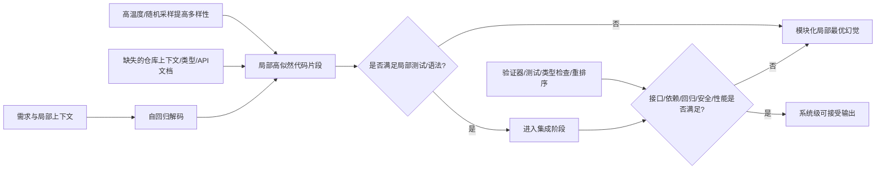
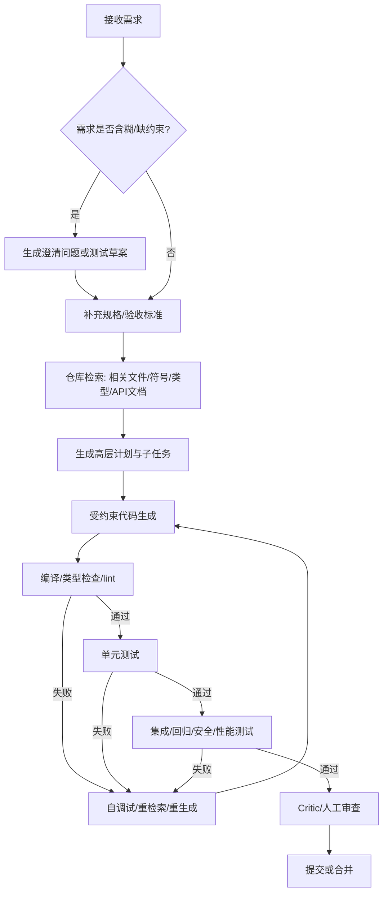
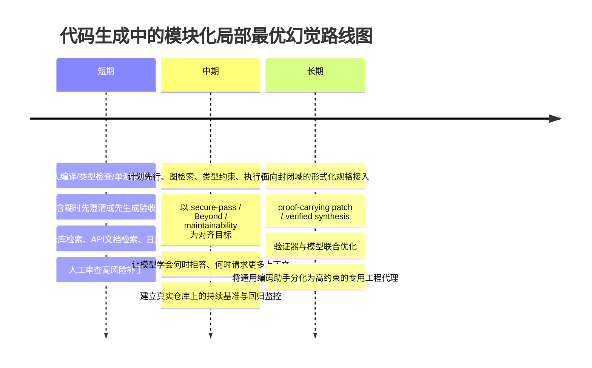

# 在 AI 代码生成中，局部概率最优会不会演化为模块化局部最优幻觉

## 执行摘要

- 结论是：**会，而且已经在函数级、类级、仓库级、Issue 级代码生成中反复出现。**其本质与文本幻觉中的“局部概率最优不等于全局事实最优”同构：模型在局部 token、局部函数、局部文件上生成了高似然、看起来合理的代码，但一旦放回完整代码库，就会在接口契约、跨文件依赖、回归约束、安全约束、性能约束或演化约束上失效。类级、仓库级与真实仓库修复基准都显示，模型在更接近真实软件工程的设置下显著变差。citeturn25view0turn13view2turn16view2

- 在机制上，这种现象可以严谨地表述为：**解码器优化的是局部条件概率或局部搜索得分，而软件工程真正关心的是系统级效用函数**，例如“能编译、测试通过、不破坏旧功能、无高危漏洞、性能不退化、未来可维护”。HumanEval 已经显示，温度、采样与候选重排序会显著改变代码正确率；而 CrossCodeEval、DevEval、RepoExec 等工作进一步证明，只要跨文件上下文、依赖或接口信息缺失，局部高似然实现就很容易在集成时失败。citeturn14view0turn18view0turn13view2turn17view0

- 从软件工程角度看，所谓“模块化局部最优幻觉”通常来自**信息切割**：模块边界、上下文窗口、检索失败、注释不足、类型信息缺失、API 文档缺失、依赖版本漂移、长尾库用法、弱测试覆盖和不完备规格，把完整系统约束压缩成了局部提示。已有研究证明：真实开源项目中超过 70% 的函数不是独立函数；加入图结构上下文、类型上下文、文档检索或仓库图，都能显著提升结果，这说明错误很大程度上来自“局部视角过窄”，而不是单纯“不会写语法”。citeturn24search2turn18view0turn19view1turn19view2turn14view3turn15view0turn15view1

- “消灭”这种错误，在开放域、真实仓库、长期演化的软件工程里几乎不现实；但在**封闭域 + 完备规范 + 可执行验证 + 受控环境**下，可以把它压缩到很低。现实工程目标不是零错误，而是把错误从“看起来能用但会埋雷”，改造成“先澄清、再检索、再生成、再验证、再修复、必要时拒答”。自规划、测试驱动交互、自调试、图检索、类型约束、文档增强、批评模型与沙箱执行，均已显示出实证收益。citeturn21view4turn21view1turn20view2turn21view0turn15view0turn27view3turn16view9

- 未指定约束：**模型规模、项目领域、编程语言均未指定**。因此本文同时纳入 Python、Java、Rust、C/C++、TypeScript、C# 与真实仓库 Issue 修复证据。citeturn24search0turn18view0turn14view3turn26view1

## 定义与判定框架

本文把“代码生成中的幻觉/误导性局部最优”定义为：**模型在局部上下文下生成了高似然、表面合理、甚至局部可运行的代码，但该代码与完整任务目标、系统上下文、接口契约、依赖事实或非功能约束不一致，并且这种不一致不能通过“这只是草稿/不确定”来合理解释**。如果说文本幻觉侧重“与事实或证据不一致”，那么代码中的对应物就是“与规范、仓库上下文、依赖事实、执行环境或全局质量目标不一致”。已有工作分别从代码缺陷、执行验证、知识冲突与仓库上下文冲突等角度给出了兼容这一观点的定义。citeturn29view0turn29view1turn29view2turn23view0

| 类型 | 典型表现 | 判定标准 | 直接指标 |
|---|---|---|---|
| 错误实现 | 单测失败、语义错误、逻辑不完整 | 是否满足需求与测试 | pass@1 / pass@k、功能正确率 |
| 接口不匹配 | 参数名、返回值、异常、类型、调用顺序不匹配 | 是否满足函数/类/模块契约 | compile@k、类型检查通过率、接口匹配率 |
| 项目上下文冲突 | 忽略仓库已有抽象、重复实现、跨文件调用错误 | 是否与仓库上下文与依赖图一致 | dependency recall@k、cross-file integration pass |
| 未考虑系统约束 | 破坏旧功能、平台依赖、配置不兼容 | 是否通过回归测试/环境验证 | 回归率、PASS_TO_PASS 失败率 |
| 非功能退化 | 代码能跑但变慢、不安全、难维护 | 是否满足性能/安全/维护性阈值 | Beyond、secure-pass@k、静态分析告警、维护性指标 |
| 边界条件遗漏 | 极值、空值、异常流、资源耗尽未处理 | 是否覆盖并正确处理边缘输入 | 扩展测试通过率、异常处理覆盖率 |
| 虚构依赖或 API | 不存在的包、符号、方法、参数、资源 | 依赖/API 是否真实存在且调用正确 | package hallucination rate、valid API invocation rate |
| 误导性过度自信 | 明明应该澄清/拒答，却直接产出代码 | 置信度与实际通过率是否一致 | reliability curve、ECE、Brier、risk-coverage |

上表的划分综合了几类研究：CodeMirage 把死代码、语法/逻辑错误、边界鲁棒性问题、安全与内存问题纳入“代码幻觉”缺陷范畴；HALLUCODE 把 Intent Conflicting、Context Inconsistency、Dead Code、Knowledge Conflicting 等纳入统一分类；CodeHalu 则从执行验证角度归纳为 mapping、naming、resource、logic 四大类；而面向真实仓库的研究又把 Task Requirement Conflicts、Project Context Conflicts、API/Dependency/Environment Conflicts 单独拉出来。citeturn29view0turn29view1turn29view2turn23view0

代码生成的一个关键区别在于：**它比文本更容易得到“可执行判定”，但更难得到“完备判定”。**单测、编译器、类型检查器、集成测试、回归测试、SAST/DAST、安全测试、性能基准都可以提供强信号；但如果测试稀疏、规格含糊、环境漂移或只检查局部功能，那么模型仍可能通过局部判定，却在系统级上失败。AlphaCode 已明确指出，许多竞赛题评测会出现“通过全部给定测试但仍不真正正确”的高假阳性；EvalPlus 进一步把 HumanEval 的测试扩充 80 倍，显示大量原先“看起来正确”的代码会被新测试打掉。citeturn5search13turn14view1

### 文本幻觉指标与代码指标的对应关系

| 文本领域指标 | 代码领域对应物 | 它真正衡量什么 | 主要局限 |
|---|---|---|---|
| factual accuracy / exact match | pass@1 / pass@k | 功能正确性 | 只能说明“某些测试下正确” |
| faithfulness / entailment | dependency recall@k、interface match rate | 是否忠实于给定仓库与接口上下文 | 不一定覆盖安全/性能 |
| citation accuracy | package/API existence & validity | 是否引用真实依赖、真实 API、真实参数 | 真实 API 也可能被错误使用 |
| hallucination rate | compile failure、unresolved symbol、package hallucination、invalid invocation rate | 明显的“编造”或结构性错误 | 不能覆盖“能跑但错” |
| consistency / self-consistency | regression rate、多轮修改后的行为一致性 | 修改是否破坏已有语义 | 一致不等于正确 |
| calibration / confidence-accuracy | 预测通过概率 vs 实际通过率、ECE/Brier | 模型是否知道自己何时可能错 | 代码置信度比文本更难直接读出 |
| long-form factuality | end-to-end integration pass、secure-pass@k、Beyond、维护性动态指标 | 系统级全局目标 | 成本高，且依赖高质量验证器 |

代码领域的指标已经明显朝“全局效用”扩展：HumanEval/MBPP/APPS 主要测函数级功能；DevEval 在 pass@k 之外增加 dependency recall@k；CatCoder引入 compile@k；Mercury 用 Beyond 把功能正确与运行效率联合起来；CWEval 与 SecRepoBench 用 secure-pass@k 同时衡量正确性与安全；MaintainCoder 则把“需求演化后的修改代价”拉入 maintainability 指标。也就是说，**代码领域已经在评测层面承认：局部正确不是全局正确。**citeturn14view0turn13view2turn14view3turn16view4turn26view2turn26view1turn20view0

## 机制：从局部概率到系统级失败

### 概率解码与模块化局部最优

在代码生成中，模型仍然是自回归地按 token 解码：

\[
p_\theta(c\mid x,R)=\prod_{t=1}^{T} p_\theta(c_t\mid x,R,c_{<t})
\]

其中 \(x\) 是需求描述，\(R\) 是可见上下文，可以是一段函数签名，也可以是整个仓库的局部检索结果。解码时，模型实际上在优化某种局部序列得分，例如

\[
\hat c=\arg\max_c \sum_{t=1}^{T}\log p_\theta(c_t\mid x,R,c_{<t})
\]

但软件工程真正关心的不是这个目标，而更接近下面的系统级效用：

\[
U(c,R)=
\mathbf{1}[\text{compile}]
\cdot
\mathbf{1}[\text{unit}]
\cdot
\mathbf{1}[\text{integration}]
\cdot
\mathbf{1}[\text{regression}]
\cdot
\mathbf{1}[\text{security}]
\cdot
\mathbf{1}[\text{perf}\le \tau]
\]

局部概率目标与系统级效用目标之间的错位，就是“模块化局部最优幻觉”的数学核心。HumanEval 事实上已经从另一个角度证明了这种错位：如果可以生成很多样本并用“知道测试答案的神谕”去挑一个最好的，那么较高温度反而更有利，因为它增加了解的多样性；但当你只能给用户一个答案时，问题就变成**如何从高似然候选中挑出真正可用的那一个**。同一篇工作还指出，在“只能选一个样本”的情形下，用最高平均 token log-prob 选样本好于随机，而用总 log-prob 选样本甚至可能略差于随机，这直接说明**序列似然不是可靠的全局正确性代理**。citeturn14view0

把系统进一步拆成模块 \(m_1,\dots,m_n\) 会把问题暴露得更清楚。若第 \(i\) 个模块只看到局部上下文 \(r_i\subset R\)，则其局部最优生成可写为：

\[
\hat m_i=\arg\max_{m_i}\log p_\theta(m_i\mid x_i,r_i)
\]

但系统成功要求的不只是每个模块“像样”，而是

\[
\text{Success}=
\left(\bigcap_{i=1}^{n} A_i\right)\cap
\left(\bigcap_{(i,j)\in E} B_{ij}\right)
\]

其中 \(A_i\) 表示模块自身功能正确，\(B_{ij}\) 表示跨模块接口/依赖边 \((i,j)\) 同时兼容。若做一个乐观近似，

\[
P(\text{Success})\approx \prod_i p_i \prod_{(i,j)\in E}(1-r_{ij})
\]

其中 \(p_i=P(A_i)\)，\(r_{ij}=P(\neg B_{ij})\)。这个式子告诉我们：**即使每个模块本身“看上去大概率正确”，只要依赖边足够多，系统级失败概率也会快速累积。**如果进一步考虑错误之间的正相关——例如一个虚构 API 会导致后续处理逻辑继续围绕这个假 API 生成——真实失败率往往比这个乐观乘积更糟。citeturn15view1turn16view6

从信息论视角看，模块化本身不是问题，**信息切割**才是问题。若完整仓库上下文记为 \(R\)，局部可见上下文记为 \(r_i\)，那么丢掉的上下文量可以用条件互信息

\[
I(M_i;R\setminus r_i\mid x_i)
\]

来理解：只要这个量显著大于 0，而模型又拿不到这些信息，它就不得不退回到“训练里最常见的模式”上。对代码而言，这通常表现为：生成一个语法合理、风格正确、甚至和其他项目里常见写法一致的实现，但它**不是这个仓库、这个版本、这个接口图上的正确实现**。CrossCodeEval、RepoBench、DevEval 与 RepoExec 本质上都在测这件事。citeturn18view0turn18view1turn13view2turn17view0



解码超参数会改变这种风险的表现方式。HumanEval 报告显示：对于 pass@1，最优温度约为 \(T=0.2\)；对于 pass@100，最优温度则上升到 \(T=0.8\)。这意味着**高温度适合“先多样生成，再靠外部过滤器挑解”的场景，不适合“一次性给出必须能集成的唯一答案”的场景**。PlanSearch 的结果又进一步表明：与其在代码层重复采样大量相似但错误的候选，不如先在自然语言层搜索“解题/实现计划”，再实现计划；在 LiveCodeBench 上，这能把 pass@200 从 60.6% 提高到 77.0%，而直接无搜索的 pass@1 只有 41.4%。换句话说，**决定成败的往往不是 token 采样本身，而是你是否在更高抽象层面探索到了正确的全局结构。**citeturn14view0turn21view1turn21view2turn21view3

### 软件工程与信息缺失根因

“模块化局部最优幻觉”在代码里之所以比纯文本更危险，是因为代码有天然的**强耦合边**：类型、符号、包、配置、部署环境、测试夹具、平台差异、历史兼容性、数据流与控制流。真实项目中，非独立函数占比极高；ClassEval 进一步显示，只有约 30% 的方法是独立于其他代码上下文的，绝大多数方法都带着字段、方法、库或跨文件依赖。类级与仓库级任务因此天然更像“有约束的组合优化”，而不是“把一句中文翻成一段函数”。citeturn24search2turn25view0

| 关键变量 | 机制 | 影响方向 | 强度 | 可量化指标 | 代表证据 |
|---|---|---|---|---|---|
| 跨文件依赖密度 | 模块看不到必要定义、调用链与副作用信息 | 放大 | 显著 | dependency recall@k、cross-file pass | CoderEval 表明真实项目中非独立函数 >70%；CrossCodeEval 明确要求 cross-file context；DevEval 加入 reference dependencies。citeturn24search2turn18view0turn13view2 |
| 类/模块内部方法耦合 | 方法单独正确不代表类整体可用 | 放大 | 显著 | class pass、method-dependent error rate | ClassEval 发现类级显著难于方法级，且多数模型更适合 method-by-method。citeturn25view0 |
| 局部检索质量 | 检索不到关键文件或检索到相似但误导片段 | 放大 | 显著 | retrieval hit rate、EM、identifier match | RepoCoder 比仅 In-File 基线提升 >10%；GraphCoder 再带来 +6.06 code match 与 +6.23 identifier match。citeturn19view1turn19view2turn19view3 |
| 类型信息可见性 | 缺少静态类型与签名，接口契约更模糊 | 缺失时放大；补足时抑制 | 显著 | compile@k、type-check pass | CatCoder 引入静态分析获得 type context，compile@k / pass@k 最多提升 14.44% / 17.35%。citeturn14view3 |
| 仓库结构表示 | 线性 prompt 难表达依赖图；图表示更利于全局导航 | 补足时抑制 | 中到显著 | repo navigation success、issue resolve rate | RepoGraph 在 SWE-bench 上平均相对提升 32.8%。citeturn15view0 |
| API 文档与版本新鲜度 | 新 API、低频 API、弃用 API 容易被错用或虚构 | 放大 | 显著 | valid API invocation rate、hallucinated arg rate | CloudAPIBench 中，GPT-4o 低频 API 有效调用仅 38.58%；文档增强可升到 47.94%，但劣质检索会让高频 API 大幅变差。citeturn16view7turn16view8 |
| 依赖生态长尾与命名相似性 | 模型倾向补全“像真的”包名/符号名 | 放大 | 显著 | package hallucination rate | Package hallucination 与模型、语言、任务具体性有关，并与 HumanEval 表现呈负相关。citeturn16view1turn16view0 |
| 规格与测试覆盖 | 局部测试稀疏会把错误代码误判为正确 | 放大 | 显著 | coverage、mutation score、false positive rate | AlphaCode 指出一些竞赛指标会有 30%+ 伪正确；EvalPlus 把 HumanEval 扩展 80x 后，pass@k 可下调 19.3–28.9%。citeturn5search13turn14view1 |
| 非功能约束显式性 | 若 prompt 与测试只表达“能跑”，模型就倾向忽略性能/安全/维护性 | 放大 | 显著 | Beyond、secure-pass@k、动态维护性 | Mercury 显示领先模型 Pass 可到 65%，Beyond 却不到 50%；CWEval 发现相当比例代码“功能正确但不安全”；MaintainCoder 显示动态维护性可提升 60%+。citeturn16view4turn26view2turn20view0 |
| 多轮交互长度 | 轮次增加、补丁叠加会引入状态漂移与回归 | 放大 | 中到显著 | multi-turn correct&secure rate、diff-level failure rate | MT-Sec 观察到，从单轮转到多轮后，“正确且安全”输出持续下降 20–27%。citeturn22view0 |
| 基准与验证器缺陷 | 测试过窄/过宽会误报成功或误杀正确修复 | 方向不确定，但会扭曲评估 | 显著 | rejection rate of correct fixes、benchmark consistency | SWE-bench Verified 审计中，59.4% 的审查样本存在测试或题面问题。citeturn27view0 |

从上表可以看出，最强的放大器几乎都与**上下文缺失、依赖图缺失、验证器不完备**有关：这正是“模块化局部最优”会变成“系统级失败”的根。一个模块在自己的 prompt 切片中看似最佳，并不意味着它在完整依赖图里仍是最佳。反过来，凡是显式补回这些信息的技术——图检索、类型上下文、文档检索、仓库导航——几乎都会带来稳定收益，这本身就是对上述机制的最直接实证支持。citeturn19view1turn19view2turn14view3turn15view0turn15view1

## 实证研究与基准

已有基准几乎形成了一条很清晰的“难度阶梯”：从**独立函数**到**有依赖的函数**，再到**类级生成**、**仓库级补全/生成**、**真实仓库 Issue 修复**、**安全与多轮演化**。模型在函数级经常显得很强，但一旦目标变成“与已有系统协同工作”，性能会明显下滑。citeturn14view0turn24search0turn25view0turn13view2turn16view2

| 时间 | 工作 | 关注层级 | 关键结论 | 对“模块化局部最优幻觉”的启示 |
|---|---|---|---|---|
| 2021 | HumanEval / Codex | 独立函数 | Codex-12B 在 HumanEval 上 pass@1 为 28.81%；温度对 pass@1 与 pass@100 的最优点不同。citeturn14view0 | 单函数可观成功，但解码目标与真实使用场景已出现错位 |
| 2021 | MBPP | 独立函数 | MBPP 用自然语言描述测短小 Python 程序合成。citeturn1search1 | 仍主要是局部、可分解任务 |
| 2021 | APPS | 竞赛式程序合成 | 问题更自由、规模更大，开始接近真实编程挑战。citeturn1search2 | 规格越开放，局部最优越不可靠 |
| 2022 | AlphaCode | 复杂算法题 | 评测中可能出现 30%+ 的伪正确程序。citeturn5search13 | “给定测试通过”不等于真正正确 |
| 2023 | CoderEval | 真实项目函数 | 真实项目中非独立函数占比超过 70%。citeturn24search2 | 现实开发不是独立函数生成 |
| 2023 | RepoCoder / RepoEval | 仓库级补全 | 比仅 In-File 基线提升超过 10%。citeturn19view1 | 仓库上下文是必要信息，不是锦上添花 |
| 2023 | RepoBench | 检索+补全流水线 | 把检索与补全拆成 RepoBench-R/C/P 三部分。citeturn18view1 | 错误可能发生在“找错上下文”而非“不会写代码” |
| 2023 | CrossCodeEval | 跨文件补全 | 缺少相关 cross-file context 时极难；加上下文后明显改善，但远未解决。citeturn18view0 | 局部 prompt 缺口会直接转化为集成失败 |
| 2023 | ClassEval | 类级生成 | 类级显著难于方法级；方法级成绩不能代表类级能力。citeturn25view0 | “局部方法正确”不代表“整体类正确” |
| 2023 | SWE-bench | Issue 级真实修复 | 最佳模型最初只能解决 1.96% 的问题。citeturn16view2 | 真正的软件工程是跨文件、长上下文、多约束问题 |
| 2023 | Self-Debugging | 生成后修复 | 在 MBPP/TransCoder 可提升最多 12%。citeturn20view2 | 局部最优问题可通过“生成—执行—反思”缓解 |
| 2023 | Self-planning | 规划后实现 | Pass@1 相对直接生成可提升最多 25.4%。citeturn21view4turn21view5 | 先找全局计划，再写局部代码，更接近全局最优 |
| 2023 | EvalPlus | 更严格测试 | 扩展测试后，pass@k 可下降 19.3–28.9%。citeturn14view1 | 许多“局部正确”只是测试不充分 |
| 2024 | LiveCodeBench | 新鲜、无污染代码题 | 同时测 code generation、self-repair、execution。citeturn16view3turn9search0 | 单一函数生成指标不够了 |
| 2024 | DevEval | 仓库级生成 | GPT-4-turbo 在 HumanEval 可达约 80%，但在 DevEval 最高 Pass@1 仅 53.04%。citeturn13view2 | 函数级高分不能外推到真实仓库 |
| 2024 | RepoExec | 可执行仓库级基准 | 正确性、可执行性、依赖利用被同时测量。citeturn17view0 | 模块级依赖集成本身就是独立难点 |
| 2024 | GraphCoder / CatCoder | 图检索/类型上下文 | +6.06 code match / +6.23 identifier match；compile@k/pass@k 最多提升 14.44%/17.35%。citeturn19view2turn14view3 | 结构化上下文显著抑制局部错配 |
| 2024 | TiCoder | 交互式测试澄清 | 5 轮交互内，平均绝对提升 45.97% pass@1。citeturn21view0 | 先澄清规格，再生成，比一次性输出可靠得多 |
| 2024 | RepoGraph | 仓库图导航 | 在 SWE-bench 上平均相对提升 32.8%。citeturn15view0 | 仓库级导航与结构提示有强收益 |
| 2025 | CloudAPIBench | API 幻觉 | 低频 API 有效调用率很低；文档增强可提升，但错误检索也会造成反效果。citeturn16view7turn16view8 | 长尾 API 与版本漂移是局部最优幻觉高发区 |
| 2025 | Package Hallucination | 依赖幻觉 | package hallucination 随模型、语言、任务而变，并与 HumanEval 负相关。citeturn16view1 | “会刷题”不等于“不会编造依赖” |
| 2025 | SecRepoBench / CWEval | 安全 + 仓库级 | 功能正确与安全并不自动一致；仓库级安全更难。citeturn26view1turn26view2 | 局部功能最优会牺牲全局安全最优 |
| 2025 | MaintainCoder | 可维护性演化 | 动态维护性指标可提升 60%+。citeturn20view0 | 单次可运行不等于长期可维护 |
| 2025 | MT-Sec | 多轮代码生成 | 多轮设置下“正确且安全”输出下降 20–27%。citeturn22view0 | 对话式迭代会积累局部错误与状态漂移 |
| 2026 | SWE-bench Verified 审计 | 基准有效性 | 审计样本中 59.4% 含测试/题面问题。citeturn27view0 | 连评测器本身也可能把全局最优测错 |

上表给出的证据足够支持一个相对强的判断：**在 AI Coding 中，“局部概率最优”和“全局系统最优”的不一致，不只是会出现，而且已经是代码生成研究从 2023 年以后逐步从函数级转向类级、仓库级和代理式软件工程的主轴问题。**类级、仓库级与真实 issue 修复任务的共同难点，不是“语言模型不会写代码”，而是“语言模型只在局部看对了问题”。citeturn25view0turn13view2turn17view0turn16view2

还需要强调评测本身的陷阱。HumanEval 的 pass@k 是“生成 \(k\) 个样本，假设有一个神谕帮你挑出正确者”的概率，不等同于真实 IDE 中一次补全的可用率；EvalPlus 说明单测不足会高估功能正确性；AlphaCode 说明竞赛测试也可能漏掉伪正确；而来自 entity["company","OpenAI","ai company"] 与原始团队协作的 SWE-bench Verified 及其后续审计又说明，仓库级评测还会受到过窄/过宽测试与题面不完备的影响。换言之，**“局部最优幻觉”不仅存在于模型里，也可能存在于评测器里。**citeturn14view0turn14view1turn5search13turn27view1turn27view0

## 缓解方法与推荐工作流

缓解这类错误，不能只靠“调一调温度”或“让模型更大一点”。更有效的做法是把方法分成三层：**训练层补知识与目标，解码层补约束与选择，系统层补验证与交互**。现有证据表明，越接近“系统级目标”的干预，越能直接改变结果。citeturn21view4turn21view1turn20view2turn21view0turn15view0turn27view3

| 层级 | 方法 | 主要作用 | 优点 | 代价/缺点 | 实证效果 |
|---|---|---|---|---|---|
| 训练层 | 仓库级/依赖感知数据 | 让模型见过更多“非独立函数”与真实依赖图 | 从源头缓解局部上下文错配 | 数据构造贵，迁移慢 | CoderEval/DevEval 的出现本身就是对这一需求的回应。citeturn24search0turn13view2 |
| 训练层 | 类型/语义上下文增强 | 把类型与签名纳入条件 | 对接口契约最直接 | 依赖静态分析；动态语言较难 | CatCoder 最多提升 17.35% pass@k。citeturn14view3 |
| 训练层 | API 文档对齐/文档增强 | 降低低频 API 幻觉 | 对长尾 API 很有效 | 检索错误会反伤高频 API | CloudAPIBench 中 GPT-4o 低频 API 从 38.58% 到 47.94%，选择性检索总体提升 8.20%。citeturn16view7turn16view8 |
| 解码层 | 低温度/受控 top-p | 压低一跳式随机错误 | 一次性补全更稳 | 多样性下降，易卡在错误模式 | HumanEval 显示 pass@1 更适合低温度。citeturn14view0 |
| 解码层 | 计划先行 | 先找全局结构，再解局部实现 | 直接缓解“先写后想” | 额外推理成本 | Self-planning 最多 +25.4%；PlanSearch 77.0% vs 60.6% repeated sampling。citeturn21view4turn21view1turn21view2 |
| 解码层 | 约束解码 + 重排序 | 用编译器、类型检查器、执行器改变候选排序 | 比纯 log-prob 更贴近目标 | 需要工具链 | HumanEval 指出单靠序列 log-prob 不是好选择器。citeturn14view0 |
| 解码层 | 自调试/自修复 | 让模型基于失败反馈二次修改 | 对已有候选的“最后一公里”很有效 | 若反馈不准会循环修错 | Self-Debugging 在部分基准最多 +12%。citeturn20view2 |
| 系统层 | 仓库检索与图导航 | 为生成补回缺失上下文 | 对跨文件依赖最关键 | 检索质量成新瓶颈 | RepoCoder、GraphCoder、RepoGraph 持续带来增益。citeturn19view1turn19view2turn15view0 |
| 系统层 | 测试驱动交互澄清 | 把规格先部分形式化 | 尤其适合需求含糊场景 | 需要更多交互轮次 | TiCoder 5 轮内平均 +45.97% pass@1。citeturn21view0 |
| 系统层 | 生成后批评与审核 | 用 critic/第二模型/人工复核找错 | 对安全与边界错误很有效 | 增加时延与人工成本 | CriticGPT 的评论更受偏好，Human+CriticGPT 更全面且更少幻觉式吹毛求疵。citeturn16view9turn16view10 |
| 系统层 | 沙箱执行、日志与可验证证据 | 把“生成代码”改成“生成并证明它验证过” | 工程上最稳 | 基础设施成本高 | 2025 年面向工程代理的 Codex 已把测试、lint、type-check、日志证据纳入默认工作流。citeturn27view3 |
| 系统层 | 安全专项扫描与 outcome-driven 评估 | 防止“功能对但不安全” | 能覆盖文本模型忽略的目标 | 会增加误报/修复成本 | CWEval、SecRepoBench 都显示功能与安全必须联合评估。citeturn26view2turn26view1 |

综合这些结果，一个更可靠的工程工作流不是“问一次，贴上生产”，而应是下面这种**检索—规划—受约束生成—执行验证—修复—再验证**的闭环。这个闭环与 entity["company","OpenAI","ai company"] 2025 年发布的云端 Codex 工作方式、以及 TiCoder、Self-Debugging、CriticGPT、RepoGraph 等研究的方向是一致的。citeturn27view3turn21view0turn20view2turn16view9turn15view0



如果只允许选一个“最值得先做”的缓解手段，那么答案通常不是“更强模型”，而是：**把局部概率模型接到全局验证器上**。这既包括编译器、类型检查器、测试与性能基准，也包括 API 文档、仓库图、Issue 历史、AGENTS.md 等“外部事实”。只要验证器还不完备，错误就不会消失；但只要验证器越来越贴近真实系统目标，错误就会从“看起来很对却会埋雷”，变成“在 merge 前被显式抓住”。citeturn27view3turn27view1turn26view2turn16view4

## 能否消灭与路线图

对这个问题，最准确的回答不是简单的“能”或“不能”，而是要区分**开放软件工程**与**封闭可验证子域**。

在开放软件工程里，想做到普遍意义上的“零失败”几乎不现实。原因并不神秘：规格通常不完备，测试既可能过窄也可能过宽，运行环境会漂移，依赖与 API 会演化，安全/性能/维护性的目标往往没有被完整形式化，多轮交互又会累积状态偏移。SWE-bench Verified 的后续审计已经证明，连被精心筛过的仓库级基准仍可能存在大量题面或测试问题；CloudAPIBench 证明 API 新鲜度与低频性会持续制造知识缺口；CWEval 与 SecRepoBench 则说明“功能正确”与“安全正确”并不自动重合；Mercury 与 MaintainCoder 进一步说明性能与维护性更是独立维度。citeturn27view0turn16view7turn26view2turn26view1turn16view4turn20view0

但在封闭、受控、可验证的子域里，零可观测失败并非完全不可逼近。只要满足几个强前提：规格明确、环境固定、依赖已知、接口可检查、验证器足够强，且允许“生成—验证—搜索/修复”迭代，那么系统实际上可以把大量错误在提交前消除。问题在于，这不是“模型学会了通用零幻觉”，而是**你把问题压缩到了一个可验证的封闭域**。对于数据库迁移脚本、内部 DSL、协议适配器、受限模板代码、测试驱动任务，这条路是现实的；对于大型历史仓库中的开放式需求实现，则只能做到风险压缩，而难以做到风险归零。citeturn21view0turn20view2turn27view3

因此，更合理的路线图应当是：短期把错误显式化，中期把上下文与验证器结构化，长期把一部分高价值编码任务迁移到形式化或半形式化可验证流程里。

围绕这一判断，推荐路线图如下。下面的时间线并不是“必然的产业时间表”，而是根据现有证据归纳出的工程优先级。citeturn21view4turn21view1turn15view0turn27view3turn20view0



综上，可以给出一句尽量精确的结论：**“模块化局部最优幻觉”在 AI Coding 中不是类比，而是已经被多组基准与改进方法间接证明的主导失败模式之一。它几乎不可能在开放软件工程里被彻底消灭，但可以在高约束验证闭环中被持续压缩。**citeturn25view0turn13view2turn26view1turn21view0

## 可复制实验设计

如果要严谨验证“模块化导致幻觉”这一假设，最好的办法不是只比较两个模型，而是**对同一任务，系统性操控模块化程度、可见上下文与验证闭环强度**，并把局部成功与全局失败分开标注。

### 核心假设

- **H1**：在控制模型、提示长度和任务内容不变的条件下，**模块切分越细、且每个子模块看到的上下文越局部，系统级集成失败率越高**；即便模块级 pass 率不低。  
- **H2**：补充契约信息（类型、签名、依赖图、文档）会显著降低接口不匹配与依赖幻觉。  
- **H3**：外部验证器越接近系统级目标，局部最优幻觉越少；尤其是 compile/type/integration/regression/security/perf 六类验证联合时。  
- **H4**：高温度/高随机性在“sample-and-verify”设置中可能提升 best-of-k，但会恶化 one-shot integration pass。  
- **H5**：多轮交互若没有状态约束与回归检查，会出现比单轮更高的“正确但不安全”或“修复此处、破坏别处”问题。citeturn14view0turn18view0turn17view0turn22view0

### 变量操控与对照设计

| 维度 | 操控方式 | 对照组 | 主要观测 |
|---|---|---|---|
| 模块化粒度 | 单函数 / 类级 / 仓库级 / issue 级 patch | 同一任务不同粒度 | 局部 pass 与集成 pass 的差距 |
| 上下文可见性 | 无仓库上下文 / 同文件 / 检索上下文 / 全仓库 oracle | oracle 检索 | dependency recall、接口错配率 |
| 类型与契约 | 是否提供签名、类型、接口文档、API 索引 | 去掉类型/文档 | compile@k、类型错误、valid API 使用率 |
| 解码策略 | greedy、T=0.2、T=0.8、top-p、best-of-k、plan-first | greedy | pass@1、pass@k、integration pass |
| 验证闭环 | 仅单测 / 单测+集成 / +回归 / +安全 / +性能 | 仅单测 | “局部过关、全局失败”标签率 |
| 交互模式 | 单轮、测试驱动多轮、自调试、critic 辅助 | 单轮直接生成 | 改进幅度、轮次成本、回归率 |

### 数据集组合建议

建议不要只用一个 benchmark，而要按层级拼接：

- **局部函数基线**：HumanEval、MBPP、APPS，用来测“局部代码能力”。citeturn14view0turn1search1turn1search2
- **有依赖的函数/类**：CoderEval、ClassEval、CrossCodeEval，用来测“模块一旦嵌入上下文后会怎样”。citeturn24search0turn25view0turn18view0
- **仓库级生成/补全**：RepoBench、DevEval、RepoExec，用来测检索、依赖利用、可执行性与功能正确性。citeturn18view1turn13view2turn17view0
- **真实仓库修复**：SWE-bench Verified，但要同时保留其局限性说明，并最好配合 LiveCodeBench 或自建最新仓库任务，以降低污染与评测器偏差。citeturn27view1turn27view0turn16view3
- **非功能目标**：Mercury 测性能；CWEval、SecRepoBench 测安全；MaintainBench/动态维护性任务测演化能力。citeturn16view4turn26view2turn26view1turn20view0

一个特别重要的设计是加入**负对照检索**：给模型随机但长度相近的无关文件，而不是有意义的相关文件。这样可以区分“只是 prompt 更长”与“真的拿到了正确上下文”。CrossCodeEval、RepoBench、RepoCoder、GraphCoder 一类工作都说明，关键不在多几个 token，而在**是否拿到正确的跨文件依赖**。citeturn18view0turn18view1turn19view1turn19view2

### 评价指标与标签方案

建议把评测拆成六层，而不是只报一个 pass@1：

1. **局部功能层**：pass@1 / pass@k  
2. **结构/可执行层**：compile@1 / compile@k、type-check pass、lint pass  
3. **上下文契合层**：dependency recall@k、symbol resolution rate、API/package existence rate  
4. **系统正确层**：integration pass、regression fail rate、PASS_TO_PASS fail rate  
5. **非功能层**：secure-pass@k、Beyond、runtime regression、memory regression、动态维护性  
6. **置信度层**：预测通过概率 vs 实际通过率、ECE、Brier、risk-coverage curve  

其中最关键的新标签不是“对/错”，而是下面三类：

- **局部正确—全局失败**：本地单测或语法通过，但集成/回归/安全/性能失败。  
- **接口/依赖幻觉**：不存在的包、API、符号、字段、配置、环境资源。  
- **误导性局部最优**：在当前模块 prompt 下看似合理，且 log-prob 较高，但被系统级验证器否决。  

这一标签体系分别对应 DevEval 的 dependency recall、CatCoder 的 compile@k、CloudAPIBench 的 valid API invocation、SWE-bench 的 PASS_TO_PASS、Mercury 的 Beyond，以及 CWEval/SecRepoBench 的 secure-pass 设计。citeturn13view2turn14view3turn16view7turn27view1turn16view4turn26view2turn26view1

### 统计检验建议

- 二元成功/失败：**配对 McNemar 检验**  
- pass@1、compile@1、integration pass 的置信区间：**paired bootstrap**  
- 多数据集、多仓库、多模型：**mixed-effects logistic regression**，以仓库/任务为随机效应  
- 运行时间、内存、维护性改动量：**Wilcoxon signed-rank** 或 **Mann-Whitney U**  
- 多重比较：**Holm-Bonferroni**  
- 校准：报告 **ECE、Brier、reliability diagram、risk-coverage**  
- 建议同时报告**效应量**，而不是只报 p 值。  

如果实验目标是验证 H1，最有力的判据不是“模块化方案总体更差”，而是：**在模块级测试通过率相近的前提下，模块化方案的集成失败率显著更高。**这才真正对应“局部最优冒充全局最优”。citeturn25view0turn13view2turn17view0

### 自动化集成测试脚本示例

下面给出一个最小可复制的自动化评测框架示意。它的核心思想是：**先记录模型在模块级的成功，再记录系统级的失败，从而直接标出‘模块化局部最优幻觉’。**

```bash
#!/usr/bin/env bash
set -euo pipefail

REPO_URL="$1"
BASE_COMMIT="$2"
PATCH_FILE="$3"

rm -rf repo
git clone "$REPO_URL" repo
cd repo
git checkout "$BASE_COMMIT"

# 预先安装依赖（可换成项目自己的 bootstrap 命令）
test -f requirements.txt && pip install -r requirements.txt || true
test -f pyproject.toml && pip install -e . || true

# 应用模型生成补丁
git apply "$PATCH_FILE"

# 结构层：编译 / 类型 / lint
python -m py_compile $(git ls-files '*.py') > ../compile.log 2>&1 || true
mypy . > ../typecheck.log 2>&1 || true
ruff check . > ../lint.log 2>&1 || true

# 局部功能层
pytest tests/unit -q > ../unit.log 2>&1 || true

# 系统正确层
pytest tests/integration -q > ../integration.log 2>&1 || true
pytest tests/regression -q > ../regression.log 2>&1 || true

# 安全层（示意，可替换为 Semgrep / Bandit / CodeQL）
bandit -q -r . > ../security.log 2>&1 || true

# 性能层（示意）
pytest tests/perf -q > ../perf.log 2>&1 || true
```

```python
from pathlib import Path
import json
import re

def exists_unresolved_symbol(log_text: str) -> bool:
    patterns = [
        r"NameError:",
        r"AttributeError:",
        r"ImportError:",
        r"ModuleNotFoundError:",
        r"cannot find module",
        r"undefined reference",
    ]
    return any(re.search(p, log_text) for p in patterns)

def classify(run_dir: Path):
    compile_ok = "error" not in (run_dir / "compile.log").read_text(errors="ignore").lower()
    type_ok = "error" not in (run_dir / "typecheck.log").read_text(errors="ignore").lower()
    unit_ok = "failed" not in (run_dir / "unit.log").read_text(errors="ignore").lower()
    integration_ok = "failed" not in (run_dir / "integration.log").read_text(errors="ignore").lower()
    regression_ok = "failed" not in (run_dir / "regression.log").read_text(errors="ignore").lower()

    security_log = (run_dir / "security.log").read_text(errors="ignore")
    security_ok = "issue:" not in security_log.lower() and "severity: high" not in security_log.lower()

    unresolved = exists_unresolved_symbol(
        "".join((run_dir / x).read_text(errors="ignore")
                for x in ["compile.log", "typecheck.log", "unit.log", "integration.log"])
    )

    if unit_ok and not (integration_ok and regression_ok and security_ok):
        label = "local_ok_global_fail"
    elif unresolved:
        label = "interface_or_dependency_hallucination"
    elif not unit_ok:
        label = "local_functional_error"
    else:
        label = "globally_acceptable"

    return {
        "compile_ok": compile_ok,
        "type_ok": type_ok,
        "unit_ok": unit_ok,
        "integration_ok": integration_ok,
        "regression_ok": regression_ok,
        "security_ok": security_ok,
        "label": label,
    }

print(json.dumps(classify(Path(".")), indent=2))
```

这套脚本可以直接映射到现有 benchmark 的设计思想：函数级正确性借鉴 HumanEval/MBPP/APPS；仓库级正确性与回归借鉴 SWE-bench/DevEval/RepoExec；安全借鉴 CWEval/SecRepoBench；性能借鉴 Mercury；维护性则可在多个 requirement-change 回合上重复运行并统计改动量、重构代价与回归率。citeturn14view0turn13view2turn17view0turn27view1turn26view2turn26view1turn16view4turn20view0

一个特别推荐的实验，是做下面四组配对消融：

- **A**：单体生成 + 全仓库上下文  
- **B**：模块化生成 + 局部上下文  
- **C**：模块化生成 + 局部上下文 + 接口契约/类型  
- **D**：模块化生成 + 局部上下文 + 契约 + 执行验证闭环  

若 B 在“模块局部测试通过率”接近 A 的同时，“集成/回归/安全通过率”显著低于 A，而 C、D 又能把差距部分拉回，那么“模块化导致局部最优幻觉”的假设就得到了直接支持。对应的证据链，正是 ClassEval、CrossCodeEval、CatCoder、RepoGraph、TiCoder 与 Self-Debugging 等工作已经分别展示过的现象，只不过你的实验会把它们统一到同一套统计框架里。citeturn25view0turn18view0turn14view3turn15view0turn21view0turn20view2

## 主要参考文献

- *Evaluating Large Language Models Trained on Code* — 提出 HumanEval、pass@k 估计与温度—多样性关系。citeturn14view0  
- *Program Synthesis with Large Language Models* — 提出 MBPP。citeturn1search1  
- *Measuring Coding Challenge Competence With APPS* — 提出 APPS。citeturn1search2  
- *Competition-level Code Generation with AlphaCode* — 指出测试不足会造成高假阳性。citeturn5search13  
- *CoderEval* — 说明真实项目中非独立函数占比极高。citeturn24search2  
- *ClassEval* — 类级代码生成显著难于方法级，方法级成绩不可外推。citeturn25view0  
- *RepoCoder*、*RepoBench*、*CrossCodeEval*、*DevEval*、*RepoExec* — 一组逐步逼近真实仓库上下文的基准与方法。citeturn19view1turn18view1turn18view0turn13view2turn17view0  
- *EvalPlus* — 说明测试不充分会高估代码正确性。citeturn14view1  
- *LiveCodeBench* — 提供更新鲜、低污染的代码评测。citeturn16view3turn9search0  
- *GraphCoder*、*CatCoder*、*RepoGraph* — 说明图结构上下文、类型上下文与仓库导航对真实仓库代码生成有显著帮助。citeturn19view2turn14view3turn15view0  
- *Teaching Large Language Models to Self-Debug*、*LLM-Based Test-Driven Interactive Code Generation*、*Planning in Natural Language Improves LLM Search for Code Generation*、*Self-planning Code Generation with Large Language Models* — 说明规划、交互测试、自调试与搜索可显著降低局部最优失误。citeturn20view2turn21view0turn21view1turn21view4  
- *CloudAPIBench*、*Importing Phantoms* — 直接研究 API/包幻觉。citeturn15view1turn16view1  
- *Mercury*、*CWEval*、*SecRepoBench*、*MaintainCoder*、*MT-Sec* — 说明性能、安全、维护性和多轮演化都是“全局最优”组成部分，不能被函数级正确率替代。citeturn16view4turn26view2turn26view1turn20view0turn22view0  
- *Finding GPT-4’s mistakes with GPT-4* 与 *Introducing Codex* — 展示基于批评模型、沙箱执行、测试和日志证据的工程化闭环方向。citeturn16view9turn27view3  
- *SWE-bench*、*Introducing SWE-bench Verified*、*Why SWE-bench Verified no longer measures frontier coding capabilities* — 展示真实仓库修复基准如何逼近软件工程本体，同时也展示评测器本身的局限。citeturn16view2turn27view1turn27view0