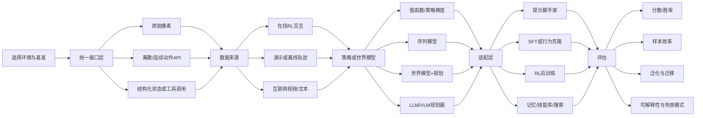
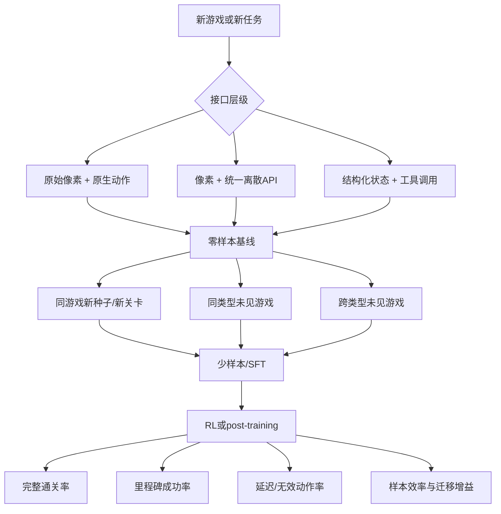

# 大模型与智能体玩游戏的研究现状与实验路径

## 执行摘要

把大模型或智能体直接放进游戏里训练，研究者真正想要的并不是“把游戏打爆”本身，而是利用游戏作为一种**可控、可重复、可计分、可快速模拟、可安全失败**的决策实验场：从 DQN 证明“从像素到动作”的端到端策略学习，到 AlphaGo、MuZero、AlphaStar、OpenAI Five 展示规划、自博弈、多智能体协同与大规模训练系统，再到 Decision Transformer、Gato、VPT、DreamerV3、MineDojo、Voyager、NitroGen 这类“更像基础模型/通用代理”的路线，游戏一直是研究策略学习、世界模型、模仿学习、探索机制、样本效率、可解释中间表示以及跨任务泛化的核心试验田。citeturn36view0turn37view0turn35view0turn37view1turn37view2turn35view2turn23view0turn19view0turn35view1turn38view4turn21view2turn12view0

如果把问题定义得最严格——**未见过的商业游戏、原始视觉输入、最小任务说明、原生实时操作、无需特制 API/脚手架，并且能够完整通关**——截至目前的公开证据，答案仍然是否定的。VideoGameBench 报告中，最佳模型 Gemini 2.5 Pro 只能完成 0.48% 的原始实时基准与 1.6% 的暂停版基准；Atari-GPT 明确指出多模态大模型“尚不能作为零样本低层控制策略”；BALROG 与 GameBench 也都显示，当前模型在简单游戏上只有部分成功，在更难、更长时程的环境中显著失效。NitroGen 官方仓库甚至直接说明，当前公开的 500M 模型还**没有**长时规划、端到端完整游戏、自我改进或“玩完全新游戏”的能力。citeturn13view3turn17view0turn29view1turn32view0turn12view4

但如果放宽条件，尤其是限制在**同一游戏生态**、允许**结构化状态/API**、允许**提示脚手架**或**少量后训练**，则已经可以看到相当实质性的进展。VPT 在 Minecraft 中通过 7 万小时伪标注视频学到早期生存技能，并在 RL 微调后达到钻石镐合成；DEPS 报告了首个能零样本稳定完成 70+ Minecraft 任务的多任务代理；Voyager 能把技能库迁移到新的 Minecraft 世界；JARVIS-1 报告能完成 200 多个 Minecraft 任务；NitroGen 则显示，大规模跨游戏行为克隆预训练后，对未见游戏再做后训练，成功率相对从零训练最高可提升 52%。citeturn20view0turn20view1turn40view2turn21view0turn22view0turn12view0

对工程实践而言，当前最重要的认识不是“模型还不够大”，而是：**新游戏能力几乎总是由接口设计、数据来源、适配层和评估协议共同决定**。原始像素与原生键鼠/手柄控制最难；像 ALE/Procgen 这种离散动作 API 容易很多；像 Orak 这样把状态预处理成结构化文本时，模型会显著受益，但这种设置也会高估真实“直接玩游戏”的能力。citeturn27view0turn27view1turn30view0turn31view0turn12view0turn14view1

## 为什么研究者会在训练初期就让模型去学玩游戏

游戏长期被 AI 社区看作“中间地带”问题：它比棋类更接近真实世界的部分可观测、长时程、连续感知与复杂控制，又比真实机器人、真实 GUI 或现实任务更便宜、更安全、更容易批量复制。ALE 把仿真细节与智能体设计解耦，自动提供分数与终止信号；Procgen 则进一步把“跨关卡泛化”和“样本效率”显式做成基准目标；NetHack、Crafter 与 MineDojo 让探索、规划、技能组合和开放世界能力进入同一个研究框架。citeturn27view0turn27view1turn38view2turn38view1turn38view4

更关键的是，游戏能把许多在现实任务里难以单独观察的问题，切成清晰的科学问题：模型到底是在学习**策略**、还是在记忆轨迹；是在形成**可规划的世界模型**、还是只会局部反应；是在利用**行为先验**、还是依赖环境奖励硬搜；是在真正**探索**、还是只在分布内重复；以及这些能力能否在**未见环境**中迁移。DQN、AlphaGo、MuZero、OpenAI Five 与 DreamerV3 的历史演进，几乎就是这一问题谱系的缩影。citeturn36view0turn37view0turn35view0turn37view2turn35view1

下表把“为什么要让模型学玩游戏”拆成更具体、可操作的研究目标。

| 研究目标 | 研究动机 | 常见方法或代表工作 | 常用衡量指标 | 代表来源 |
| --- | --- | --- | --- | --- |
| 策略学习 | 验证模型能否把高维观测映射到动作，并形成长期有用的行为策略 | DQN、AlphaGo、OpenAI Five | episodic return、human-normalized score、win rate、Elo、任务完成率 | citeturn36view0turn37view0turn37view2 |
| 世界模型与规划 | 在未知动力学下学习“对决策有用”的环境模型，用以搜索或想象未来 | MuZero、Dreamer、DreamerV3 | 固定交互预算下的最终回报、规划后性能提升、模型误差、数据效率 | citeturn35view0turn35view3turn35view1 |
| 模仿学习与行为先验 | 在 RL 难探索或奖励稀疏时，用演示/视频先学“人类会怎么做” | VPT、Decision Transformer、Gato | action accuracy / NLL、下游成功率、少演示适配效率 | citeturn19view0turn20view4turn35view2turn23view0 |
| 探索机制 | 测试模型能否在开放世界或稀疏奖励环境中发现关键中间目标 | NetHack、Crafter、Voyager、DreamerV3 | unique items、achievements、coverage、达到首个里程碑的时间 | citeturn38view2turn38view1turn21view0turn35view1 |
| 样本效率 | 检验算法在有限环境交互下达到有效性能的能力 | Dreamer、Procgen、VPT-IDM | performance-per-step、达到阈值所需 steps、wall-clock | citeturn35view1turn27view1turn20view4 |
| 可解释性与技能抽象 | 让代理中间表示更可审计、更可复用，也更易调试 | Gato attention / embedding、Voyager skill library | attention 可视化、技能库复用率、失败轨迹分析、人工可读代码技能 | citeturn39view0turn39view2 |
| 通用性与迁移 | 检验“同一模型”能否跨任务、跨关卡、跨环境甚至跨游戏迁移 | Gato、Procgen、NitroGen、Orak | held-out level/game success、平均专家分、OOD 提升幅度 | citeturn23view0turn27view1turn12view0turn31view0 |

这些目标在工程上往往会汇合成同一个训练流水线：先统一接口，再选数据来源，再决定是用 RL、BC、序列建模、世界模型还是 LLM 规划器，最后再看要不要加记忆、搜索、技能库和后训练。下面这个流程图，是对近几年主流游戏代理路线的抽象总结。citeturn27view0turn12view0turn34view2turn34view1turn30view0

## 当前的大模型或代理能否在未见过的游戏上直接操作并成功通关

如果采用最严格的定义，结论应该说得非常明确：**公开文献尚未证明当前大模型/VLM/LLM 代理能在“未见过的游戏”上，凭原始视觉输入与最小说明，直接稳定完成整局游戏或通关。** VideoGameBench 的设置已经非常接近这个定义：模型直接与 1990 年代流行游戏实时交互，仅提供原始视觉与高层目标/控制说明，并且保留秘密测试游戏来约束过拟合；结果是最佳模型也只完成 0.48% 的原始实时基准与 1.6% 的暂停版基准。Atari-GPT 对“多模态大模型做低层控制”的结论更直接：这些模型**还不能**成为零样本低层策略，主要受制于视觉与空间推理。citeturn13view3turn17view0

不过，如果把问题改成“能否在**同一世界**或**同一操作范式**里，对新任务、新关卡、新地图产生有意义的零样本/少样本泛化”，答案就会转为“**可以，但范围有限**”。例如，DEPS 报告了首个能零样本稳定完成 70+ Minecraft 任务的多任务代理；Voyager 可以把技能库迁移到全新 Minecraft 世界解决新任务；Open-World Multi-Task Control 在 20 个 Minecraft 任务上显著超过基线，并对新生物群系有零样本泛化；Orak 和 lmgame-Bench 则进一步显示，经过后训练或 RL 后，模型在未见场景、未见游戏和某些非游戏任务上会出现可测量的迁移收益。citeturn40view2turn21view1turn40view4turn31view0turn16view0

真正决定结论的，往往不是“是不是大模型”，而是**环境接口是否对模型友好**。当输入是原始像素、输出是原生键鼠/手柄、且控制频率与真实游戏一致时，难点会叠加：视觉定位、时间同步、动作合法性、长时记忆、计划-执行闭环都会一起出问题。VPT、NitroGen 和 VideoGameBench 都在试图逼近这件事，因此它们最能揭示当前瓶颈。相对地，当环境改为 ALE/Procgen 这类离散 API，或者进一步像 Orak 那样把状态预处理成结构化文本，再通过 MCP/tool 调用动作接口，模型的表现通常会明显上升，但这并不等价于“学会了直接玩游戏”。citeturn20view0turn12view0turn12view4turn13view3turn27view0turn27view1turn31view0

下面这张表把“未见游戏能力”分成更实用的三档。

| 设定 | 典型接口 | 公开证据 | 结论 | 代表来源 |
| --- | --- | --- | --- | --- |
| 严格零样本：未见商业游戏、原始像素、原生实时控制 | 原始屏幕 + 手柄/键鼠 | VideoGameBench 最佳模型仅完成 0.48% / 1.6%；Atari-GPT 认为现有多模态模型尚不能做零样本低层策略 | **未解决** | citeturn13view3turn17view0 |
| 同一游戏世界内的新任务/新世界 | Minecraft API/代码技能/控制器 | DEPS 70+ 零样本任务；Voyager 能迁移技能到新世界；JARVIS-1 能做 200+ 任务 | **同域可行，但强依赖域内工具链** | citeturn40view2turn21view1turn22view0 |
| 跨游戏迁移，但允许少量后训练 | 像素到手柄、或结构化状态到动作 | NitroGen 预训练后对未见游戏后训练最高 +52%；Orak OOD-game 变好；lmgame-Bench 单游戏 RL 能迁移到别的游戏与规划任务 | **有潜力，但不是“直接通关”** | citeturn12view0turn31view0turn16view0 |

当前最常见的适配层有三类。第一类是**提示与脚手架**：lmgame-Bench 明确指出，直接把 LLM 丢进游戏里会因为视觉脆弱、提示敏感和污染问题而几乎失效，因此它专门引入 perception / memory harness；Voyager 和 DEPS 也都依赖外部技能库、描述器、反馈解释器或目标选择器。第二类是**行为克隆/监督微调**：VPT 先用 IDM 给互联网视频打动作标签，再进行行为克隆；LLaMA-Rider 只用 1.3k 条经验就能微调提升探索与任务完成。第三类是**RL 后训练**：VPT 的钻石工具突破、NitroGen 的 post-training、RL4VLM 用 PPO/CoT 将 VLM 直接变成决策代理、以及 lmgame-Bench 的单游戏 RL 迁移，都属于这一路。citeturn14view1turn14view2turn39view2turn40view2turn20view0turn40view3turn26search1turn26search5turn16view0

失败模式也已经相当清楚。最常见的是**视觉脆弱与空间推理不足**，Atari-GPT、BALROG、lmgame-Bench 都指向这一点；其次是**长时规划/记忆崩溃**，VideoGameBench 与 NitroGen 公开版都暴露了长时程问题；再次是**实时性与控制频率不匹配**，VideoGameBench 把“暂停等待模型”单独做成 Lite 模式，反过来证明推理时延本身就是决定性瓶颈；此外还有**无效动作/动作语义不稳定**，Orak 的微调分析显示，性能提升很大程度上来自“更稳定地产生有效动作”；最后是**脚手架依赖和数据污染**，lmgame-Bench 与 GameBench 都专门把提示敏感与污染风险纳入研究问题。citeturn17view0turn29view1turn14view1turn13view3turn12view4turn31view0turn32view0

从评估角度看，建议把“新游戏能力”拆成三个层级分别测，而不是用一个总分混在一起。citeturn27view1turn13view3turn31view0

## 关键论文、开源项目与基准比较

下表优先选取原始论文与官方资源，重点覆盖“从专用游戏代理到更通用的大模型/基础代理”的主线。表中“能否零样本”一列，严格按论文/官方仓库中的公开证据填写，而不是按宣传语推断。

| 工作 | 方法范式 | 训练数据与训练方式 | 输入/输出接口 | 能否零样本运行 | 主要结果 | 主要限制与官方资源 |
| --- | --- | --- | --- | --- | --- | --- |
| DQN | 从像素端到端深度 RL | Atari 在线交互；单一算法、架构与超参 | 像素 → 离散动作 | 否 | 在 49 个 Atari 游戏上达到与专业人类测试员相当的水平 | 仍需按环境训练；跨游戏泛化弱。ALE 有官方平台。citeturn36view0turn27view0 |
| MuZero | 学习式世界模型 + 树搜索 | 在线交互/自博弈；不显式给环境动力学 | 视觉或棋盘状态 → policy/value/reward | 否 | 在 57 个 Atari 上达 SOTA，并在 Go/Chess/Shogi 上匹配 AlphaZero 的超人表现 | 计算量高，仍是按领域训练。citeturn35view0 |
| Decision Transformer | 把 RL 转成条件序列建模 | Atari、OpenAI Gym、Key-to-Door 离线轨迹 | 状态/动作/回报 token 序列 | 否 | 匹配或超过多种离线 RL 基线 | 依赖高质量离线数据，未证明未见游戏零样本泛化；有官方代码。citeturn35view2turn6search2 |
| Gato | 多模态、多任务、同权重通用策略 | 604 个任务的混合数据 | 图像/文本/状态 → 文本/按钮/控制 token | 部分同域可，未证明任意新游戏 | 超过 450/604 控制任务达到 50% expert 阈值；23 个 Atari 达人类平均或以上 | 通用体仍弱于领域专才；无官方开源代码。citeturn23view0turn39view0 |
| VPT | IDM 伪标签 + 行为克隆 + RL 微调 | 约 2k 小时有动作标注数据训练 IDM；约 70k 小时 IDM 伪标注 Minecraft 视频训练基础模型 | 像素 → 原生键鼠 | 同游戏内部分零样本可 | 零样本学会砍树/木板/工作台；RL 微调后 10 分钟回合中 2.5% 达到钻石镐 | 单游戏、重数据；跨游戏未证实；有 OpenAI 官方代码与模型。citeturn20view0turn20view1turn20view4turn19view2 |
| DreamerV3 | 世界模型 + imagination RL | 150+ 任务在线交互，固定配置 | 图像 → 动作 | 开箱跨多域可，但不是未见商业游戏直接零样本 | 首个无需人类数据/课程、从零在 Minecraft 采到钻石的通用算法 | 仍需环境交互训练，不等于对全新游戏直接可用；有官方代码。citeturn35view1turn6search0 |
| DEPS | LLM 交互式规划 + 目标选择 | 零样本多任务规划；依赖域内控制器与反馈回路 | 描述/状态/反馈 → 子目标与计划 | 是，但局限于 Minecraft 任务域 | 报告首个能零样本稳定完成 70+ Minecraft 任务的多任务代理，整体表现近乎翻倍 | 很依赖 Minecraft 域工作流；有官方代码。citeturn40view2 |
| Voyager | GPT-4 + 自动课程 + 技能库 | 在线探索，不做参数微调 | 程序代码/环境反馈 → Minecraft 行为 | 是，同一游戏世界内 | 3.3× 更多独特物品、2.3× 更远距离、关键里程碑最快 15.3×；技能库能迁移到新世界 | 依赖可执行代码与专门接口；有官方开源代码与 prompts。citeturn21view0turn21view2turn7search1 |
| JARVIS-1 | 记忆增强 MLLM 规划器 + 控制器 | 预训练多模态模型 + 生存经验记忆 | 多模态观测/指令 → 计划 → 控制器 | 未证明跨新游戏零样本 | 在 Minecraft 中可完成 200+ 任务，ObtainDiamondPickaxe 可靠性较先前 SOTA 高 5× | 仍是单游戏生态；项目页公开。citeturn22view0 |
| NitroGen | 跨游戏视觉-动作基础模型 | 4 万小时、1000+ 游戏的公开视频动作提取 + 行为克隆 | 像素 → 手柄动作 | 论文展示跨标题零样本；但公开版仓库明确“不支持完全未见游戏” | 对未见游戏 post-training，成功率较从零训练最高 +52% | 当前公开 500M 模型仅看最后一帧，官方承认缺长时规划、端到端完整游戏与完全未见游戏能力；有官方数据集、评测与权重。citeturn12view0turn12view4turn8search1 |

如果更关注中文/中国团队路线，那么近两年最值得重点读的是 Minecraft 这条线。Open-World Multi-Task Control 在 20 个 Minecraft 任务上显著超过基线，并报告对新生物群系的零样本泛化；LLaMA-Rider 用仅 1.3k 条收集经验完成低成本微调；MP5 在难过程依赖任务上达到 22% 成功率、在强上下文依赖任务上达到 91%，而且对全新开放任务也有能力扩展。citeturn40view4turn40view3turn40view0

下面这张表重点比较**基准**，因为很多“模型强弱”的结论其实是被基准接口定义决定的。

| 基准 | 场景类型 | 主要接口 | 核心评估点 | 优势 | 主要局限 |
| --- | --- | --- | --- | --- | --- |
| ALE | 经典 Atari | 像素 + 离散动作，统一仿真 | 标准化游戏得分与控制学习 | 历史最成熟、仿真快、100+ 游戏、自动分数/终止信号 | 对“未见关卡/未见规则”的泛化强调不足。citeturn27view0 |
| Procgen | 程序化 2D 游戏 | 像素 + 离散动作 | 样本效率与 test-level 泛化 | 16 环境、训练/测试关卡可分离 | 仍是风格化 2D 世界，不等于真实商业游戏。citeturn27view1 |
| NetHack Learning Environment | 复杂 Roguelike | 终端式观测 + 丰富动作 | 探索、规划、技能获得、系统泛化 | 复杂、随机、便宜，适合长期研究 | 非图形化，和现实视觉控制差距较大。citeturn38view2turn38view3 |
| Crafter | 单环境开放生存 | 视觉输入 + 动作 | 语义成就、探索、长期推理 | 单环境可覆盖广泛能力，训练成本低 | 仍简化于真正商业开放世界。citeturn38view1 |
| MineDojo | 开放世界 Minecraft | 视觉/语言/环境交互 | 开放任务、互联网知识、语言目标 | 数千任务 + 互联网知识库，特别适合 embodied generalist | 仍强绑定 Minecraft 世界观。citeturn38view4turn24search4 |
| SmartPlay | LLM 智能体能力基准 | Gym 风格接口，obs/history/manual | 6 个游戏、20 个设置、9 种能力 | 适合拆分推理/规划/随机性等能力 | 不是“完全原生游戏直接控制”。citeturn18search1turn33view1 |
| BALROG | LLM/VLM agentic benchmark | 文本或视觉环境表示 | 长时交互、细粒度指标 | 覆盖从简单到极难环境，适合比较 agentic reasoning | 结果显示视觉会显著拖后腿，当前模型在难任务上普遍失效。citeturn29view1 |
| lmgame-Bench | 游戏化 LLM 评测 | 截图 + 统一 Gym API + perception/memory harness | 游戏、规划与 agentic 转移 | 直接研究“脚手架是否必要”；支持 RL 转移分析 | 带 harness，不是纯裸模型直接玩。citeturn14view1turn16view0turn9search10 |
| Orak | 多品类真实视频游戏 | MCP + 结构化状态/工具 | 12 款流行游戏、agentic 模块、微调效果 | 可重复、适合系统研究 memory/reflection/tool-use | 官方承认其状态预处理对 LLM 有利，会低估真实感知难度。citeturn30view0turn31view0turn30view1 |
| VideoGameBench | 真实“直接玩游戏”评测 | 原始视觉 + 实时交互 | 真实时间、完整游戏、隐藏测试游戏 | 最接近“未见游戏直接通关”问题定义 | 当前最好结果非常低，强烈暴露时延与视觉瓶颈。citeturn13view3turn9search0 |

## 验证大模型在新游戏上能力的实验设计建议

如果你的目标是真正验证“大模型在新游戏上的能力”，最重要的不是先换更大的模型，而是先把**实验设计从“单分数排行榜”改成“分层剖面测试”**。Procgen 提醒我们必须把训练关卡与测试关卡分开；VideoGameBench 用秘密测试游戏来约束过拟合；lmgame-Bench 和 GameBench 则说明污染与提示敏感会严重扭曲结论；Orak 进一步表明，如果你预处理状态，必须把这一点单独报告。citeturn27view1turn13view3turn14view1turn32view0turn31view0

我建议用下面这个实验矩阵来做“新游戏能力”验证。

| 设计维度 | 建议做法 | 这样做的原因 | 参考依据 |
| --- | --- | --- | --- |
| 游戏切分 | 至少做三层：同游戏新种子/关卡、同类型未见游戏、跨类型未见游戏；如果可能保留隐藏测试游戏 | 否则很容易把“记住了规则/素材”误判为泛化 | citeturn27view1turn13view3turn31view0 |
| 接口分层 | 同一游戏至少评三档接口：原始像素+原生动作；像素+统一离散 API；结构化状态/MCP | 将“感知难度”“动作语义难度”“高层规划难度”拆开 | citeturn27view0turn12view0turn31view0 |
| 对照组 | 必须包含 random、脚本/规则代理、领域专才 RL、提示脚手架版、后训练版 | 不然无法判断提升来自模型本体、还是来自接口/脚手架 | citeturn14view1turn29view1turn26search1 |
| 适配阶梯 | 按 prompt-only → harness → SFT/BC → RL/post-training 逐级报告，而不是只报最好结果 | 能清楚看出“零样本能力”与“适配能力”是否是两回事 | citeturn14view1turn20view0turn26search1turn12view0 |
| 评价指标 | 不只报最终分数；至少再报完整通关率、首个里程碑成功率、样本效率、无效动作率、平均推理时延、失败原因分布 | 当前失败往往来自无效动作、迟滞、感知错误，而非单纯策略差 | citeturn13view3turn31view0turn29view1 |
| 污染控制 | 选低污染游戏，或随机替换素材/地图；保留秘密测试集；显式做视觉/文本污染检测 | lmgame-Bench 和 GameBench 都表明污染会显著影响解释 | citeturn14view3turn32view0turn13view3 |
| 可复现设置 | 固定 ROM/游戏版本、动作重复、分辨率、帧率、时延预算、温度、提示模板、模型版本、随机种子，并公开 wrapper | 游戏评测对环境版本和提示极其敏感 | citeturn27view0turn14view2turn13view3turn30view0 |

更具体地说，若你的目标是“验证新游戏上的真实能力”，建议把主实验定义成：**隐藏测试游戏 + 原始像素 + 原生动作 + 实时预算**；把结构化状态和脚手架版本挪到**诊断实验**，用于定位瓶颈，而不是用来替代主结论。这样做的好处是，你既能得到“真实能力上限有多低/多高”，也能知道到底是感知、记忆、动作解析还是规划造成失败。citeturn13view3turn17view0turn31view0

如果目标偏工程落地，而不是纯 benchmark，那么可以采用一种更务实的两阶段设计。第一阶段先用类似 NitroGen/VPT 的大规模行为先验，学习**反射式低层控制**；第二阶段再叠加类似 Voyager、DEPS、JARVIS-1 的**高层记忆、计划、技能库**。这一组合更符合当前公开证据：纯 prompt-only LLM 在原始游戏控制上通常不够稳定，但“感知-动作模型 + 高层规划器”的分层体系已在 Minecraft 与多游戏迁移中显示出更强可行性。citeturn12view0turn20view0turn21view2turn40view2turn22view0

## 结论与未来方向

基于公开论文、官方项目与近两年的新基准，可以下一个相对稳健的判断：**当前大模型/Agent 已经足以在“受限接口、同域生态、带脚手架或少量后训练”的条件下表现出可观的游戏能力，但还没有公开证据表明它们已经解决了“未见过的真实游戏、原始输入、原生操作、完整通关”的严格问题。** 真正的障碍不是单一因素，而是感知、动作语义、实时性、长时规划和评测污染同时存在。citeturn13view3turn17view0turn29view1turn12view4

因此，如果你的调研目标是“Agent 去玩游戏”，我的结论性建议是：**不要把“会不会玩”当成一个单点问题，而要把它拆成接口层、先验层、适配层与评估层四个子问题。** 研究上，优先做“隐藏测试游戏 + 接口分层 + 适配阶梯”的设计；工程上，优先采用“视觉-动作基础模型做低层控制，LLM 做高层规划/记忆/技能调度”的混合架构。就目前证据看，这比纯 RL 从零训练更省样本，也比把裸 LLM 直接塞进实时游戏更靠谱。citeturn12view0turn20view0turn14view1turn26search1turn21view2

未来最值得投入的方向，我认为有四个。第一，是把 NitroGen、VPT 这类**互联网游戏视频预训练**与 DreamerV3、MuZero 这类**世界模型/规划**更紧密地结合，让“会反应”和“会想象未来”不再分家。第二，是发展真正**接口无关**的统一评测：同一任务同时提供原始像素、轻量 API、结构化状态三种入口，以隔离模型本体能力与工具加成。第三，是加强**长时记忆与技能抽象**，因为 Voyager、JARVIS-1、Orak 都在不同程度上表明，可复用技能库、反思与记忆模块比单轮视觉问答更接近能工作的 agent。第四，是建设更强的**抗污染隐藏测试集**，否则“从互联网上学会了素材”与“真的学会了玩法”仍会被混淆。DreamerV3 论文甚至把“从互联网视频里教授世界知识、学习跨域统一世界模型”明确列为未来方向，这一点与当前游戏代理研究正在形成呼应。citeturn35view1turn12view0turn21view2turn22view0turn31view0

开放问题与局限也需要直说。第一，很多当前最强结果都仍然发生在 Minecraft 这类**单一生态**中；跨游戏、跨引擎、跨操作范式的证据仍不足。第二，像 Orak 一类框架为了可复现，会对状态做结构化预处理；这非常有价值，但不应与“直接玩原生游戏”混为一谈。第三，商业游戏上的训练与评测还受到许可、平台、封装器和系统延迟的现实制约——例如 NitroGen 当前官方仓库只支持用户自备 Windows 游戏环境。换句话说，现阶段最稳妥的研究路线不是宣称“通用游戏代理已经出现”，而是承认这仍是一个**尚未解决、但已经开始具备清晰技术路线图**的问题。citeturn31view0turn12view4